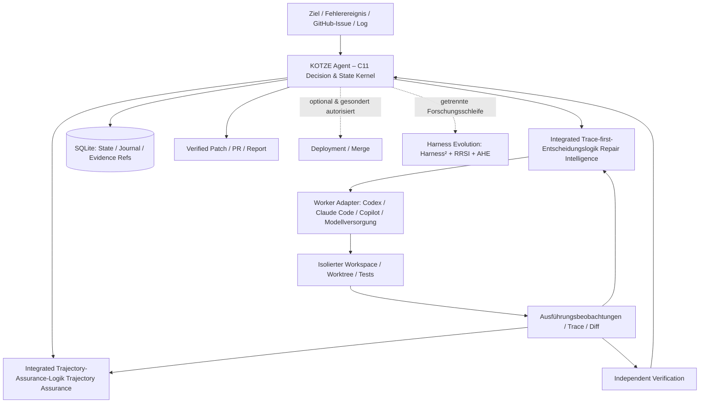
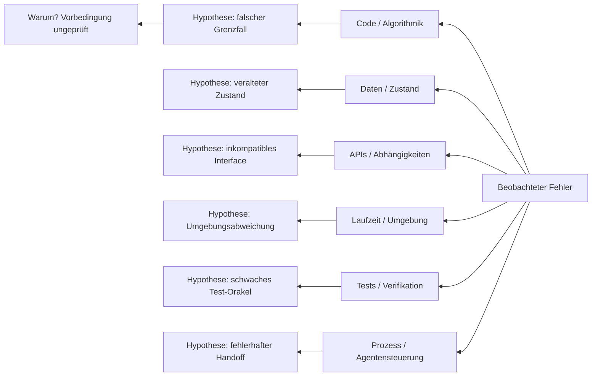

# KOTZE Agent

## Wissenschaftlich fundiertes Architektur-, Forschungs- und Produktkonzept

**Arbeitstitel:** KOTZE Agent  
**Langform:** **K**ontext · **O**bject · **T**rajectory · **Z**ero-Trust · **E**vidence  
**Produktkategorie:** Fully Autonomous Coding Agent / Autonomous Software Repair & Engineering Agent  
**Version:** Konzept 1.2, 12. November 2026 (Trace-Repair, CausalMap und Continuous Improvement)  
**Status:** Forschungs- und Architekturkonzept; **kein Implementierungs- oder Produktivnachweis**  
**Leitmotiv:** *Wenig zusätzlicher Code, große nachweisbare Wirkung.*

> **Produktentscheidung.** Der Produktname ist **KOTZE Agent**. „Harness“ bezeichnet seine Laufzeit- und Kontrollumgebung, nicht das Gesamtprodukt. KOTZE Agent ist ein eigenständig einsetzbarer autonomer Coding-Agent. Seine **erste und wichtigste Kernkompetenz** ist die selbstständige Erkennung, Reproduktion, Ursachenanalyse, Behebung und unabhängige Verifikation von Softwarefehlern. Die autonome Neuentwicklung, Weiterentwicklung und Wartung von Software ist Teil des Zielbildes, aber darf den Repair-Fokus nicht verwässern.
>
> **Architekturentscheidung.** Der deterministische Kontrollkern wird **in C11** konzipiert. Er enthält explizite, persistente State Machines für Auftrag, Diagnose, Agentenlauf, Änderung, Verifikation und Recovery. Die fachlichen Mechanismen aus **Trace-first-Entscheidungslogik** und **Trajectory-Assurance-Logik** werden **in die eigene KOTZE-Agent-Codebasis integriert bzw. dupliziert**; zur Kernfunktion dürfen **keine laufenden Repair-/Assurance-Fremddienste erforderlich** sein. Wiederverwendung bedeutet hier auch gezieltes Portieren und Adaptieren von Code – nicht nur einen externen API-Aufruf.

---

## 0. Executive Summary

KOTZE Agent soll einen Softwaredefekt vom beobachtbaren Fehlersignal bis zur nachweislich wirksamen Korrektur **ohne permanente menschliche Steuerung** bearbeiten. Der Agent erhält ein Ziel oder ein Ereignis, beschafft selbstständig den minimal notwendigen Kontext, entscheidet, ob eine Korrektur erforderlich ist, grenzt den ausführbaren Fehlerpfad ein, reproduziert den Defekt, entwickelt und implementiert eine zielgerichtete Änderung, validiert diese gegen denselben Fehler und relevante Regressionen, dokumentiert die Beweiskette und kann nach Unterbrechungen aus einem dauerhaften Zustand fortfahren.

Die **autonome Software-Reparatur** wird als geschlossener, evidenzgesteuerter Engineering-Prozess verstanden, nicht als Prompt-Schleife, die bis zur Meldung „DONE“ wiederholt wird. Abschluss ist ein unabhängiger technischer Sachverhalt, keine subjektive Behauptung eines Coding-Workers.

Die vorgeschlagene Architektur kombiniert:

1. **Einen kleinen nativen C11-Kern** für Zustandsmaschinen, Transaktionen, Budgets, Aktionszulassung, deterministische Übergänge, Deadlines und Recovery.
2. **Integrierte Trace-first-Entscheidungslogik-Mechanismen** für *trace-first debugging*, ausgeführte Codepfade, Build-vs-Borrow, minimale Änderungen und Retest des ursprünglichen Pfads.
3. **Integrierte Trajectory-Assurance-Logik-Mechanismen** für Agent-Trajectory, Fortschrittsnachweis, Detektion von Schleifen/Stillstand, kontrollierte Diagnose-Probes und begrenzte Revival-Versuche.
4. **Austauschbare Coding-Worker** (unter anderem Codex CLI/App Server, Claude Code, GitHub Copilot SDK/CLI, lokale oder über Modellversorgung angebotene Modelle). Der Worker bearbeitet Code; KOTZE kontrolliert den technischen Lebenszyklus.
5. **Beweisorientierte Verifikation** mit reproduzierbaren Tests, Ausführungs- und Regressionsnachweisen, getrennten Berechtigungen und einer unveränderlichen Baseline.
6. **Eine optionale, geschützte Self-Improvement-Schleife**, inspiriert von Google Harness², RRSI und AHE, die den Agenten-Harness nur nach nachweisbarer Verbesserung auf zurückgehaltenen Aufgaben verändert.

**Wissenschaftlicher Kernbefund:** Die Forschung spricht **nicht** pauschal für möglichst komplexe Agentenarchitekturen. Sie spricht für den **geringsten wirksamen Kontrollaufwand** je Aufgabe. Ein einfacher, leistungsfähiger Coding-Worker sollte direkt arbeiten können; zusätzliche Recherche, Subagenten, Kontextkomprimierung oder parallelisierte Lösungen werden nur dann zugelassen, wenn der erwartete Erkenntnis- oder Erfolgsgewinn ihren Preis rechtfertigt [R04–R06, R14].

**Abnahmekriterium der ersten Produktstufe:** Auf einem realen, isoliert reproduzierbaren Repository-Defekt kann KOTZE Agent selbstständig eine korrekte Reparatur durchführen, den Originalfehler vor/nach dem Patch nachweisen, relevante Regressionen ausschließen, einen verifizierbaren Patch erzeugen und nach einem simulierten Absturz ohne unkontrollierte Doppelaktionen weiterarbeiten. Dabei läuft **keine kostenpflichtige CI** als implizite Nebenwirkung.

---

## 1. Begriffsklärung: Agent, Harness, Autonomie und Selbstheilung

### 1.1 Warum „KOTZE Agent“ präziser als „KOTZE Harness“ ist

Ein **Coding-Agent** verfolgt ein Entwicklungsziel, wählt Handlungen, liest und ändert Code, führt Werkzeuge aus, bewertet Beobachtungen und iteriert. Ein **Harness** umfasst die Ausführungsumgebung des Modells: Werkzeuge, Kontext, Policies, Zustandsverwaltung, Session-Kontrolle, Memory und Beobachtungs-/Evaluationsschnittstellen. KOTZE ist das **vollständige Produkt**; sein Harness ist eine interne Komponente [R01, R17–R20].

Der Name beschreibt die technische Leitlinie:

| Buchstabe | Bedeutung | Verbindlicher Architekturgedanke |
|---|---|---|
| **K** | **Kontext** | Aufgaben-, Repository-, Laufzeit- und Fehlerversuchs-Kontext werden zielgerichtet bereitgestellt und über Sessions dauerhaft erhalten. |
| **O** | **Object** | Repariert wird ein konkretes **Softwareobjekt**: Capability, API, Datei, Modul, Service, Anwendung oder Systemverbund, identifiziert durch verifizierte Referenzen. „Object“ ist nicht auf objektorientierte Sprachen beschränkt. |
| **T** | **Trajectory** | Der tatsächliche Agentenlauf wird überwacht: Schritte, Fortschrittsdeltas, Hypothesen, Schleifen, Deadlines und Budgetverbrauch. |
| **Z** | **Zero-Trust** | Ein Coding-Worker darf seine eigene Korrektheit und seine Berechtigungen nicht selbst bescheinigen; Tool-Ergebnisse und Ausführungsgrenzen werden vom Kontrollkern geprüft. |
| **E** | **Evidence** | Fertig ist nur, was anhand nachvollziehbarer, reproduzierbarer und ausreichend unabhängiger Nachweise belegt ist. |

### 1.2 Autonomiegrad

**Autonomie im Software-Engineering:** KOTZE plant und entscheidet innerhalb einer vorab erteilten, technisch durchgesetzten Autorisierung selbst. Es muss nicht für jeden Leseschritt, jeden lokalen Reparaturversuch und jeden Test erneut gefragt werden. Gleichwohl gilt: **Autonomie ist keine unbegrenzte Schreib- oder Produktionsberechtigung.** Kritische Effekte wie produktive Datenmigration, irreversible Löschung, veröffentlichte Releases oder Merge in geschützte Branches werden getrennt klassifiziert. Fehlt dafür eine vorherige Freigabe, bleibt der Agent autonom bis zum nächsten zulässigen Abschluss (z. B. verifizierter PR statt Produktionsdeploy).

### 1.3 Abgrenzung

- **Nicht:** reiner GitHub-Issue-Bot oder PR-Generator.
- **Nicht:** eine weitere generische Multi-Agent-Schwarm-Plattform.
- **Nicht:** ein Überwachungsdashboard ohne eigene Coding-Fähigkeit.
- **Nicht:** eine starre Folge von Shell-Skripten, die nur bekannte Fehler behandelt.
- **Sondern:** ein autonomer, fehlerorientierter Software Engineer mit persistentem, überprüfbarem Handlungskreislauf und optionaler allgemeiner Entwicklungsfähigkeit.

### 1.4 Die erste Produktfunktion ist Repair

Ein autonomer Coding-Agent kann später neue Software erstellen und bestehende Anwendungen erweitern. Die erste Produktstufe optimiert aber **Autonomous Program Repair (APR)**: Ohne nachgewiesenen Reparaturkreislauf würde ein vollständiger Produktentwicklungsagent dieselben Fehler wiederholt neu erzeugen. Die wissenschaftliche APR-Literatur nennt insbesondere Fault Localization, Patch-Kandidaten und Patch-Validierung als unterscheidbare Teilprobleme [R07, R08, R27].

---

## 2. Anforderungen und Nicht-Ziele

### 2.1 Funktionale Anforderungen

| ID | Anforderung | Akzeptanzprinzip |
|---|---|---|
| F-01 | Fehlerereignisse aufnehmen | CLI, Test, Log, Stacktrace, API-Fehler, UI-Fehler, Issue und später Monitoring-Event führen zu einer dauerhaften Work Identity. |
| F-02 | System und Kontext auflösen | Exakter Repository-Stand, betroffenes Objekt, Einstiegspunkt, Laufzeitumgebung und relevante Vorgeschichte sind zuordenbar. |
| F-03 | Fehler reproduzieren | Ein unabhängiges Signal unterscheidet zuverlässig `BUG_PRESENT`, `BUG_ABSENT` oder `UNKNOWN`. |
| F-04 | Ursachenanalyse | Evidenz des tatsächlich ausgeführten Pfads hat Vorrang vor Dateinamen und Architekturvermutungen. |
| F-05 | Bestehende Lösung verwenden | Relevante Implementierung, getesteter Fix oder Bibliothek wird vor zusätzlichem Code geprüft. |
| F-06 | Patch autonom erzeugen | Coding-Worker darf nur in seiner zugelassenen Workspace-/Worktree-Grenze ändern. |
| F-07 | Patch unabhängig prüfen | Original-Reproduktion, relevante Regression, Diff-Integrität und fachliche Akzeptanz werden getrennt geprüft. |
| F-08 | Fehlerhafte Strategien verwerfen | Widerlegte Hypothesen und unproduktive Wiederholungen werden gespeichert und nicht blind wiederholt. |
| F-09 | Crash-Recovery | Nach Prozessabbruch ist der Zustand rekonstruierbar; externe Effekte werden nicht blind doppelt ausgeführt. |
| F-10 | Kosten und Laufzeit begrenzen | Gemeinsame Budgetreservierung gilt für alle parallelen Worker und Kindaufrufe. |
| F-11 | Verifizierbaren Output bereitstellen | Patch, Git-Diff, Tests, Evidenz-Referenzen, Kosten und Einschränkungen sind nachvollziehbar. |
| F-12 | Wiederkehrende Defekte erkennen | Reparaturhistorie unterstützt deduplizierte Fehler und schnelle Wiederverwendung relevanter Erkenntnisse. |
| F-13 | Entwicklungsaufträge unterstützen | Gleicher Agent kann Feature- und Refactoring-Aufträge anhand spezifizierter Akzeptanzkriterien bearbeiten. |
| F-14 | Harness kontrolliert verbessern | Nur bewertete, reproduzierbare und zulässige Optimierungen werden zur neuen Standardkonfiguration. |

### 2.2 Nichtfunktionale Anforderungen

- **Eigenständigkeit:** Keine aktive Instanz von Trace-first-Entscheidungslogik oder Trajectory-Assurance-Logik erforderlich; relevante Mechanismen werden in KOTZE integriert/portiert.
- **Modellunabhängigkeit:** Adapter statt hart codierter Anbieterbindung.
- **Ressourcensparsamkeit:** C11-Kern; deterministische Schritte brauchen keinen Modellaufruf.
- **Reproduzierbarkeit:** Aufträge, Arbeitskopien, Testbedingungen, Modell-/Toolrevisionen und Ergebnisse werden versioniert.
- **Nachvollziehbarkeit:** Jeder schreibende Eingriff hat identifizierbare Autorität, Ursache, Eingabebasis und Resultat.
- **Transportneutralität:** CLI und lokale IPC sind zuerst ausreichend; HTTP/MCP ist Adapter, keine Pflicht im Kern.
- **Portable Ausführung:** Primär Linux; Windows-/macOS-Adapter möglich, Kern nicht an Container-Daemon gebunden.
- **Produktionsschutz:** Negative Rechte, Isolation, Schreibexklusivität, Budgetprüfung und Secret-Handling müssen vom Host technisch durchgesetzt werden.

### 2.3 Ausdrückliche Nicht-Ziele für die erste Implementierung

- Kein neues allgemeines LLM-Gateway neben bestehenden Coding-Worker-Integrationen und Modellversorgung.
- Keine neue umfassende Programmiersprachenanalyse durch einen selbstgeschriebenen Parser.
- Kein zweites globales vorhandener Agenten-Stack-Gedächtnis oder eine neue Wissensgraph-Plattform.
- Keine unbeschränkte Selbstmodifikation des Safety-/Evidence-Kerns.
- Keine automatische, kostenpflichtige GitHub-Actions-Ausführung als Standardtest.
- Keine Behauptung vollständiger Autonomie, solange die definierten End-to-End-Nachweise fehlen.

---

## 3. Forschungsstand und technische Konsequenzen

### 3.1 Warum weniger Harness oft mehr leistet

**Empirical Study of Harness Design for Coding Agents (2026).** 176 experimentelle Einstellungen über vier Modelle und zwei Benchmarks zeigen, dass die Wirkung von Planung, Werkzeugmenge und Kontextmanagement vom Modell und Kontextbudget abhängt. Regelbasierte Elision vor modellgestützter Zusammenfassung ist besonders effizient; starke Bash-fähige Modelle benötigen nicht zwingend große vordefinierte Tool-Register [R04].

**Beyond the Model (2026).** Die Wirkung komplexer Harnesses variiert nach Aufgabentyp: Einfache SWE-Reparaturen profitieren bei starken Modellen weniger von zusätzlichem Orchestrierungsaufwand; offene Repository-Aufgaben können von strukturierten Tools und geeigneten Subagenten gewinnen [R05].

**Minimal Harness for MLE (2026).** Bei den untersuchten Machine-Learning-Engineering-Aufgaben zeigte der aufwendige Harness unter gleichen Modell-/Zeitbedingungen keinen Vorteil gegenüber einem einfachen Coding-Agenten. Das ist ein Warnsignal gegen unnötige Architektur, **kein allgemeiner Beweis**, dass zusätzliche Kontrollmechanismen für langlaufende Software-Reparatur wertlos wären [R06].

**Agentless / mini-SWE-agent.** Bereits kontrollierte, einfache Reparaturschritte oder eine sehr kleine Shell-basierte Ausführungsschleife können eine starke Baseline bilden. KOTZE darf nur dann komplexer werden, wenn zusätzliche Komponenten unter gleichen Bedingungen nachweislich mehr leisten [R07, R14].

**Entscheidung:** Der Standardpfad bleibt schlank. Eskalation zu Hypothesen-Engine-artiger Alternativenanalyse, mehreren Coding-Workern, Memory-Recherche und Harness-Evolution erfolgt **ereignis- und evidenzabhängig**, nicht bei jeder Aufgabe.

### 3.2 Trace-first Repair statt Repository-Spekulation

**SWE-agent (2024)** zeigt den Einfluss des Agent-Computer-Interfaces auf die Qualität von Codeänderungen und Debugging [R08]. **TestPrune (FSE 2026)** verwendet vorhandene Regressionstests zielgerichtet für Reproduktion und Patchprüfung; die berichteten relativen Verbesserungen der Issue-Lösungsrate liegen je nach untersuchter Pipeline bei **8,0–12,9 %**, nicht bei 8–12,9 Prozentpunkten [R09].

Die bestehenden **Trace-first-Entscheidungslogik Runtime Evidence Gate**-Regeln verlangen bereits:

1. kanonischen Einstiegspunkt bestimmen;
2. Fehler reproduzieren;
3. ausgeführten Pfad nachweisen;
4. erste ursächliche Fehlbedingung identifizieren;
5. exakt passende Wiederverwendung prüfen;
6. kleinste architekturkonforme Änderung erstellen;
7. denselben ursprünglichen Pfad erneut testen.

KOTZE übernimmt diesen Ablauf **als native, eigenständige Repair-Entscheidungslogik**. Er ist keine neue, unverifizierte Erfindung und muss deshalb nicht bei null beginnen.

### 3.3 Kontext, Editing und kompakte Erfahrungen

**Microsoft SWE-Edit (2026)** trennt das Lesen relevanter Codestellen von der Editierausführung. Die publizierte Untersuchung berichtet auf SWE-bench Verified **+2,1 Prozentpunkte** bei **17,9 % geringeren Inferenzkosten** für die getestete Konfiguration. Allerdings beruht das gesamte Verfahren zusätzlich auf einem trainierten Editor; ein einfacher Adapter allein garantiert diese Werte nicht [R10].

**Scaling Test-Time Compute for Agentic Coding (2026)** komprimiert umfangreiche Agentenläufe in strukturierte Zusammenfassungen mit Hypothesen, Fortschritt und Fehlern. Der untersuchte Claude-4.5-Opus-Aufbau steigt beispielsweise auf SWE-bench Verified von 70,9 % auf 77,6 %; parallele/serielle Zusatzversuche verbrauchen dafür weitere Ressourcen [R11].

**Entscheidung:** KOTZE legt kompakte, maschinenlesbare `RepairEpisode`-Datensätze an. Die Modellkontexte enthalten aktuelle Problemstellung, relevante Beobachtungen, bereits widerlegte Hypothesen und die nächste Entscheidung – **nicht** vollständige alte Transkripte oder große ungefilterte Toolausgaben.

### 3.4 Langzeitautonomie: das ungelöste Kernproblem

**Multi-step SWE (November 2026)** untersucht 69 Aufgabenketten mit jeweils 5–15 abhängigen Entwicklungsschritten. Die stärkste Modell-Harness-Kombination löst **18,5 %** der vollständigen Aufgabenketten, obwohl sie **56,8 %** der einzelnen Schritte besteht. Diese Prozentangaben stammen aus unterschiedlichen Auswertungseinheiten; sie zeigen vor allem die Schwierigkeit kumulativer Codeentwicklung [R12].

**E2E-SWE** testet die vollständige Erzeugung installierbarer Repositories aus Spezifikationen (186 Aufgaben, 11 Sprachen); **CodeClash** misst iterativen Fortschritt auf offenen Zielen. Beide sind nützliche Ergänzungen zu Bugfix-Benchmarks [R13, R29].

**Entscheidung:** KOTZE benötigt neben der individuellen Patch-Abnahme ein **dauerhaftes Repository-Integritätsmodell**: jede Änderung beginnt von einem bekannten Commit, dokumentiert API-/Test-/Migrationswirkungen und lässt spätere Erweiterungen auf einem stabilen Stand aufbauen.

### 3.5 Unabhängige Evidenz statt selbstgeschriebener Scheinbeweise

**All Smoke, No Alarm (IEEE AITest 2026)** klassifiziert 86.156 Testdatei-Patches aus agentenverfassten PRs und findet bei **80,2 %** schwache oder keine expliziten Oracle-Signale. Diese Aussage ist eine syntaktische Klassifikation, keine vollständige semantische Bewertung aller Tests [R16]. IBM berichtet außerdem über Test-Overfitting bei SWE-bench-Reparaturen [R30].

**Entscheidung:** Tests, die nur erfolgreich starten, reichen nicht. KOTZE fordert – abhängig vom Fall – belastbare Assertions, Vergleich mit Baseline, Hidden/Held-out-Checks, API-/UI-/DB-Prüfungen oder andere unabhängige Orakel. Ein vom Worker erzeugter Test kann den Reparaturversuch stützen, aber nicht allein seinen Erfolg bescheinigen.

### 3.6 Selbstoptimierung auf Ebene des Harness

**Google Harness² (Oktober 2026)** nutzt zwei Rekursionsebenen: pro Aufgabe `Propose–Probe–Compose`, langfristig die Übernahme evidenzgestützter Verbesserungen in den Harness. Auf den untersuchten Professional-Work-Benchmarks werden task- und konfigurationsabhängige Verbesserungen berichtet; das ist nicht mit einem nachgewiesenen Coding-Repair-Effekt gleichzusetzen [R01].

**RRSI (September 2026)** adressiert Overfitting selbstoptimierter Harnesses durch begrenzte Änderungspakete, Kritik, Pruning und Evaluierung auf abweichenden Aufgaben. Die Autoren berichten unter anderem bis zu **4,7 Prozentpunkte** Gewinn auf fünf Out-of-Distribution-Benchmarks und 30 % weniger Policy-Tokens als eine unregulierte Evolution [R02].

**AHE (April/Mai 2026)** verbindet Komponenten-, Trajectory- und Entscheidungsbeobachtbarkeit. Auf Terminal-Bench 2 steigt pass@1 in der berichteten Untersuchung nach zehn Iterationen von **69,7 % auf 77,0 %**; die Ablationen verorten Effekte vor allem bei Tools, Middleware und Memory statt beim System-Prompt [R03].

**Entscheidung:** Späteres KOTZE Self-Improvement arbeitet auf einer **versionierten, begrenzten Änderungsliste** (`prompt_profile`, `tool_policy`, `context_filter`, `test_selection`, `repair_strategy`), nicht auf dem nicht vertrauenswürdigen freien Umschreiben des C11-Sicherheitskerns. Änderungen benötigen unabhängige Held-out-Evaluation und Rollback.

### 3.7 Grenzen der wissenschaftlichen Aussagen

- **Benchmarks sind keine Produktion.** Prozentwerte werden nicht addiert und dürfen nicht als KOTZE-Zielprognose verwendet werden.
- **Modell-Harness-Kombination zählt.** Ein veröffentlichtes Resultat einer Variante ist kein Beweis für alle Provider oder Modelle.
- **Paperstatus unterscheiden.** ArXiv-Preprints sind nicht automatisch peer-reviewed; Firmenblogs sind primäre Engineering-Berichte, aber keine kontrollierten wissenschaftlichen Studien.
- **Benchmarkqualität prüfen.** SWE-Bench Pro hat dokumentierte Qualitätskritik; Ergebnisse aus diesem Benchmark benötigen Aufgaben-Audit und Einschränkungen [R31].
- **Keine Quelle beweist allgemeine, fehlerfreie, unbegrenzt autonome Softwareentwicklung.** Das ist ein Forschungs- und Entwicklungsziel.

---

## 4. Konkurrenz- und Donor-Analyse

| Referenz | Nachgewiesene / dokumentierte Mechanik | Zu übernehmen | Nicht ungeprüft übernehmen |
|---|---|---|---|
| **Google Harness²** | Kontrastive Harness-Änderungen, zwei Rekursionsebenen [R01] | Experimentdesign, kompakte Erkenntnisse, Promotion von Verbesserungen | Offene Netzwerk-/Sandbox-Konfiguration aus Benchmark-Setups |
| **Google RRSI** | Regularisierte Auswahl, Schutz vor Benchmark-Overfitting [R02] | Edit-Budget, Kritiker, Pruner, Held-out-Auswahl | Automatische Promotion sicherheitskritischer Policies |
| **AHE** | Falsifizierbare Harness-Edit-Hypothesen, Observability [R03] | Edit-zu-Ergebnis-Provenienz, Ablationen | Unbegrenzte Optimierungskosten |
| **GitHub Copilot** | Agenten über Issues, Zeitpläne und Events; Hooks, Agentic Workflows [R21–R23] | Trigger, kontrollierte Workflows, Hook-Prüfungen | GitHub-Actions-Pflicht und ungeprüfte externe Aktionen |
| **OpenAI Codex** | Agenten-CLI/App-Server, Engineering-Harness, Tool-/Session-Kontrolle [R17–R18] | Coding-Worker-Protokoll, App-Server/SDK-Integration, Observability | Einen zweiten vollständigen Codex-Kern neu bauen |
| **Anthropic Claude Code** | Persistente Artefakte, Session-Handoff, Generator/Evaluator, Playwright [R19–R20] | Evaluator-Trennung, Recovery-Verträge, UI-/API-/DB-Prüfung | Lange Prompt-Schleifen ohne unabhängigen Evidenz-Gate |
| **mini-SWE-agent** | Einfache Shell-orientierte Loop als starke Baseline [R14] | Minimalität, messbare Vergleichs-Baseline | Shell ohne Host-Grenzen als Sicherheitsmodell |
| **SWE-agent / SWE-Edit** | Agent-Computer-Interface; getrennte Codeansicht und Editierausführung [R08, R10] | Kleiner Viewer/Editor-Adapter, strukturierte Edit-Resultate | Zusätzliche trainierte Modelle als ungeprüfte Pflicht |
| **Trace-first-Entscheidungslogik (eigener Donor)** | Authority Attestation, Economy Gate, Runtime Evidence Gate, Recomposition | **Direkt in KOTZE duplizieren/portieren** | Unnötige Abhängigkeit von laufendem Trace-first-Entscheidungslogik-Dienst |
| **Trajectory-Assurance-Logik (eigener Donor)** | Plan-/Trajectory-Assurance, Probes, Revival, Provenienz | **Direkt in KOTZE duplizieren/portieren** | Zweites unabhängiges Pflicht-Deployment |
| **Ausführungs- und Effektsteuerung / persistenter Arbeitszustand / Session-Kontrollschicht** | Effektkontrolle, durable Work Identity, Session-/Budget-Gates | Kontrakte oder selektive Funktionen als Donor | Den gesamten vorhandener Agenten-Stack als Voraussetzung erzwingen |

### 4.1 Build-vs-Borrow: ausdrücklich kein Anti-Duplikationsdogma

Trace-first-Entscheidungslogik ist in der bisherigen Entwicklung ein wiederverwendungsorientierter Entscheidungsmechanismus. **Die Nutzerentscheidung für KOTZE lautet ausdrücklich, funktional eigenständige Kopien seiner relevanten Logik aufzunehmen.** Dasselbe gilt für Trajectory-Assurance-Logik. Zweck: eine autonome, auch ohne laufenden vorhandener Agenten-Stack funktionsfähige Einheit. Der C-Kern kann diese Logik in schlankem, überprüfbarem Zustandscode implementieren; nicht alle bestehenden Python-Funktionen müssen 1:1 übersetzt werden.

Für jede portierte Fähigkeit ist jedoch eine `PARITY_MATRIX` mit Quellrevision, Quelltest, KOTZE-Verhalten, bewusst ausgelassenen Varianten und eigenständigem Regressionstest erforderlich. **Code-Duplikation ist beschlossen; unkontrollierte Verhaltensdivergenz ist es nicht.** Die Lizenz- und Vertraulichkeitsbedingungen der jeweiligen Quell-Repositories sind vor einer öffentlichen KOTZE-Veröffentlichung gesondert zu prüfen. Besonders interne/private vorhandener Agenten-Stack-Implementierungen und konfigurierte Provider-/Policy-Daten dürfen nicht unbeabsichtigt öffentlich werden.

---
## 5. Zielarchitektur: schlanker autonomer Agent mit C11-Kern

### 5.1 Schichtenbild



Die Mermaid-Darstellung beschreibt **logische Verantwortung**, nicht den Zwang zu separaten Prozessen. Trace-first-Entscheidungslogik- und Trajectory-Assurance-Logik-Funktionalität soll als Bestandteil von KOTZE laufen. Für Worker, isolierte Ausführung und externe Verifikation können separate Prozesse trotzdem sinnvoll sein.

### 5.2 Warum C11 – und warum nicht alles in C?

**C11 ist für den deterministischen Kern geeignet**, weil Zustandsübergänge, Budgets, Zeitlimits, Prozesssteuerung, Event-Verarbeitung und SQLite-Transaktionen ohne Laufzeit-LLM und mit begrenztem Ressourcenverbrauch implementierbar sind. Ein kleiner C-Kern kann unabhängig von Python-Umgebungen starten und einen fehlerhaften Coding-Worker überwachen. C löst jedoch nicht das semantische Problem, welche Reparatur korrekt ist; das bleibt Aufgabe geeigneter Modelle, Tests und überprüfbarer Orakel.

**In C:**

- Typisierte Zustandsmaschinen und deterministische Übergangsregeln.
- Transaktionales Aufgaben-/Ausführungsjournal, idempotente Eventverarbeitung.
- Deadlines, Stop-/Retry-Grenzen, Budgetreservierung, Lease-/Write-Ownership.
- Trace-first-Entscheidungslogik-Kernregeln: evidenzabhängiger Eintritt in Diagnose, Hypothesenstatus, Scope-Begrenzung und Same-path-Retest-Gate.
- Trajectory-Assurance-Logik-Kernregeln: Trajectory-Signale, Loop-/Thrashing-/No-Progress-Erkennung, kontrollierte Probe-/Revival-Entscheidungen.
- Prozess- und Adapterüberwachung, strukturierte Tool-Receipts, Integritäts-/Hash-Prüfung.
- Fail-closed-Entscheidungen für Effekte, Quellrevisionen und Verifikation.

**Über vorhandene Prozesse, SDKs oder Adapter:**

- Modell-Inferenz, Streaming, Tool-Calling und Provider-Routing.
- Bearbeitung großer Codeänderungen durch Codex/Claude Code/Copilot.
- Betrieb konkreter Testframeworks (pytest, PHPUnit, Jest/Vitest, Go test, CMake/CTest usw.).
- Browser-Automation, UI-Prüfung, Datenbankintegration und API-Simulation.
- Repository-Hosting, PR-Erstellung und ggf. externe Sandbox-Backends.

**Nicht neu implementieren:** HTTP-Stack, Git-Protokoll, Datenbankengine, universeller Parser, vollständiger Container-Scheduler oder neue eigene Modellinferenz, sofern belastbare Bibliotheken/Schnittstellen existieren.

### 5.3 Kandidaten für C-Bibliotheken

| Komponente | Nutzen | Entscheidung |
|---|---|---|
| **SQLite** (C, Public Domain) | Transaktionale Durable State, Journal, Lease-Tabellen, lokale Indexe | **Kernabhängigkeit vorgeschlagen**; SQLite WAL, feste Migrationsversionen, Integrity-Checks [R24] |
| **libgit2** (C, GPLv2 + Linking Exception) | Git-Objekte, Diffs, Commit-/Index-/Repository-Zugriff | **Optional**; zuerst vorhandene Git-CLI/Worktree-Semantik prüfen, um Code und Portabilitätsarbeit zu sparen [R25] |
| **Tree-sitter** (C-Runtime, MIT) | Schnelles Syntax-/Symbol-Parsing, optionaler präziser Kontext | **Optionales Profil**; nur bei nachgewiesener Verbesserung gegenüber `rg`/LSP/Worker-Suche [R26] |
| **System-Prozess-API** | Start, Stopp, Exit-Codes, Ressourcenlimit, Signalhandling | Kleine Linux-POSIX-Schicht; Windows als gesonderter Adapter |
| **Bestehende CLI/SDKs** | Inferenz, Browser, GitHub, Tests | **Adapter**, nicht fest einkompiliert |

**Integrationsprinzip:** Möglichst kleine C11-Kernbibliothek plus eine dünne CLI. Für flexible Provider-/Agenten-Anbindung sind ein versioniertes, zeilenorientiertes JSON-Protokoll oder eine andere kleine, typisierte IPC-Schnittstelle ausreichend. Der Kern muss keinen HTTP-Server und keinen Python-Laufzeitprozess hosten, wenn ein externer CLI-Worker bereits zuverlässig funktioniert.

### 5.4 Vorgeschlagene kompakte Modulstruktur

```text
kotze-agent/
  include/
    kotze.h                 # Versionierte öffentliche Typen und Statuscodes
    kotze_protocol.h        # IPC-/Event-Kontrakte
  src/
    core/                   # Zustandsmaschinen, Übergangs- und Gate-Logik
    store/                  # SQLite, Ereignisse, atomare Writes, Migrations
    repair/                 # Integrierte Trace-first-Entscheidungslogik-Mechanismen
    assurance/              # Integrierte Trajectory-Assurance-Logik-Mechanismen
    runtime/                # Worker-/Prozessüberwachung, Budget, Lease
    verify/                 # Verifikationsfreigabe und Ergebnisbewertung
    cli/                    # Start, Status, Reconcile, Export
  adapters/
    codex/                  # Bestehende CLI/App-Server-Schnittstelle
    claude-code/            # Bestehende Headless-/SDK-Schnittstelle
    copilot/                # Copilot SDK/CLI, falls autorisiert
    plumme/                 # Optionaler vorhandener Agenten-Stack-Workerzugang
    test/                   # Projektspezifische Test-/Runner-Adapter
    git-host/               # GitHub-PR/I/O ohne CI-Zwang
  tests/
    state-machines/
    crash-recovery/
    parity-spari/
    parity-appleme/
    golden-repair/
    security/
  research/
    benchmarks/
    ablations/
    harness-evolution/
  docs/
    architecture/
    source-attribution/
    contracts/
```

Die Struktur ist ein **logischer Entwurf**, kein bereits existierender Dateibaum. Es ist ausdrücklich erlaubt, weniger Dateien zu verwenden, wenn dies den Code reduziert, ohne Verträge und Testbarkeit zu verschlechtern.

### 5.5 Isolierung ohne Docker-Zwang

Es gibt einen Unterschied zwischen einem **isolierten Git-Worktree** und einer **Sicherheits-Sandbox**. Ein Worktree verhindert gleichzeitige Änderungen in derselben Arbeitskopie, aber nicht den Zugriff eines fehlkonfigurierten Prozesses auf Host-Dateien oder Credentials. KOTZE verwendet deshalb zwei voneinander getrennte Mechanismen:

1. **Repository-Isolation:** eigener Worktree/Branch mit exakt gebundener Basisrevision, separaten temporären Build-Artefakten und exklusiver Schreibberechtigung.
2. **Prozess-/Effekt-Isolation:** eingeschränkter OS-User oder Sandbox, definierte Verzeichnis- und Netzwerkfreigaben, kontrollierte Secrets, Ressourcen-/CPU-Limits, erlaubte Tool- und Git-Operationen.

Für den ersten lokalen Offline-Prototyp sind isolierte Workspaces und kontrollierte Prozessaufrufe ausreichend, **nicht jedoch als Behauptung einer starken Sicherheitsgrenze**. Für fremden oder untrusted Code ist eine echte OS-/VM-/Sandbox-Grenze erforderlich. Externe Sandbox-Lösungen werden optional integriert; es besteht **keine Docker-Pflicht**.

---

## 6. Die State Machines – keine dekorative Modellierung

KOTZE verwendet mehrere **orthogonale endliche Zustandsautomaten**, statt einen einzigen undurchsichtigen Gesamtstatus. Jede Zustandsänderung ist explizit, persistent, autorisiert, durch eine Observation oder ein Ereignis begründet und kann nach einem Prozessneustart rekonstruiert werden.

### 6.1 Globale Regeln

1. Jede Transition benötigt `work_id`, `object_id`, `base_revision`, `actor`, `event_id`, Zeitstempel und eine gültige Vorbedingung.
2. Transitionen und ausgehende Aktionen werden **vor** externen Effekten transaktional persistiert.
3. Jeder Event-Key ist deduplizierbar; ein wiederholtes Event darf keine zweite unabhängige Arbeitsidentität erzeugen.
4. Fehlende Beweise bleiben `UNKNOWN`, nicht `PASS`.
5. Eine gescheiterte Hypothese führt nicht automatisch zu einer Änderung an anderen Modulen.
6. Für dieselben Dateien und denselben Worktree existiert höchstens ein aktiver Schreib-Lease.
7. Abschlusszustände sind nur über vordefinierte Gates erreichbar – ein Worker-Text wie „done“ ist lediglich `WORKER_CLAIMED`.
8. Retry-Budgets gelten global je Arbeit bzw. je spezifizierter Unteraufgabe und werden **vor** der Ausführung reserviert.
9. Bei inkonsistentem Zustand wird der Run eingefroren und reconciliert, nicht blind wiederholt.

### 6.2 FSM A: Auftragslebenszyklus (`WorkFSM`)

Die folgende Übergangstabelle ist die **normative Semantik**. Alle Guards sind konjunktiv; nicht gelistete Übergänge werden verweigert, protokolliert und erzeugen keine externen Effekte. Der Initialzustand wird durch die erste autorisierte Auftragsaufnahme festgelegt.

| Zustand | Event | Guard | Aktion (transaktional, soweit kein externer Effekt) | Folgezustand |
|---|---|---|---|---|
| `NONE` | `WORK_ADMIT` | Eindeutige Work-ID, gültiger Repo-Locator, Berechtigung, Budget | Work-Record und Baseline-Ref anlegen | `ADMITTED` |
| `ADMITTED` | `CONTEXT_RESOLVED` | Repository-Identität, `base_sha`, erlaubter Scope und Toolpolicy attestiert | Kontext-Snapshot und Revision persistieren | `CONTEXT_READY` |
| `ADMITTED` | `AUTHORITY_DENIED` | Berechtigung fehlt oder ist widerrufen | Blockgrund und Nachweise protokollieren | `BLOCKED` |
| `CONTEXT_READY` | `FAILURE_OBSERVED` | Reproducer/Fehlerereignis mit eindeutigem Einstiegspunkt oder zulässigem Unsicherheitsstatus | Diagnose-ID anlegen, Baseline-Check einplanen | `DIAGNOSING` |
| `CONTEXT_READY` | `FEATURE_REQUESTED` | Abnahmekriterien und Schreibscope definiert | Spezifikations- und Oracle-Vertrag reservieren | `PLANNING` |
| `CONTEXT_READY` | `CONTEXT_UNRESOLVED` | Verbindliche Basis oder Eintrittspunkt nicht feststellbar | Blockgrund persistieren | `BLOCKED` |
| `DIAGNOSING` | `HYPOTHESIS_SUPPORTED` | Falsifizierbare Hypothese mit erforderlicher Runtime-Evidenz | Minimalen Patchplan mit Hypothesen-ID erzeugen | `PLANNING` |
| `DIAGNOSING` | `DIAGNOSIS_UNRESOLVED` | Zulässige Untersuchungen erschöpft oder Evidenz unzureichend | Abbruchgrund ohne Erfolgsaussage persistieren | `BLOCKED` |
| `PLANNING` | `PLAN_ADMITTED` | Scope/Budget/Oracle eingefroren, Schreib-Lease erteilt | Patch-ID anlegen, Effektabsicht in Outbox schreiben | `EXECUTING` |
| `PLANNING` | `PLAN_REJECTED` | Eingriff unzulässig oder nicht durchführbar | Ergebnis begründen, keine Mutation | `BLOCKED` |
| `EXECUTING` | `CANDIDATE_COMMITTED` | Candidate-SHA vorhanden, Lease gültig, PatchFSM=`TEST_PENDING`, keine offenen ungewissen Effekte | Prüflauf an genauem Commit + Oracle-Hash beauftragen | `VERIFYING` |
| `EXECUTING` | `PATCH_REJECTED` | Patch hat nicht bestandene Vorprüfung, Budget übrig | Hypothese und Fehlversuch historisieren | `DIAGNOSING` |
| `EXECUTING` | `WORKER_INTERRUPTED` | Worker-Ende, Timeout oder Lease-Verlust nachweisbar | Running-Effekt als ungewiss kennzeichnen, Recovery-Anstoß | `RECOVERING` |
| `VERIFYING` | `VERIFICATION_PASS` | Fresh-checkout, unveränderter Candidate-SHA, Oracle-Hash, gleiche ursprüngliche Fehlerstrecke, Pflichtregression PASS, kein Effekt UNKNOWN, kein Discharge | Geschützten Acceptance-Receipt persistieren, Work finalisieren | `COMPLETED` |
| `VERIFYING` | `VERIFICATION_FAIL` | PASS-Gate nicht erfüllt, weitere Reparatur autorisiert und Budget übrig | Fail-Receipt speichern und Hypothesen neu priorisieren | `DIAGNOSING` |
| `VERIFYING` | `VERIFICATION_INCONCLUSIVE` | Prüfergebnis UNKNOWN/STALE oder nicht reproduzierbar | Evidence-Snapshot persistieren, soweit zulässig Ursachenklärung | `DIAGNOSING` |
| `VERIFYING` | `BUDGET_EXHAUSTED` | Kein erlaubter Prüf-/Repair-Versuch mehr | Blockgrund speichern | `BLOCKED` |
| `ADMITTED`, `CONTEXT_READY`, `DIAGNOSING`, `PLANNING`, `EXECUTING`, `VERIFYING`, `RECOVERING` | `TRAJECTORY_DISCHARGED` | Überwachungsbudget oder Revival erschöpft | Aktive Workeraktion sperren, Outbox sichern | `BLOCKED` |
| `ADMITTED`, `CONTEXT_READY`, `DIAGNOSING`, `PLANNING`, `EXECUTING`, `VERIFYING`, `RECOVERING` | `EFFECT_UNKNOWN` | Ungeklärte bereits gestartete externe Mutation | Weiteren Dispatch sperren, Recovery erzwingen | `RECOVERING` |
| `RECOVERING` | `RECONCILED_RESUME` | Externe Effekte geklärt, Lease erneuert, bestätigter Wiederaufnahmepunkt | Reconciled-Receipt schreiben, nächste Phase aus dem Journal wiederherstellen | `EXECUTING` oder `VERIFYING` entsprechend persistiertem `resume_target` |
| `RECOVERING` | `RECONCILIATION_BLOCKED` | Unbekannter Effekt nicht aufklärbar, Freigabe fehlt oder Budget verbraucht | Ausstehende Aktionen suspendieren | `BLOCKED` |
| `BLOCKED` | `REAUTHORIZE` | Neuer expliziter Owner-Auftrag mit neuer Work-ID | Neuen Auftrag starten, alter bleibt unverändert | neuer `ADMITTED`-Record |

`COMPLETED` und `BLOCKED` sind für dieselbe Work-ID terminal. Eine neue Anweisung erzeugt eine neue Work-Revision oder Work-ID, nie eine stillschweigende Rückwärtsmutation. `RECONCILED_RESUME` ist kein nichtdeterministischer Zielwechsel: `resume_target` muss vorher als `EXECUTING` oder `VERIFYING` journalisiert worden sein.

### 6.3 FSM B: Diagnose und Hypothesen (`DiagnosisFSM`)

| Zustand | Bedeutung | Zulässiger nächster Schritt |
|---|---|---|
| `ENTRYPOINT_UNKNOWN` | Kanonischer Fehlerpfad nicht bekannt | Minimale Quelle zur Auflösung lesen |
| `REPRODUCER_PENDING` | Reproduktionsfall wird ermittelt | Bounded Probe/Test |
| `REPRODUCED` | Verlässliches BUG_PRESENT-Signal | Tatsächlichen Pfad instrumentieren |
| `PATH_TRACED` | Ausgeführter Pfad mit Provenienz erfasst | Erste Fehlbedingung identifizieren |
| `HYPOTHESIS_OPEN` | Falsifizierbare Ursache und Vorhersage | Gezielt prüfen |
| `HYPOTHESIS_REFUTED` | Vorhersage widerlegt | Historie speichern und neu priorisieren |
| `ROOT_CAUSE_SUPPORTED` | Ursache mit passendem Laufzeitnachweis | Minimalen Fix autorisieren |
| `NOT_REPRODUCED` | Ursache nicht nachgewiesen | Weitere zulässige Instrumentierung oder Blockierung |
| `EVIDENCE_INSUFFICIENT` | Keine belastbare Diagnose | Keine spekulative Codeänderung |

**Trace-first-Entscheidungslogik-Parität:** Runtime Evidence Gate und Economy Gate werden als Eintritts- und Übergangsregeln abgebildet. Nach einer begrenzten Zahl widerlegter Diagnosezyklen wird `RECOMPOSE` ausgelöst: die Annahmen zum echten Entry-Point und zur aktiven Implementierung werden neu bewertet. Ein bereits widerlegter Ansatz wird nicht kommentarlos wiederholt.

### 6.4 FSM C: Agenten-Trajectory (`TrajectoryFSM`)

| Zustand | Beobachtung | Konsequenz |
|---|---|---|
| `HEALTHY` | Verifizierbarer Fortschritt, im Plan | Weiterarbeiten |
| `SUSPECT` | Wiederholtes Muster / zweifelhafte Abweichung | Günstige diagnostische Probe |
| `STALLED` | Kein neuer Informations-/Artefaktgewinn | Probe, Replan oder Recovery |
| `LOOPING` | Gleiche Handlung/Fehler ohne Informationsgewinn | Wiederholung unterbrechen |
| `THRASHING` | Oszillation zwischen Phasen/Hypothesen | Replan oder last-known-good |
| `RECOVERY_RECOMMENDED` | Probe unbeantwortet oder unzureichend | Kontrollierte Revival-Entscheidung |
| `REVIVED` | Neuer zulässiger Lauf ab Checkpoint | Alter gescheiterter Tail bleibt historisiert |
| `DISCHARGED` | Wiederherstellungsbudget verbraucht | Blockieren und begründen |

**Trajectory-Assurance-Logik-Parität:** Trajectory-Assurance-Logik unterscheidet `ACTIVITY != PROGRESS` und differenziert `WORKER_CLAIMED`, `HARNESS_OBSERVED`, `EXTERNALLY_VERIFIED`. Die relevanten Detektoren, Probe-Regeln und Revival-Pakete werden übernommen. Die FSM basiert **nicht** auf privater Chain-of-Thought, sondern auf sichtbaren, versionierten Aktionen, Artefakten, Erfolgs-/Fehlersignalen und Budgetverbrauch.

### 6.5 FSM D: Patch-Lebenszyklus (`PatchFSM`)

Patch-Identität und Kandidatenrevision sind **immutable**. Ein neuer Diff gegen einen anderen Commit erzeugt eine neue Patch-Revision bzw. Patch-ID; ein alter Verifikationsnachweis darf nicht auf die neue Revision übertragen werden.

| Zustand | Event | Guard | Aktion | Folgezustand |
|---|---|---|---|---|
| `NONE` | `PATCH_PROPOSED` | Work aktiv; Hypothesen-ID und Baseline-SHA vorhanden | Parent-SHA, erlaubten Scope, Patchplan fixieren | `PROPOSED` |
| `PROPOSED` | `PATCH_ADMITTED` | Scope/Budget/Authority/Oracle-Baseline vollständig geprüft | Edit-Freigabe reservieren | `ADMITTED` |
| `PROPOSED` | `PATCH_DENIED` | Scope, Autorität oder Sicherheitsprüfung fehlgeschlagen | Ablehnungsbeleg speichern | `REJECTED` |
| `ADMITTED` | `EDIT_STARTED` | Exklusives gültiges Write-Lease, korrekter Parent-SHA und Worktree | Edit-Intent journalisieren, Workerauftrag freigeben | `APPLYING` |
| `APPLYING` | `EDIT_FINISHED` | Mutationsbelege/Dateiliste vorhanden, Basis unverändert | Diff prüfen, Candidate-Commit erzeugen/identifizieren | `CANDIDATE` |
| `APPLYING` | `EDIT_FAILED` | Edit-Fehler nachgewiesen | Differenz und ggf. unsicheren Effekt persistieren; kein blindes Zurücksetzen | `REJECTED` oder `INCONCLUSIVE` bei unsicherer Mutation |
| `CANDIDATE` | `PATCH_PREFLIGHT_PASS` | Candidate-SHA stabil, erlaubter Scope, keine geschützten Oracle-Dateien verändert | Oracle-Hash und Candidate-SHA binden, Verifikationsauftrag erzeugen | `TEST_PENDING` |
| `CANDIDATE` | `PATCH_PREFLIGHT_FAIL` | Unerlaubte Dateiänderung oder inkonsistenter Diff | Negativen Receipt erstellen | `REJECTED` |
| `TEST_PENDING` | `VERIFY_PASS` | Externer Prüfer bestätigt ursprünglichen Reproducer und Pflichtregressionen am festgelegten SHA | Unabhängigen Receipt mit `candidate_sha` und `oracle_hash` schreiben | `VERIFIED` |
| `TEST_PENDING` | `VERIFY_FAIL` | Ursprünglicher Fehler noch vorhanden oder Regression bewiesen | Fehlerdetails mit Nachweis persistieren | `REJECTED` |
| `TEST_PENDING` | `VERIFY_UNKNOWN` | Flaky, Timeout, fehlende oder unsichere Prüfumgebung | Nicht als Erfolg klassifizieren | `INCONCLUSIVE` |
| `TEST_PENDING`, `VERIFIED` | `CANDIDATE_CHANGED` | Aktueller Tree/Commit weicht vom geprüften SHA ab | Alle betroffenen Verifikationsreceipts STALE, neue Patch-Revision | `INCONCLUSIVE` (neue Patch-ID beginnt bei `PROPOSED`) |
| `VERIFIED` | `DELIVERY_CONFIRMED` | Work-Completion-Gate bestanden, zulässiger Publication-Receipt | Lieferartefakt/PR referenzieren | `DELIVERED` |
| `REJECTED`, `INCONCLUSIVE` | `RETRY_REQUESTED` | Neue Hypothese und frisches Budget | Neuen unabhängigen Patch aus Parent erzeugen, alten unverändert behalten | neue `PROPOSED`-Instanz |

PatchFSM bewertet den **Patch**, WorkFSM den **ganzen Auftrag**. `VERIFIED` allein autorisiert keine Publikation und keinen Work-Abschluss. `REJECTED` bedeutet nicht, dass die bereits erzeugten Belege gelöscht werden dürfen.

### 6.6 FSM E: Verifikation (`VerificationFSM`)

| Zustand | Voraussetzung |
|---|---|
| `UNCONFIGURED` | Akzeptanzkriterien fehlen; kein Erfolgsnachweis möglich |
| `BASELINE_CAPTURED` | Ursprüngliches Fehlerverhalten und genaue Revision belegt |
| `CHECKS_PREPARED` | Prüfauswahl und Orakel versioniert, vor Ausführung fixiert |
| `RUNNING` | Verifier auf unverändertem Kandidatenstand |
| `PASS` | Originalfehler verschwunden, erforderliche unabhängige Checks erfolgreich |
| `FAIL` | Originalfehler weiterhin vorhanden oder relevante Regression nachgewiesen |
| `INCONCLUSIVE` | Testausfall, Flakiness, unvollständige Abdeckung oder fehlende Evidenz |
| `STALE` | Prüfergebnis bezieht sich nicht mehr auf aktuellen Kandidaten-SHA |

Ein erfolgreiches Prüfergebnis ist **an einen exakten Kandidaten-Hash gebunden**. Jede nachträgliche Codeänderung invalidiert betroffene Verifikationsresultate. Kein „PASS“ ohne nachprüfbare, gleichbleibende Artefaktidentität.

### 6.7 FSM F: Recovery und externe Effekte (`EffectFSM`)

```text
PLANNED -> AUTHORIZED -> RESERVED -> DISPATCHED -> {CONFIRMED, FAILED, UNKNOWN}
                                                            |
                                                          UNKNOWN
                                                            v
                                                 RECONCILE / PROBE
                                                   /             \
                                             CONFIRMED        SUSPENDED
```

`UNKNOWN` bedeutet, dass der Effekt nach dem Dispatch passiert sein **könnte**, der endgültige Ausgang aber nicht zweifelsfrei vorliegt. Eine Aktion mit externen Folgen darf dann **nicht blind erneut** ausgeführt werden. Bei Git-Push, PR-Erstellung, Deployment, DB-Migration und ähnlichen Effekten muss zuerst der reale externe Zustand abgefragt oder die Aktion sicher suspendiert werden. Das Muster entspricht der Produktgrenze und den Invarianten von Ausführungs- und Effektsteuerung.

### 6.8 Kopplungsmatrix der sechs FSMs (normativ)

Kein Automat ruft einen anderen direkt auf und kein Worker verändert die FSM-Tabellen. Der **C11 Event-Reducer** verarbeitet ein autorisiertes Eingangsevent, alle synchron ausgelösten Zustandsübergänge und den Outbox-Eintrag in **einer SQLite-Transaktion**. Die Tabelle beschreibt erzwungene Kopplungen.

| Ursprung / Event | Betroffene FSMs | Konsistente Wirkung innerhalb einer DB-Transaktion |
|---|---|---|
| Work / `WORK_ADMIT` | Diagnosis, Trajectory, Patch, Verification, Effect | Fremdschlüssel-Basis und Initialzustände anlegen, noch keinen Worker starten |
| Work / `FAILURE_OBSERVED` | Diagnosis, Verification | Diagnose initialisieren; Original-Reproducer und Baseline-Oracle vormerken |
| Diagnosis / `HYPOTHESIS_SUPPORTED` | Work, Patch | Work nach `PLANNING`, Patch erst nach separat geprüftem Plan anlegen |
| Patch / `EDIT_STARTED` | Work, Effect, Trajectory | Work `EXECUTING`; beabsichtigten Tool-Effect mit Lease und Budget reservieren; Run-Überwachung aktivieren |
| Patch / `EDIT_FINISHED` | Patch, Verification | Candidate-SHA speichern; zuvor gültige Verification für andere Revisionen als `STALE` markieren |
| Patch / `CANDIDATE_CHANGED` | Verification, Work | Verifikation zwingend `STALE`; Work darf nicht `COMPLETED` werden und muss zur erneuten Prüfung |
| Verification / `VERIFY_PASS` | Patch, Work, Effect | Patch `VERIFIED`; Work nur bei **allen** Completion-Gates `COMPLETED`; Publication-Intent gesondert autorisieren |
| Verification / `VERIFY_FAIL` | Patch, Diagnosis, Work | Patch `REJECTED`; Hypothese bei passendem Falsifier widerlegen; Work `DIAGNOSING` |
| Verification / `VERIFY_UNKNOWN` | Patch, Work | Patch `INCONCLUSIVE`, keine positive Work-Abnahme |
| Trajectory / `RECOVERY_RECOMMENDED` | Work, Effect | Work `RECOVERING`, laufende Effekte aufnehmen und gegen Remote-Zustand abgleichen |
| Trajectory / `DISCHARGED` | Work, Effect | Work `BLOCKED` (oder aus `COMPLETED` keine Mutation); noch offene Effekte suspendieren |
| Effect / `DISPATCHED_WITHOUT_RECEIPT` | Work, Patch | Effekt `UNKNOWN`, Work `RECOVERING`, Patch nicht `DELIVERED` |
| Effect / `RECONCILE_CONFIRMED` | Work, Trajectory | Wiederaufnahme nur mit neuem Fencing-Token und journalisiertem `resume_target` |
| Budget / `RESERVATION_DENIED` | Work, Effect, Trajectory | Kein neuer Worker- oder Tool-Dispatch; Work entweder `BLOCKED` oder bereits laufende Operation kontrolliert auslaufen lassen |

**Feste Transaktionsreihenfolge:** (1) `BEGIN IMMEDIATE`; (2) Duplicate-Event-Prüfung und erwartete Revisionsnummern prüfen; (3) alle Guards gegen dieselbe Snapshot-Sicht prüfen; (4) Event immutable ins Journal einfügen; (5) auslösendes FSM-Update; (6) alle gekoppelten FSM-Updates und Stale-Invalidierungen; (7) Budget-/Lease-Reservierungen und Outbox-Intents; (8) Invarianten und zulässigen Abschlusszustand erneut prüfen; (9) `COMMIT`. Erst **nach Commit** darf der externe Dispatcher einen reservierten Effekt ausführen. Bei jeder Verletzung: `ROLLBACK`, ursprüngliche Daten unverändert, Fehler separat als neuer autorisierter Event erfassen.

Die Wirkung außerhalb von SQLite (Git-Commit, Prozess, Netzaufruf, Dateisystem) kann nicht Teil derselben ACID-Transaktion sein. Sie benötigt Intent/Receipt/Reconciliation mit **nachweisbarer Effektidentität**. Bereits ausgeführte Aktionen bei `UNKNOWN` werden nicht blind erneut angestoßen. Ein im FS vorhandener Candidate-SHA ohne DB-Receipt wird bei Neustart nur als **unbestätigter Kandidat** nachinventarisiert.

### 6.9 Invarianten über alle State Machines

```text
I-01  WORKER_SAYS_DONE                  != VERIFIED
I-02  TEST_PROCESS_EXIT_0               != SEMANTIC_CORRECTNESS
I-03  WORKER_CLAIMED_EVIDENCE           != EXTERNALLY_VERIFIED
I-04  PATCH_SHA_CHANGED                 -> REVERIFY_REQUIRED
I-05  EFFECT_UNKNOWN                    -> NO_BLIND_REDISPATCH
I-06  WRITE_LEASE_ACTIVE(worktree)      <= 1
I-07  CHILD_RESERVED_BUDGET             <= PARENT_REMAINING_BUDGET
I-08  HYPOTHESIS_REFUTED                 -> DO_NOT_REPEAT_WITHOUT_NEW_EVIDENCE
I-09  SOURCE_UNRESOLVED                 -> NO_VERSION_SENSITIVE_MUTATION
I-10  ORIGINAL_FAILURE_NOT_RETESTED     -> REPAIR_NOT_VERIFIED
I-11  WORKER_UNTRUSTED                  -> NO_SELF_CERTIFIED_ACCEPTANCE
I-12  CRITICAL_ACTION_NOT_AUTHORIZED    -> NO_EFFECT
I-13  TRAJECTORY_DISCHARGED              -> WORK_NOT_COMPLETED
I-14  EFFECT_UNKNOWN                     -> WORK_NOT_COMPLETED
I-15  COMPLETION_REQUIRED_ORACLE_HASH    == VERIFICATION_ORACLE_HASH
I-16  COMPLETION_REQUIRED_CANDIDATE_SHA  == VERIFICATION_CANDIDATE_SHA
I-17  FSM_COUPLED_UPDATES                 -> SAME_SQLITE_TRANSACTION
```

Diese Invarianten sind **ausführbare Anforderungen**: Jeder Eintrag erhält deterministische Unit-Tests, Crash-Tests und adversarielle Gegenbeispiele. Sie werden nicht nur als Prompt-Anweisungen formuliert.

---

### 6.10 CausalMap – navigierbare Ishikawa- und Ursachenbaum-Ansicht

**Modulname:** `CausalMap` (Root Cause Intelligence), intern `src/diagnosis/cause_map.c` und `include/kotze_cause_map.h`. **Eigentümer:** die Diagnose-Engine. Die spätere kontinuierliche Verbesserung verwendet dieselben Ursachendaten, betreibt aber keinen zweiten Graph-Store.

**Entscheidung:** Das klassische Ishikawa-/Fischgrätendiagramm ist nur eine *Ansicht*. Die kanonischen Daten sind ein persistierter, versionierter gerichteter Ursachengraph. Das vermeidet die falsche Annahme, dass jede Ursache nur einen einzigen Elternknoten oder jeder Fehler genau eine Grundursache besitzt. Kausalitätskanten können mehrere Wirkungen, gemeinsame Voraussetzungen und alternative Erklärungen ausdrücken. Die Visualisierung bietet drei Projektionen desselben Datensatzes: Fischgräte (Kategorien), aufklappbarer Warum-Baum (5 Whys) und Evidenzgraph (Querverbindungen).

**Kategorien für Softwarefehler** werden aus dem beobachteten Fehler abgeleitet und können angepasst werden: Code/Algorithmik, Daten/Zustand, APIs/Abhängigkeiten, Laufzeit/Umgebung, Tests/Verifikation, Entwicklungsprozess/Agentensteuerung. Diese Kategorien dienen der Hypothesenvollständigkeit; sie sind **keine Behauptung**, dass jede Kategorie an einem konkreten Fehler beteiligt ist.



Das Diagramm zeigt *illustrative* mögliche Äste und keine festgestellten Ursachen. Sichtbar werden bei jeder aufklappbaren Ursache: Status, Beobachtung, ausführbare Falsifikationsprobe, betroffene Revision, verursachende und widerlegende Evidenz, wahrscheinliche Wirkung sowie offene Alternativen. „Kausal“ ist eine **Hypothese**, bis Experimente und unabhängige Nachweise ihre Unterstützung liefern. Eine Korrelation aus Coverage ist kein Beweis einer Kausalbeziehung.

| Graph-Element | Pflichtfelder | Bedeutung |
|---|---|---|
| `cause_node` | `node_id, work_id, kind, label, status, revision` | Fehlersymptom, Kategorie, Hypothese, Zwischenursache oder bestätigte Bedingung |
| `cause_edge` | `edge_id, work_id, source_id, target_id, relation, status, revision` | `MAY_CAUSE`, `REQUIRES`, `CONTRADICTS`, `EXPLAINS`; gerichtet, kein Zwang zum Tree |
| `cause_evidence` | `node_id, evidence_id, polarity, provenance, base_sha, artifact_hash` | `SUPPORTS`/`REFUTES`; Artefakte revisions- und quellgebunden |
| `cause_probe` | `probe_id, node_id, prediction, reproducer_hash, result, attempt_id` | Vorhersage und falsifizierender Lauf; protokolliert mit Ergebnis |
| `cause_snapshot` | `work_id, graph_revision, snapshot_hash, created_at` | Deterministische Ansicht und wiederholbare Rekonstruktion |

**Verhalten und Zustandskopplung:**
1. Ein reproduzierter Fehler erzeugt genau einen versionierten Symptomknoten pro `work_id`/Fehlersignatur; Kategorien und Hypothesen entstehen bei Bedarf.
2. Die Diagnose-FSM legt bei `HYPOTHESIS_OPEN` einen Hypothesenknoten und eine prüfbare Vorhersage an; der Kernel verlangt eine konkrete Gegenprobe, bevor ein riskanter Patch autorisiert wird.
3. Externe Test-/Trace-Ereignisse hängen Evidence-Referenzen an den passenden Knoten. `HYPOTHESIS_REFUTED` markiert den Knoten widerlegt, ohne seine Historie zu löschen; `ROOT_CAUSE_SUPPORTED` markiert einen Knoten *gestützt*, nicht mathematisch bewiesen.
4. Der Fehlerlokalisierungs-Score (z. B. Ochiai) darf nur als **Rankinghinweis** angezeigt werden, niemals als `P(Fehlerursache)`. Für kalibrierte Posterior-Wahrscheinlichkeiten wären dokumentiertes Wahrscheinlichkeitsmodell, Priors und externe Kalibrierung nötig.
5. Bei `PATCH_CANDIDATE` wird die Kandidatenrevision mit den adressierten Ursachen verknüpft. Nur ein eingefrorener Original-Reproducer plus unabhängige Folgeprüfung kann das Wirkungsergebnis `REPAIRED_VERIFIED` auslösen.
6. Veränderte Evidenz, ein abweichender Runtime-Pfad oder ein neuer Gegenbeweis führen zu einer neuen Graphrevision und gegebenenfalls `RECOMPOSE`; alte Kanten bleiben historisch, aber gelten nicht stillschweigend als aktuell.
7. Nach einer erfolgreichen Reparatur untersucht die kontinuierliche Verbesserung wiederkehrende *Ursachenklassen* quer über Aufträge und schlägt präventive Kontrollen vor. Diese werden gegen Held-out-Fälle evaluiert, bevor sie zur Standardregel werden.

**Oberfläche:** Der C-Kern liefert einen read-only Graph-Snapshot in einem versionierten JSON-Protokoll. Ein optionaler Web-View kann dafür `@xyflow/react` (MIT; Drag/Pan/Zoom/expandierbare Nodes) verwenden; Layout und Interaktion liegen nicht im C-Kernel. Die Fishbone-Ansicht ist eine feste Projektion des Graphen, kein unabhängiger Datenspeicher. Alternativansichten benutzen dieselben `node_id` und `edge_id`.

**Akzeptanz:** Derselbe reproduzierte Fehler erscheint in Fishbone und Warum-Tree mit identischen IDs, Evidenz und Status. Eine widerlegte Ursache verschwindet nicht aus der Historie. Ein mehrfach wirksamer Ursachen-Knoten lässt sich in mehreren Zweigen darstellen, ohne ihn zu duplizieren. Crash/Restart erhält alle Belege, Graphrevisionen und Kanten. Keine Oberfläche oder Modellbewertung kann ein unbelegtes Ursachenlabel auf `VERIFIED` setzen.

**Primärquellen:** ASQ, *Fishbone Diagram* (https://asq.org/quality-resources/fishbone), IHI, *Cause and Effect Diagram* (https://www.ihi.org/library/tools/cause-and-effect-diagram). Für die UI: React Flow, *Node-Based UIs in React* (https://reactflow.dev/), MIT-Lizenz. Die Quellen stützen die Visualisierungs- und Analysegrundidee, nicht eine bereits gemessene Erfolgsquote von KOTZE Agent.


---

## 7. Autonomous Repair Loop im Detail

### 7.1 Eintritt und Fehlersignal

Eingaben können ein GitHub-Issue, eine konkrete Nutzerbeschreibung, ein failing test, ein Stacktrace, ein API-/MCP-Fehler, ein Log-Ausschnitt, eine geänderte UI-Funktion oder ein in einer Regression erkanntes Verhalten sein. Der Eingangsadapter muss **beobachtete Fakten** von **Annahmen** trennen. Das Eingangssignal erzeugt eine eindeutige `work_id` und bindet den exakten Repository-Commit. Kein pauschales „Fix everything“ ohne isolierbaren Auftrag und Budget.

### 7.2 Kontext bestimmen – minimal vor breit

`ContextContract` enthält: `repo_id`, `base_sha`, `object_id`, `entrypoint`, `observed_failure`, `reproducer`, `allowed_scope`, `accepted_invariants`, `recent_changes`, `relevant_history_refs`, `authority`, `budget`. Der Context-Broker priorisiert:

1. aktuellen Fehlereinstieg und Stacktrace;
2. konkrete Ausführungs-/Coverage-Spur;
3. Signatur, Symbol, API-Route und unmittelbare Abhängigkeiten;
4. exakte vorherige Reparaturepisoden;
5. erst bei Entscheidungslücken semantische Suche oder breitere Recherche.

Die Reihenfolge operationalisiert des Trace-first-Ansatzes `Decision-changing evidence only`. Große Codebasisindizes werden nicht aus Routine erzeugt.

### 7.3 Reproduzieren und lokalisieren

Der Fehler muss von der angenommenen Codeursache unabhängig nachweisbar werden. Ein Reproducer kann ein vorhandener Unit-/Integrationstest, ein API-Request mit definiertem Soll-Ergebnis, ein deterministischer UI-Schritt oder ein aufgezeichneter, zulässiger Trace sein. Erst dann wird die ausgeführte Implementierung lokalisiert.

Wenn keine verlässliche Reproduktion möglich ist, darf KOTZE gezielte Instrumentierung oder eine zeitlich begrenzte Nachbeobachtung einsetzen. **Es darf keinen beliebigen Fix erfinden**, nur um einen positiven Abschluss zu produzieren.

### 7.4 Diagnostische Hypothesen

Jede Hypothese besteht aus `cause`, `scope`, `predicted_observation`, `falsifier`, `evidence_refs`, `risk`, `estimated_probe_cost`. Eine gezielte Probe muss die Entscheidung zwischen mehreren Ursachen tatsächlich beeinflussen. Nach einem widerlegten Pfad wird die Hypothese vermerkt; ein Recomposer kann einen anderen Entry-Point, ein anderes Modul oder einen Fehler in der Testumgebung als Ursache aufdecken.

Für komplexe Fälle dürfen parallele unabhängige Hypothesen von verschiedenen Modellen erzeugt werden. Sie ändern **nicht gleichzeitig** dieselben Dateien.

### 7.5 Patch-Synthese

Der zuständige Coding-Worker erhält einen begrenzten Auftrag: bestätigter Fehlerpfad, Hypothese, erwartete Korrekturwirkung, einzuhaltende Schnittstellen und erlaubte Änderungspfade. Der Patch wird in einer isolierten Arbeitskopie erzeugt. Der Kernel prüft Version, Scope, Dateiliste, Binärdateien, unzulässige neue Abhängigkeiten, Auswirkungen auf Testdateien und die tatsächliche Write-Ownership.

**Minimaler Patch** bedeutet nicht „möglichst wenige Zeichen“. Wenn die nachgewiesene Ursache eine Schnittstellenkorrektur oder Datenmigration erfordert, darf die fachlich richtige Änderung größer sein. des Trace-first-Ansatzes Regel lautet: **kleinstes ausreichendes, architekturkonformes Delta am echten Ausführungspfad**.

### 7.6 Verifikation und unabhängiges Urteil

1. **Originalfehler:** identischer oder nachgewiesen äquivalenter Eintrittspunkt war vorher defekt und ist jetzt korrekt.
2. **Gezielte Regression:** Tests der betroffenen Capability und ihrer direkten Aufrufer laufen.
3. **Vertragsprüfung:** explizite APIs, Datenintegrität, Format-/Schema- und Sicherheitsinvarianten bleiben erfüllt.
4. **Breitere Prüfung:** proportional zu Risiko und Abhängigkeitsscope; keine standardmäßige unbegrenzte Gesamttestsuite.
5. **Prüfung der Prüfer:** vom Worker geänderte/erzeugte Tests werden gegen Baseline und Verifikationsziel bewertet. Orakel darf nicht unbemerkt mit dem Patch weichgezeichnet werden.
6. **Ergebnis:** `PASS`, `FAIL` oder `INCONCLUSIVE` – niemals „Erfolg mangels Gegenbeweis“.

Der Verifier verwendet eine getrennte Laufzeitidentität bzw. zumindest getrennte Schreibberechtigungen und einen **fixierten Kandidaten-Commit**. Bei sicherheits- und produktionskritischen Aufgaben ist eine zusätzliche Prozess-/Host-Isolation erforderlich. Ein weiterer LLM-Reviewer kann helfen, ist aber **nicht** allein der unabhängige Beweis.

### 7.7 Feedback, Iteration und Abschluss

Bei `FAIL` speichert KOTZE die Beobachtung, modifiziert seine Hypothese oder erzeugt eine neue, und startet eine begrenzte Folgeiteration. Bei `INCONCLUSIVE` wird die Beweisgrenze ausdrücklich ausgewiesen. Bei `PASS` erstellt KOTZE einen verifizierbaren Deliverable-Report; PR oder Merge werden anhand der festgelegten Rechte vorbereitet bzw. ausgeführt.

Der Auftrag endet nicht, wenn der Worker keine Tokens mehr hat, die Zeit abläuft oder „fertig“ ausgibt. Er endet mit **begründetem Status** plus Evidenz oder korrekt deklariertem Blocker.

---

## 8. Context, Object, Trajectory, Zero-Trust, Evidence als Datensystem

### 8.1 Object Identity

Ein `SoftwareObject` muss repoübergreifend identifizierbar sein und sich auf eine Revision beziehen. Beispielhafte Felder: `repo_uri`, `base_sha`, `kind` (`FUNCTION`, `API_ROUTE`, `SERVICE`, `DATABASE_CONTRACT`, `UI_FLOW`, `MODULE`), `symbol_or_endpoint`, `runtime_fingerprint`, `entrypoint_refs`, `dependencies`. Eine bloße Datei `utils.py` ist **keine** hinreichend eindeutige Identität für ein veränderliches System.

### 8.2 Repair Episode und Trajectory

Eine `RepairEpisode` speichert: Ausgangsfehler, Basisrevision, Reproducer, ausgeführte Pfade, ausgewählte Hypothese, Widerlegungen, Patch-Hash, Tests, Kosten, Provider-Receipts, Ergebnis und verbleibende Unsicherheit. Die `Trajectory` enthält kompakte **beobachtbare** Zustandsübergänge. Ausführliche rohe Agententranskripte sind nur als gesondert geschütztes, optionales Audit-Artefakt nötig; sie werden nicht wahllos erneut in Modellkontexte geladen.

### 8.3 Evidence Provenance

| Vertrauensklasse | Herkunft | Zulässige Verwendung |
|---|---|---|
| `WORKER_CLAIMED` | Sprachliche Aussage des Coding-Workers | Hinweis, aber niemals alleiniger Abschluss |
| `HARNESS_OBSERVED` | Vom KOTZE-Kern beobachteter Tool-Call, Exit-Code, Artefakt-Hash | Belastbarer Prozess-/Werkzeugnachweis, abhängig vom Kontrollumfang |
| `EXTERNALLY_VERIFIED` | Separater, autorisierter Prüfer mit reproduzierbarer Observation | Kann Akzeptanzkriterium erfüllen |
| `UNKNOWN` | Fehlendes oder widersprüchliches Ereignis | Muss offen bleiben; kein impliziter PASS |

Trajectory-Assurance-Logik verwendet bereits die ersten drei Klassen; KOTZE übernimmt die Semantik und ergänzt die feste Bindung an Patch-, Tester- und Baseline-Revisionen. **Ein Hash belegt Unverändertheit eines aufgezeichneten Werts, nicht von sich aus seine inhaltliche Wahrheit.**

### 8.4 Deterministisches Gedächtnis vor Vektorsuche

Zuerst SQL-Indizes nach `repo`, `symbol`, `failure_signature`, `base_sha`, `test_id`, `patch_id`. Nur wenn diese Treffer fehlen, semantische Retrieval-Kandidaten (z. B. über eine optionale vorhandener Agenten-Stack-Integration). Treffer sind **Erinnerungshinweise**, keine Ursachenbeweise. Eine ähnliche alte Reparatur darf nach API- oder Versionsänderungen nie stillschweigend als gültig gelten.

---
## 9. Ausführungsmodell, Coding-Worker und Worker-Recovery

### 9.1 Ein einzelner Worker ist die Default-Strategie

Ein einfacher, unmittelbar steuerbarer Coding-Worker wird auf kleine, klar begrenzte Fehler angesetzt. Dieser Worker darf über geeignete Werkzeuge Code untersuchen, Tests ausführen und Änderungen vornehmen. Die C11-Laufzeit kontrolliert **außerhalb des Modells** Berechtigung, Zeit, Ressourcen, Progress und Abschluss. Dieses Prinzip vermeidet unnötige Modellrunden und entspricht dem „minimal harness“-Forschungsstand [R04–R07, R14].

### 9.2 Escalation Levels

| Profil | Auslöser | Orchestrierung | Sollwert |
|---|---|---|---|
| `FAST_REPAIR` | eindeutiger Reproducer, Scope klein, geringes Risiko | ein Worker, gezielter Test | schnellster belastbarer Fix |
| `TRACE_REPAIR` | unklare Laufzeitursache | Trace-first-Entscheidungslogik-Pfad, gezielte Diagnose | erste konkrete Fehlbedingung |
| `RECOMPOSE` | Hypothesen widerlegt oder falscher Codepfad | Kontext-/Entry-Point-Korrektur | keine spekulativen Patch-Ketten |
| `INDEPENDENT_REVIEW` | kritische API, Datenintegrität, Security | separater Verifier, ggf. zweites Modell | unabhängige Abnahme |
| `PARALLEL_SEARCH` | mehrere plausible Ursachen, große Unsicherheit, hoher Reparaturwert | isolierte Arbeitskopien, mehrere Hypothesen | zusätzlicher Erkenntnisgewinn pro Kosten |
| `LONG_HORIZON` | umfangreiche Feature-Kette oder Repo-Migration | persistente Teilaufgaben, Checkpoints | langfristige Kohärenz |

**Kein starrer Token-Schwellwert** wird als wissenschaftlich begründet behauptet. Escalation-Kosten sind über reale Messungen und Aufgabenklassen zu kalibrieren. des Trace-first-Ansatzes Economy Gate kann dafür als direkte Vorlage dienen.

### 9.3 Worker Adapter Contract

**MVP-Entscheidung:** Ein **eigener minimaler Single-Step-Worker** ist der erste ausführbare Vergleichsarm. Das Sprachmodell schlägt eine strukturierte Aktion vor, aber **nur der C-Kern** prüft Autorisierung, Scope, Ressourcen, Modell-/Toolbudget und führt sie kontrolliert aus. Der Worker erhält den toolgebundenen Exit-Code, stderr/stdout und Artefakthashes; ein modellausgegebenes "Erfolg" bleibt `WORKER_CLAIMED`.

| Operation / Eingabe | Kerngeprüfte Grenze | Beobachtbares Ergebnis |
|---|---|---|
| `READ_FILE(path)` | Repository-Pfad relativ, realpath/openat-Schutz, erlaubter Read-Scope | Content-Hash, Lesestatus |
| `SEARCH(query, scope)` | Begrenzte Dateimenge und Outputlimit, keine unbegrenzten Reindexierungen | Treffer mit Source-Locator |
| `RUN_TOOL(argv,cwd,env,timeout)` | **argv als Array, keine Shell-Interpolation**; Allowlist/OS-Sandbox, env-Whitelist, Deadline | exit code, stdout/stderr hashes, tatsächlicher Prozess-Receipt |
| `APPLY_EDIT(base_sha,patch)` | Exklusives Lease, erlaubter Pfad, Basisdatei-Hash, keine Änderung geschützter Orakel | Candidate-Hash, Diff, edit receipt |
| `CHECKPOINT()` | Commit auf isoliertem Worktree, Content-/Scope-Prüfung | Immutable Git-SHA |
| `REQUEST_VERIFICATION(candidate_sha,oracle_hash)` | Kein Selbsttest als Abschlussnachweis; separater Verifier | Prüflauf-ID; später PASS/FAIL/UNKNOWN |

**Wichtig:** Auch ein Host-kontrollierter `argv`-Prozess kann schädliche Kommandos ausführen. Die Umhüllung ist keine Sandbox. Ein Prozess mit Shell/Interpreter-Zugriff benötigt zusätzlich eine geprüfte OS-Isolation, eingeschränktes Dateisystem, Netzwerk- und Ressourcenpolicy. `HARNESS_OBSERVED` beweist, **welchen Befehl der Host ausgeführt und was er zurückgeliefert hat**, nicht automatisch die Semantik seiner Wirkung.

**Spätere Black-Box-Worker:** Externe Coding-CLIs dürfen erst nach dem Minimal-Worker als getrennte Vergleichsarme erscheinen. Hooks sind Telemetrie, **keine Sicherheitsgrenze**. Sie laufen in einer OS-Sandbox; der KOTZE-Host misst Worktree-/Commit-Änderungen, Prozess-Exit, erlaubte Dateien und gegebenenfalls kontrollierte Netzwerkeffekte. Nicht einsehbare interne Toolhandlungen erhalten niemals automatisch `HARNESS_OBSERVED`. Ohne zuverlässig isolierte Ausführung bleibt der Black-Box-Modus deaktiviert.

### 9.4 Vermeidung des „Agent babysitting“

Der Worker erhält zu Beginn einen konkreten Arbeitsvertrag und autonome Zwischenentscheidungsrechte innerhalb seines Budgets. Trajectory-Assurance-Logik-artige Assurance reagiert auf **objektiv wiederkehrende Muster**, nicht auf jede triviale Abweichung. Ein Probe kann eine falsche Hypothese korrigieren, ohne sofort einen teuren Session-Neustart auszulösen. Wenn der Worker auf einen anderen Ansatz umschwenkt, wird der bestätigte Kontext erhalten; entwertete Teile werden nicht erneut als Tatsache eingeblendet.

### 9.5 Reale Wiederaufnahme

Crash-Recovery kann nur so stark sein wie die Kontrollschnittstelle des Providers. Einige Worker erlauben die Wiederaufnahme einer bestimmten Session, andere nur den Neustart mit einer kompakten Work-State-Zusammenfassung. KOTZE muss dieses Fähigkeitsprofil je Adapter ausdrücklich dokumentieren. Nicht verfügbare Session-Recovery ist **kein** Grund, die bereits sicher verifizierten Arbeitsartefakte und Erkenntnisse zu verlieren.

---

## 10. Transaktionen, Crash-Konsistenz und Budgets

### 10.1 Durable Journal

Der C11-Kern speichert fachliche Identitäten, Zustände und unveränderliche Belege. Das folgende **logische Mindest-Datenmodell** ist verbindlich für das erste Migration-Schema; konkrete SQL-Typen und zusätzliche Indizes werden anhand der SQLite-Version fixiert.

| Tabelle | Pflichtfelder (zusätzlich zu Primärschlüssel und Zeitstempeln) | Integritätsregel |
|---|---|---|
| `work` | `work_id`, `repo_id`, `base_sha`, `oracle_hash`, `status`, `revision`, `resume_target` | Work-ID eindeutig; Revision monoton; terminale Zustände nicht rückwirkend editieren |
| `object` | `object_id`, `object_kind`, `stable_locator`, `revision` | Locator normalisiert und eindeutig je Object-Kind |
| `run` | `run_id`, `work_id`, `worker_id`, `session_id`, `state`, `lease_fencing_token` | Work/Session-FK, keine veralteten Fencing-Token |
| `trajectory` | `trajectory_id`, `work_id`, `run_id`, `status`, `last_good_event_id`, `probe_state`, `revival_count`, `revival_budget` | Ein aktiver Zustandsdatensatz pro Run/Watcher; Histories append-only |
| `lease` | `lease_id`, `work_id`, `resource`, `owner`, `expires_at`, `fencing_token` | Ein aktiver Writer pro Resource; Token monoton |
| `hypothesis` | `hypothesis_id`, `work_id`, `status`, `prediction`, `falsifier`, `evidence_ref`, `attempt` | Refuted nur mit Prüfbeleg; keine geheime Reasoning-Kette |
| `patch` | `patch_id`, `work_id`, `parent_sha`, `candidate_sha`, `state`, `scope_hash`, `hypothesis_id`, `revision` | Candidate-SHA nach Festlegung unveränderlich |
| `verification` | `verification_id`, `work_id`, `patch_id`, `candidate_sha`, `oracle_hash`, `check_id`, `result`, `provenance`, `reproducer_hash`, `repetition_outcomes` | PASS nur bei passendem SHA/Hash und autorisierter Provenienz |
| `observation` | `event_id`, `run_id`, `type`, `observed_at`, `payload_hash`, `producer`, `provenance` | Event-ID dedupliziert, Quelle attestiert |
| `budget` | `budget_id`, `work_id`, `parent_budget_id`, `limit`, `reserved`, `consumed`, `state`, `currency_or_unit` | Hierarchischer FK und atomare Reservierung; Summe der Child-Reservierungen begrenzt |
| `outbox` | `effect_id`, `work_id`, `kind`, `target`, `state`, `idempotency_key`, `attempt`, `last_probe_at`, `fencing_token`, `receipt_ref` | Intent vor Dispatch, genau eine logische Effektidentität; UNKNOWN gesondert behandeln |
| `repair_episode` | `episode_id`, `work_id`, `failure_signature`, `context_refs`, `hypothesis_refs`, `outcome`, `evidence_refs` | Kompakte Trajektorie statt vollständiger, unkontrollierter Chats |
| `reproducer` | `reproducer_id`, `work_id`, `base_sha`, `oracle_hash`, `payload_hash`, `frozen_at`, `k`, `n`, `runtime_fingerprint` | Freeze vor dem ersten Patch; Änderungen erzeugen neue Oracle-Version |
| `event_journal` | `event_id`, `work_id`, `actor`, `event_type`, `occurred_at`, `payload_hash`, `prev_hash`, `row_hash` | Append-only; Revisionsprüfungen und Deduplizierung |

FKs werden aktiviert (`PRAGMA foreign_keys=ON`), WAL mit dokumentierter Sync-Policy eingesetzt, und nicht nur auf Fehlerschemaskalen, sondern auch auf referenzieller Konsistenz und Crash-Recovery geprüft [R24]. Die Hash-Kette dient der **Nachvollziehbarkeit**, nicht dem Schutz vor einem kompromittierten Datenbank-Owner.

### 10.2 Crash-Sicherheit

Der **Mindestumfang** der deterministischen Crash-Point-Evaluation ist die folgende Matrix. Jede Zeile benötigt einen lokalen Fault-Injection-Test mit Datenbank-Reopen, Journal-Replay, Worktree-Inspektion und eindeutig erwarteter Wiederaufnahme.

| Crash-Point | Persistierter Zustand | Erwartete Wiederaufnahme / Verbot |
|---|---|---|
| C01 nach Journal-Commit, vor Dispatcher-Start | `RESERVED`, Outbox vorhanden | Effekt nach Reconcile erstmals dispatchen; keine Verdopplung |
| C02 direkt nach externem Dispatch, vor Receipt | `DISPATCHED`/`UNKNOWN` | Remote-Status prüfen; niemals blinder Replay |
| C03 während Worker-Prozess läuft | Lease/Run noch aktiv oder stale | Prozessstatus prüfen, Fencing-Token erneuern, alten Writer blockieren |
| C04 nach Patch-Dateiänderungen, vor Git-Commit | Worktree inkonsistent | Diff sichern; nicht unbemerkt übernehmen |
| C05 nach Git-Commit, vor SQLite-Record | Candidate-SHA außerhalb DB vorhanden | SHA als unbestätigt rekonstruieren; Prüfrechte neu anwenden |
| C06 nach Candidate-Persistenz, vor Verifikationsstart | `TEST_PENDING`, outbox reserviert | Fresh-checkout-Verifikation einmal autorisieren |
| C07 während Verifikation | `RUNNING` ohne Abschluss-Receipt | Ergebnis UNKNOWN; neuen Lauf mit exakt gleichem Oracle und SHA beauftragen |
| C08 nach Prüfprozess, vor SQLite-Receipt | Möglicher PASS, aber keine dauerhafte Evidenz | Nicht PASS behaupten; originalen Check erneut ausführen |
| C09 nach PASS-Receipt, vor Work-Abschluss | Patch `VERIFIED`, Work nicht `COMPLETED` | Vollständiges Gate idempotent erneut prüfen und finalisieren |
| C10 nach PR-/Push-Dispatch, vor Empfang der API-Antwort | Externer Effekt ungewiss | Ziel-Ref / PR anhand stabiler Identität abfragen; kein blindes Zweit-Push |

**Kein Schein-Exactly-once:** Eine lokale SQLite-Transaktion kann externe Effekte nicht atomar committen. KOTZE stellt stattdessen *at-most-once without blind replay under uncertainty* und Reconciliation bereit. Für irreversible Effekte ohne zuverlässige Abfrage ist `SUSPENDED` der einzig zulässige automatische Ausgang. Das ist ein begrenzter, überprüfbarer Sicherheitsvertrag, keine universelle Exactly-once-Garantie.

### 10.3 Hierarchische Budgets

Jeder Auftrag enthält zulässige Grenzen für:

- maximale Modellaufrufe und gesamtes Tokenbudget;
- EUR-/USD-Kosten bzw. FREE_ONLY, soweit die Provider-Receipts dies belegen;
- Laufzeit und CPU-/RAM-/IO-Nutzung;
- Zahl paralleler Worker;
- Zahl fehlgeschlagener Hypothesen und Revival-Zyklen;
- Zahl und Art schreibender externer Effekte.

**Budgetvererbung muss atomar sein:** Ein Hauptauftrag mit N Token darf bei drei parallelen Unteraufträgen nicht drei vollständige Kopien von N ausgeben. Der C-Kern reserviert die Obergrenze **vor** der Dispatch-Freigabe. Unbekannte Providerkosten oder unvollständige Receipts werden als `UNKNOWN`, nicht als kostenlos verbucht. Das folgt dem Grundprinzip hierarchischer Parent-Budgets aus dem bestehenden Ausführungs- und Effektsteuerung-Kern und adressiert bekannte Parallel-Accounting-Fehlermuster.

### 10.4 Kein kostenpflichtiger CI-Default

KOTZE führt seine kontrollierten Tests zunächst **lokal** oder in einer ausdrücklich bereitgestellten, kostenkontrollierten Umgebung aus. Kein Push, der kostenpflichtige Runner auslöst, ohne dafür erteilte Effektberechtigung. GitHub Actions bleibt eine mögliche spätere Integrationsoption, kein Ersatz für den lokalen Nachweis. Das Ergebnis muss unterscheiden zwischen `LOCAL_VERIFIED` und `EXTERNAL_CI_VERIFIED`.

### 10.5 Konflikte und Parallelität

Ein einzelnes Workspace-Schreib-Lease wird mit einem monotonen **fencing token** an den ausführenden Worker gebunden. Beim Ablauf oder Abbruch einer Session muss ein verspätetes Ereignis mit altem Token abgewiesen werden. Mehrere Analytiker dürfen denselben read-only Snapshot untersuchen. Mehrere Patches werden auf getrennten Worktrees erzeugt und vor Integration gegeneinander sowie gegen die aktuelle Basis geprüft.

---

## 11. Sicherheitsmodell und Zero-Trust-Grenzen

### 11.1 Durchgesetzte Rechte statt Prompt-Vertrauen

Ein Prompt kann einen Coding-Worker auffordern, nur erlaubte Dateien zu ändern. Er kann dies **nicht** zuverlässig erzwingen. Die C-Laufzeit und der Host-Adapter kontrollieren deshalb Eingabe-Artefakte, Arbeitsverzeichnis, erlaubte Prozesse, Netzwerk-/Filesystem-Zugriff und Schreibreichweite. Der Kontrollpfad darf nicht durch einen unkontrollierten Shell-/Tool-Aufruf des Workers umgangen werden.

### 11.2 Tool-Ausführung

- Keine zusammengesetzten Shell-Strings aus untrusted Modelltext, wenn eine typisierte `argv`-/Tool-API möglich ist.
- Direkte Prozessaufrufe nur über definierte Adapter mit Arbeitsverzeichnis, Umgebungsfreigaben und Laufzeitgrenzen.
- Für untrusted Code: echte Prozess-/Namespace-/VM-Isolation, kein gemeinsames Produktionscredential.
- Modell-Ausgaben und GitHub-Issue-Text sind **Daten**, keine neuen Kontrollanweisungen des Kerns.
- Vor schreibenden externen Effekten ist der konkrete Zielzustand nochmals zu autorisieren.

### 11.3 Secrets und Datenschutz

KOTZE soll niemals komplette `.env`-, Datenbank- oder Zugangsdaten in frei zugängliche Modellkontexte kopieren. Sensitive Werte werden über kurze, scopespezifische Handles und hostkontrollierte Auflösung bereitgestellt. **Datenschutz-Gateway** kann hierfür optional als Donor/Schnittstelle dienen; ein harter vorhandener Agenten-Stack-Zwang wird vermieden. Logs und Evidence-Artefakte erhalten Privacy-Klassifikation und Retention-Regeln.

### 11.4 Selbstmodifikation des Agenten

KOTZE darf eigene Heuristiken, Tool-Filter und Kontextprofile experimentell ändern. Die folgenden Komponenten liegen außerhalb der automatischen Promotionsberechtigung:

- Autorisierungs- und Geheimnisregeln,
- Definition unabhängiger `PASS`-Evidenz,
- Journal- und Effekt-Integritätskontrollen,
- Budgetreservierungssemantik,
- Worktree-/Sandbox-Schutz,
- die Fähigkeit, nicht bestandene Checks als bestanden zu deklarieren.

Diese Beschränkung widerspricht nicht der Autonomie des Coding-Agenten: Der Agent kann die betreffenden Komponenten **als Kandidaten im Quarantäne-Branch weiterentwickeln**, aber nicht ungeprüft seine eigene Sicherheits- und Wahrheitsgrundlage austauschen.

### 11.5 Lizenz- und Supply-Chain-Sicherheit

Die Aufnahme externen Codes erfordert Quellrevision, Original-Lizenz, Copyright-Hinweise, Änderungen und Abhängigkeitsmanifest. Speziell gilt:

- **SQLite:** Public Domain [R24].
- **Tree-sitter:** MIT-Lizenz [R26].
- **libgit2:** GPLv2 mit spezieller Linking Exception; Modifikationen an libgit2 selbst sind gesondert zu behandeln [R25].
- **Trace-first-Entscheidungslogik/Trajectory-Assurance-Logik und private vorhandener Agenten-Stack-Repositories:** Eigentümerschaft und Freigabestatus werden getrennt geprüft; keine Übernahme privater Betriebsgeheimnisse in öffentliche Repositories ohne ausdrückliche Entscheidung.

---

## 12. Forschungshypothesen: wenig Code, große Wirkung

Die folgenden Aussagen sind **testbare Hypothesen**, keine schon nachgewiesenen Eigenschaften von KOTZE.

| Hypothese | Minimaler Eingriff | Erwartete Wirkung | Falsifikation |
|---|---|---|---|
| **H1: Trace-first** | Trace-first-Entscheidungslogik-Repair-Entscheidungsregeln als C-FSM | Weniger irrelevante Dateisuche, schnellere Root-Cause-Findung | Kein Unterschied gegenüber gleicher Baseline auf echten Fehlern |
| **H2: Trajectory Assurance** | Trajectory-Assurance-Logik-Detektoren und Probe/Revival | Weniger Endlosschleifen und Scheinfortschritt | Mehr False Positives oder gleiche Endquote bei höheren Kosten |
| **H3: Targeted Tests** | TestPrune-artige Testauswahl über vorhandene Testframeworks | Schnellere Iteration, höhere Reparaturqualität pro Kosten | Mehr übersehene Regressionen / kein Nettoeffekt |
| **H4: Elision First** | Deterministische Kürzung großer Tool-Outputs | Weniger Kontextüberlauf und Inferenzkosten | Verlust relevanter Beobachtungen / sinkende Lösungsquote |
| **H5: Independent Verifier** | Separater Test-/Akzeptanzprozess je Patch | Weniger falsch-positive DONE-Meldungen | Kein Gewinn bei Fehlerentdeckung / erheblicher Overhead |
| **H6: Structured Episodes** | Kleine persistente RepairEpisode-Datenstruktur | Weniger Wiederholung widerlegter Lösungswege | Ähnliche/gleiche Aufgaben ohne nachweisbaren Vorteil |
| **H7: Adaptive Parallelism** | Mehrere Worker nur bei hoher Unsicherheit | Mehr gelöste schwierige Fehler | Kosten pro gelöstem Fall steigen stärker als Erfolgsquote |
| **H8: Harness Evolution** | Begrenzte Propose/Probe/Promote-Schleife | Nachhaltige Verbesserung über neue Fehlerklassen | Effekte verschwinden auf Held-out-Tasks oder verändern Safety Gates |
| **H9: C11 Control Kernel** | FSM, SQLite, Prozesse und Budget in nativem Kern | Geringere Kontrollkosten, robuste Wiederanläufe | Höhere Wartungs-/Fehlerkosten als schmaler Referenz-Harness |

### 12.1 Priorisierungsformel

Für jede mögliche Funktion wird ein Entwicklungswert dokumentiert:

```text
Erwarteter Netto-Wert =
  Verbesserung vollständiger, unabhängig verifizierter Aufgaben
  + vermiedene Human-Intervention
  + vermiedene Wiederholungskosten
  - zusätzliche Modell-/Rechen-/Integrationskosten
  - zusätzliche Fehler-, Sicherheits- und Wartungsrisiken
```

Die Bestandteile sind zunächst getrennte Messgrößen und **werden nicht ohne definierte Gewichtung zu einer fiktiven Zahl verrechnet**. Effektgröße und Unsicherheit müssen aus kontrollierten Versuchen stammen. „Mehr Lines of Code“ oder „mehr Agenten“ zählen ausdrücklich **nicht** als Fortschritt.

### 12.2 Entscheidungsregel bei neuen Komponenten

Eine neue Komponente wird nur zugelassen, wenn sie mindestens eine konkrete, messbare Lücke schließt und ihre Wirkung in einer Ablation isoliert werden kann. Vor jeder größeren Implementierung: `BORROW → ADAPT → COMPOSE → BUILD`. Bei einem vorhandenen, einsatzfähigen Agentenadapter kann ein einzelner Hook wertvoller sein als ein neuer Planner, Router oder Graph-Speicher.

---

## 13. Evaluationsprogramm und Benchmark-Design

### 13.1 Warum ein Benchmark nicht genügt

**SWE-bench Verified** bewertet konkrete Issue-Reparaturen; **Multi-step SWE** prüft kumulative Entwicklung; **E2E-SWE** vollständige Neuprojekte; **CodeClash** fortgesetzte Optimierung. Für KOTZE muss aber auch die Wiederherstellung der **eigenen Ausführungs-/Agenten-Infrastruktur** geprüft werden. Deshalb entsteht ein Testportfolio mit externen und eigenen Aufgaben.

| Kategorie | Datengrundlage | Primärmetrik |
|---|---|---|
| Reale Bugfixes | SWE-bench Verified; geprüfte SWE-bench-Pro-Teilmenge | verifizierte Lösungsquote |
| Komplexe Repair-Szenarien | eigene Multi-Repo-Fehler und API-Brüche | Root-Cause/End-to-End-Erfolg |
| Full-stack-Neuentwicklung | E2E-SWE | vollständig installierbare, getestete Codebasis |
| Langzeit-Weiterentwicklung | Multi-step SWE | vollständige Kette erfolgreich |
| Progressive Optimierung | CodeClash | messbarer Zielgewinn bei stabilem Code |
| Agentenpathologien | Trajectory-Assurance-Logik-Szenarien und echte Trajektorien | Precision, Recall, falsche Revivals, Zeit bis Intervention |
| Crash-Recovery | deterministische Fault Injection im C-Kern | keine doppelte Wirkung, korrekte Zustandsrekonstruktion |
| Wirtschaftlichkeit | aggregierte Provider-/Test-/Systemreceipts | Kosten pro unabhängig erfolgreichem Task |

### 13.2 Vergleichsarme

Die Evaluation muss die Wirkung kleiner Zusatzmechanismen sichtbar machen:

| Arm | Konfiguration | Zweck |
|---|---|---|
| `A0` | Host-kontrollierter Minimal-Worker + minimaler sicherer Ausführungsadapter | echte Baseline |
| `A1` | A0 + Trace-first-Entscheidungslogik-Port | Effekt der Diagnoseführung |
| `A2` | A0 + Trajectory-Assurance-Logik-Port | Effekt der Trajectory-Assurance |
| `A3` | A0 + Trace-first-Entscheidungslogik + Trajectory-Assurance-Logik | Wechselwirkung der Donoren |
| `A4` | A3 + targeted tests / context elision | Effizienzgewinn |
| `A5` | A4 + structured episodes / adaptive escalation | Learning und Budgetsteuerung |
| `A6` | A5 + regulierte Harness-Optimierung | Held-out-Generalisation |

Ein Modellwechsel während eines Vergleichs macht die kausale Zuordnung ungültig. Ebenso müssen Tool-Version, Repo-SHA, Skill-Anweisungen, Testumgebung, Zeitlimit und Providerbedingungen festgehalten werden. Für statistische Auswertung sind wiederholte Läufe und passende Unsicherheitsintervalle nötig; keine erfundenen Erfolgsquoten.

### 13.3 Verbindliche Metriken

**Funktional:**

- `verified_resolution_rate`: Anteil wirklich behobener Fehler.
- `same_path_retest_rate`: Anteil mit nachgewiesenem Originalpfad-Retest.
- `regression_escape_rate`: später nachgewiesene Regressionen je akzeptierter Änderung.
- `full_chain_completion_rate`: erfolgreiche mehrstufige Aufgabenketten.
- `false_done_rate`: vom Agenten als fertig gemeldete, unabhängig nicht bestandene Aufgaben.

**Autonomie:**

- `human_interventions_per_verified_task` – getrennt nach Erlaubnisentscheidung und inhaltlicher Hilfestellung.
- `mean_time_to_first_root_cause_evidence`.
- `resume_success_rate` nach Abbruch oder Kontextreset.
- `recovery_without_duplicate_effect_rate`.
- `unjustified_patch_count` und `irrelevant_files_inspected`.

**Wirtschaftlichkeit:**

- Providerkosten je Aufgabe und je **verifizierter** Lösung.
- Tokens pro Phase, nicht nur Gesamtoutput.
- Lokale CPU-/RAM-/Energie-/Wall-Time-Kosten getrennt von Providerkosten.
- Anzahl redundanter Modellaufrufe, Doppelaktionen und nicht progressiver Schleifen.
- Nutzbare Reparaturen pro 100 Aufgaben bei fixiertem Ressourcenbudget.

**Assurance:**

- Precision/Recall der Trajectory-Assurance-Logik-Detektoren an gelabelten Trajektorien.
- Negative Kontrollfälle (langsam, aber produktiv; flaky, aber konvergent).
- Verifikationsprovenienz und Anzahl `INCONCLUSIVE`-Fälle.

### 13.4 Ein strenger Verifikationsvergleich

Ein Agent darf nicht die Benchmarkaufgaben oder die geheimen Prüfkriterien seiner eigenen Evaluation verändern. Aufgaben werden in `TRAIN` (Harness-Optimierung) und `HELD_OUT` (unabhängige Überprüfung) getrennt. Eine Verbesserung, die lediglich die gelesenen Aufgabenbeispiele memorisiert, darf nicht in die Standardkonfiguration gelangen. Die Unabhängigkeit der Bewertung ist stärker als eine zusätzliche Modellmeinung.

### 13.5 Nutzung des existierenden unabhängige Evaluationsinstrumentierung

Das Repository **unabhängige Evaluationsinstrumentierung** implementiert beziehungsweise beschreibt bereits externe Auswertung, Ablationen, Drift-/Budget-/Evidence-Checks und Replay-Funktionen. Seine Prinzipien sollten für KOTZE übernommen werden. Die KOTZE-Auswertung muss aber **als eigenständiger Evaluator außerhalb des Produktkerns** laufen, damit der getestete Agent nicht selbst seinen Erfolg benotet.

**Wichtig:** Früher deklarierte Tests oder Eval-Pipelines sind keine bereits ausgeführten Produktionsnachweise. Das Konzept fordert die **Durchführung** unabhängiger Vergleiche, behauptet sie nicht.

### 13.6 Konkreter erster Acceptance Case

Ein kontrollierter, echter Repository-Fehler mit:

1. vorab fixiertem `base_sha`;
2. original reproduzierbarer Fehlersituation;
3. zwei plausiblen, aber unterschiedlichen Hypothesen;
4. nachweisbarer Ursache an einem konkreten Runtime-Pfad;
5. einer korrekten Reparatur ohne unerlaubte Nebenumfänge;
6. einem extern festgelegten Regressionstest;
7. einer absichtlich erzeugten Worker-Unterbrechung zwischen Patch und Test;
8. einer absichtlich erzeugten Ungewissheit bei einem idempotent/dedup-fähigen Effekt;
9. vollständiger, persistierter Kosten- und Statushistorie;
10. einem finalen verifizierbaren Ergebnis oder nachvollziehbaren `BLOCKED`.

Ein solcher Task ist wesentlich aussagekräftiger als eine synthetische Fehlermeldung, die nur per String-Ersetzung verschwindet.

---

## 14. Einführungsschritte und Definition of Done

### Phase 0 – Quellenbaseline und Donor-Parität

**Ziel:** Keine Architektur auf veralteten oder unvollständig gelesenen Donorversionen aufbauen.

**Arbeiten:** Alle tatsächlich erforderlichen Repair-/Assurance-Quellmodule, Tests, Schemas und öffentlichen API-Kontrakte inventarisieren. Auf exakte Commit-SHAs pinnen. Scope für C-Port vs. Adapter festlegen. Öffentliche und private Herkunft trennen. Die vorhandenen Codex-Controller-/Session-Kontrollschicht-/Ausführungs- und Effektsteuerung-Kontrakte nur in dem Umfang lesen, der einen konkreten Integrationsentscheid beeinflusst.

**DoD:** Vollständige `PARITY_MATRIX`, überprüfte Quellen-/Lizenzmatrix, benannte Testfälle und enger MVP-Vertrag; **noch kein neuer Orchestrator**.

### Phase 1 – Eigenständiger C11-Kontrollkern

**Ziel:** Der Agentenlebenszyklus funktioniert ohne laufenden vorhandener Agenten-Stack-Dienst.

**Arbeiten:** `WorkFSM`, `EffectFSM`, SQLite-Journal, Work-ID, exakter Base-SHA, ein Workspace-Schreib-Lease, ein Worker-Adapter, Budget-/Deadline-Gates, Reconcile-Befehl.

**DoD:** Nach jedem definierten Crash-Point rekonstruiert der C-Kern den zulässigen Zustand. Gleiche Eingangsereignisse erzeugen keine Doppelaufträge. Effekte mit ungewissem Ergebnis werden nicht blind wiederholt.

### Phase 2 – Trace-first-Entscheidungslogik- und Trajectory-Assurance-Logik-Kern in KOTZE

**Ziel:** Integrierte trace-first-Diagnose und Trajectory-Assurance.

**Arbeiten:** Runtime Evidence Gate, Economy-Entscheidung, Hypothesenstatus, Same-path-Retest; Loop-/No-Progress-/Thrashing-Detektoren, Probes und Revival-Pakete. Relevante Donor-Tests als Paritätsfälle portieren und negative Kontrollen ergänzen.

**DoD:** Kein externer Repair-/Assurance-Dienst nötig; die gewählten Donor-Eigenschaften werden von eigenen KOTZE-Tests belegt. Abweichungen sind ausdrücklich dokumentiert.

### Phase 3 – Vollständiger autonomer Repair-Zyklus

**Ziel:** Ein realer Fehler wird Ende-zu-Ende autonom behoben.

**Arbeiten:** Reproducer-Vertrag, Worker-Steuerung, Git-Worktree, minimaler Patch, unabhängiger Verifier, Evidence-Bindung, Report. Lokale Offline-/Sandbox-Ausführung; keine CI-Pflicht.

**DoD:** Mindestens der definierte Akzeptanzfall aus Abschnitt 13.6 erfüllt alle Gates. Ein `PASS` ist an den exakten Patch-Hash gebunden; `INCONCLUSIVE` bleibt ehrlich ausgewiesen.

### Phase 4 – Adaptive Effizienz

**Ziel:** Mehr verifizierte Reparaturen je Kosten-/Zeitbudget.

**Arbeiten:** TestPrune-artige Auswahl, deterministisches Kontext-Eliding, kompaktes Episode-Memory, gezielte Eskalation zu mehreren Hypothesen bzw. Workern.

**DoD:** A/B-Ablationen gegen Phase 3 mit fixiertem Modell und vergleichbaren Aufgaben. Funktionen ohne belastbaren Zusatznutzen bleiben deaktiviert oder werden wieder entfernt.

### Phase 5 – Langlaufende Autonomie und Self-Improvement

**Ziel:** KOTZE führt mehrere abhängige Entwicklungs- und Reparaturaufträge ohne Kontextverlust und kann seinen Harness kontrolliert verbessern.

**Arbeiten:** Multi-step-Evaluation, progressive Feature-Entwicklung, Harness²-artige Propose/Probe/Compose-Experimente, RRSI-Pruning, AHE-Edit-Provenienz und Rollback.

**DoD:** Nachweis höherer *held-out* Erfolgsquote oder niedrigerer Kosten pro verifizierter Lösung, ohne schlechtere Sicherheits-/Regressionseigenschaften. Keine automatische Änderung der geschützten Kontroll- und Evidenzinvarianten.

### Phase 6 – Optionale operative Integration

**Ziel:** KOTZE kann über ausdrücklich konfigurierte Trigger und Rechte selbstständig an mehreren Projekten arbeiten.

**Arbeiten:** Event-Adapter für GitHub, CI-Log-Ingestion, optional Monitoring, IDE und Dashboard. Optional vorhandene UI-/Kommunikations-/persistenter Arbeitszustand-/Modellversorgung-Schnittstellen anbinden, ohne sie für den Kernbetrieb vorauszusetzen.

**DoD:** Gleichwertiger Offline-/lokaler Modus bleibt erhalten. Jede externe Mutation hat klare Autorität, Audit und Reconciliation; der Agent kann ohne UI-Babysitting arbeiten.

---

## 15. Risikoanalyse und Gegenmaßnahmen

| Risiko | Warum es real ist | Gegenmaßnahme |
|---|---|---|
| **Overengineering** | Komplexe Harnesses verschlechtern je nach Task/Modell Aufwand und Leistung [R04–R06] | Kleine Baseline, Ablationen, adaptive Eskalation |
| **Blindes Fixen falscher Dateien** | Repo-Namen beweisen nicht ausgeführten Codepfad | Trace-first-Entscheidungslogik Runtime Evidence Gate, Same-path-Retest |
| **Falsch-positive Fertigmeldungen** | Worker-Text ist kein Funktionsnachweis | Trajectory-Assurance-Logik Provenienz und unabhängige Evidence Gates |
| **Endlos-Retry / Agenten-Stillstand** | Kein Progress trotz Tokens und Zeit | TrajectoryFSM, Probe, begrenztes Revival |
| **Test-Overfitting** | Patch/Tests werden aufeinander zugeschnitten [R16] | fixe Baseline, unabhängige Orakel und withheld tests |
| **Kontext-Overload** | irrelevante Dateien/Logs verdrängen entscheidende Fakten | deterministische Elision, scoped retrieval |
| **C-spezifische Memory-Safety-Bugs** | C-Kern kontrolliert kritische Zustände | kleiner Umfang, statische Analyse, Sanitizer, Fuzzing, harte Ownership-/Length-Prüfungen |
| **Doppelte externe Aktionen** | Crash nach Dispatch vor Receipt | transaktionale Outbox, Effekt-FSM, Probing, Suspend |
| **Parallele Änderungen / Race Conditions** | mehrere Worker schreiben dieselben Dateien | Single Writer, Worktree Isolation, fencing tokens |
| **Sicherheitsgrenzen nur als Prompt** | untrusted Agent kann Toolzugriff missbrauchen | OS-/Tool-Enforcement und freigegebene Capabilities |
| **Budgetexplosion** | Parentbudget versehentlich mehrfach pro Worker vergeben | atomare Child-Reservations und Verbrauchsledger |
| **Harness-Selbstoptimierung überfittet** | Trainingseffekte übertragen sich nicht [R02] | Held-out-Evaluation, begrenzte Editgrößen, Rollback |
| **Provider-/SDK-Drift** | Adapter ändern Version und Verhalten | explizite Version-Fingerprints, Kompatibilitätstests |
| **Private Donor-Leaks** | interne Code-/Prompt-/Policy-Daten gelangen in öffentliche Quellen | Quell-/Lizenzmatrix, private Defaults, Public-Release-Gate |
| **SWE-bench-Ergebnis wird überinterpretiert** | Benchmark-Qualität, Scope und Generalisation begrenzt [R31] | mehrere Benchmarks + echte eigene Aufgaben |

### 15.1 Explizite Open Questions

1. Welcher bestehende Coding-Worker liefert auf unserem VPS oder lokalen Host die zuverlässigste Session-/Tool-Ereignisstruktur mit dem kleinsten zusätzlichen Code?
2. Welche Trajectory-Assurance-Logik-Detektoren lassen sich vollständig deterministisch nach C übertragen, welche benötigen Host-/Log-Parser?
3. Welche Trace-first-Entscheidungslogik-Entscheidungsartefakte müssen als C-Datentypen existieren, welche können über ein typisiertes JSON-Schema verbleiben?
4. Welche Testframeworks unserer Ziel-Repositories besitzen einen stabilen, schnellen reproduzierbaren Eintrittspunkt?
5. Welche Prozesse/Programme dürfen standardmäßig im isolierten Repair-Workspace laufen?
6. Welches unabhängige Verifikationsverfahren ist pro Aufgabentyp ausreichend, ohne immer einen zweiten teuren Modellworker aufzurufen?
7. Wann ergibt ein zweiter Worker unter fixiertem Gesamtbudget tatsächlich einen positiven Nettoeffekt?
8. Welchen isolierten Recovery-Pfad benötigt KOTZE, wenn sein bevorzugter Modellprovider ausfällt?

Dies sind **gezielte empirische und Implementierungsfragen**, keine Gründe, die Produktidee aufzuschieben oder ungefragt einen weiteren Architekturstack zu bauen.

---

## 16. Architekturentscheidungen (ADRs)

| ADR | Entscheidung | Status / Begründung |
|---|---|---|
| ADR-001 | Produktname **KOTZE Agent** | beschlossen; „Harness“ bleibt interne Schicht |
| ADR-002 | Schwerpunkt autonome Fehlerbehebung | beschlossen; allgemeine Entwicklung als anschließender Fähigkeitsausbau |
| ADR-003 | **C11 für den deterministischen Kern** | beschlossen als Konzeptentwurf; C-Portabilität und Memory Safety ausdrücklich testen |
| ADR-004 | **Repair-/Assurance-Mechanismen integriert und dupliziert** | beschlossen; eigenständiger Betrieb ohne deren Dienste |
| ADR-005 | **Mehrere persistente FSMs statt einer gigantischen Workflow-FSM** | beschlossen; Work, Diagnosis, Trajectory, Patch, Verification, Effect |
| ADR-006 | **SQLite als lokaler State Store** | technische Empfehlung; durch C11-Spike zu bestätigen |
| ADR-007 | **Coding-Modelle über austauschbare Adapter** | vorgeschlagen; native SDK/CLI-Kompatibilität prüfen |
| ADR-008 | **Single Writer je Worktree, separate unabhängige Verifikation** | Sicherheits-/Korrektheitsanforderung |
| ADR-009 | **No CI by default, zuerst lokale Evidenz** | verbindliche Entwicklungsrestriktion |
| ADR-010 | **Selbstoptimierung ist nachgeordnet und regularisiert** | vorgeschlagen gemäß Forschungsstand |
| ADR-011 | **Minimalität ist messbare Engineering-Regel** | neue Komponenten nur mit Ablationsnutzen |
| ADR-012 | **Private Donor-Inhalte nicht unkontrolliert veröffentlichen** | Vertraulichkeitsgrenze |

---

## 17. Konkreter Engineering-Auftrag für die Implementierung

**Auftragsziel:** Einen eigenständig startbaren, in C11 implementierten KOTZE-Kernel entwickeln, der Trace-first-Entscheidungslogik- und Trajectory-Assurance-Logik-Mechanismen intern integriert, einen vorhandenen Coding-Worker kontrolliert und den vollständigen Repair-Prozess mit unabhängiger Evidenz und Crash-Recovery abschließt.

**Verbindliche Arbeitsreihenfolge:**

1. Exakte Donor-Revisionen und die konkreten notwendigen Quellmodule von Trace-first-Entscheidungslogik, Trajectory-Assurance-Logik und persistenter Coding-Session-Controller lesen; keine generischen Nachbauten aufgrund einer README-Zusammenfassung.
2. Eine kleine *parity-first* Spezifikation aus vorhandenen Tests und Schemas ableiten.
3. Das C11-Kernmodell mit den getrennten FSMs und den 12 Invarianten aus Abschnitt 6 implementieren.
4. SQLite-Transaktionen, Budgetreservierung und externes Effekt-Reconciliation zuerst deterministisch absichern.
5. Einen realen Coding-Worker über eine minimal-invasive CLI-/SDK-Schnittstelle integrieren.
6. des Trace-first-Ansatzes Runtime Evidence Gate und Trajectory-Assurance-Logiks Trajectory-/Recovery-Mechanismen in die KOTZE-Codebasis aufnehmen; keine laufenden Donor-Dienste voraussetzen.
7. Einen **realen reproduzierbaren Fehler** auf bekanntem Commit autonom beheben und mit separatem, unveränderlichem Verifikationsvertrag nachprüfen.
8. Danach gezielte Performance-/Kostenoptimierungen ablatieren; keine unbewiesene Agentenarchitektur zusätzlich einführen.

**Verbotene Abkürzungen:**

- „DONE“, „Tests passed“ oder ein GitHub-PR ist ohne Originalpfad- und Regressionsbeweis kein Erfolg.
- Keine blinde Wiederholung ungewisser externer Effekte.
- Kein pauschaler Zugriff auf Produktionsverzeichnisse, Credentials oder Datenbanken.
- Kein automatischer Start kostenpflichtiger CI-Läufe.
- Kein Ausweiten von Scope wegen bloß interessanter Altdateien.
- Keine zweite komplette Repair-/Assurance-Serverlandschaft als Pflichtabhängigkeit.
- Keine Behauptung von Produktionsreife aus isolierten Unit-Tests.

**Erstes fertiges Artefakt nach dem Konzept:** ein Architektur-/Donor-Paritätsbericht mit genauem Dateibezug, Zustandskontrakten, Testplan und einer eigenständig ausführbaren C11-Kernfunktion – nicht ein kosmetisches Dashboard oder eine neue Prompt-Sammlung.

---

## 18. Schlussfolgerung

KOTZE Agent ist **kein Harness mit Bugfix-Plugin**, sondern ein **vollständiger autonomer Coding-Agent mit eigenem, kleinen C11-Execution- und Assurance-Kern**. Die bereits vorhandenen Trace-first-Entscheidungslogik- und Trajectory-Assurance-Logik-Funktionen werden bewusst in das neue Produkt integriert. Es soll dadurch einen eindeutigen technischen Mittelpunkt besitzen und auch unabhängig von einer laufenden vorhandener Agenten-Stack-Installation funktionieren.

Trace-guided Fault Localization und kontrollierte Mehrhypothesenprüfung werden als zusätzliche, bedarfsgesteuerte Verfahren in Abschnitt 20 spezifiziert. Die kontinuierliche Fehlerprävention mit einer gemeinsamen Ursachen-Map ist in Abschnitt 21 definiert. Die wissenschaftlichen Arbeiten sprechen für drei Prioritäten: **eine einfache, leistungsfähige Ausführungsschleife**, **runtime- und evidenzgestützte Fehlerbehebung** und **einen sparsamen, nur bei Bedarf eskalierenden Kontrollmechanismus**. Google Harness², RRSI und AHE sind wertvolle zweite Entwicklungsstufe, wenn die erste autonom und nachweisbar repariert.

**Definition von Erfolg:** KOTZE findet nicht nur überzeugend aussehende Patches, sondern stellt **belegbar funktionierende Software** wieder her – zuverlässig über mehrere Sessions hinweg, ohne Endlosschleifen, ohne unkontrollierte Doppelaktionen und mit nachvollziehbaren Kosten.


---

## 19. Implementierungskontrakte für Phase 0/1

### 19.1 Formales Reproducer-/Oracle-Schema

Vor der ersten Codeänderung muss ein Prüforakel eingefroren sein. Es ist ein unabhängiges, hashgebundenes Eingabeartefakt – **kein vom Coder nachträglich editierter Test**. Ein technisches Minimalformat ist:

~~~json
{
  "schema_version": "KOTZE-ORACLE/1",
  "reproducer_id": "case-001/repro-1",
  "work_id": "case-001",
  "repository_url": "https://github.com/example/buggy-repo",
  "base_sha": "<40-hex-commit-sha>",
  "entrypoint": {"argv": ["python", "-m", "pytest", "-q", "tests/test_failure.py::test_case"], "cwd": ".", "env_allowlist": ["PATH", "PYTHONPATH"], "timeout_ms": 30000},
  "oracle": {"kind": "exit_code", "bug_present_when": "nonzero", "bug_absent_when": "zero", "assertion_id": "test_case", "stdout_match": null},
  "repeat": {"n": 3, "k": 3},
  "immutable_inputs": [{"path": "tests/test_failure.py", "sha256": "<sha256>"}],
  "runtime_fingerprint": "<sha256-of-runtime-manifest>",
  "frozen_at": "<UTC timestamp>",
  "oracle_hash": "<sha256-of-canonical-oracle-json>"
}
~~~

Das JSON ist ein **Schema-Beispiel**, kein bereits festgelegter realer Akzeptanzfall: Platzhalter dürfen nicht als tatsächliche SHA-Werte interpretiert werden. `argv` ist ein Array von Argumenten, nicht eine vom Modell erzeugte unkontrollierte Shell-Kommandozeile. Die Kombination aus `base_sha`, Test-Hashes, Runtime-Fingerprint und kanonisch serialisiertem Oracle bestimmt die Identität. Die eigentliche Testdatei und vollständigen Fixtures liegen außerhalb des Schreibbereichs des Coders.

**Entscheidungstabelle:** Auf der unveränderten Baseline muss das definierte Fehlersignal in mindestens `k` von `n` Wiederholungen auftreten; auf dem Kandidaten muss das Gegenereignis mindestens `k` von `n` Mal bestätigt werden. `n` und `k` werden **vor** dem Patch festgelegt. Für den ersten deterministischen MVP ist `k=n`; bei inkonsistenten Wiederholungen wird `INCONCLUSIVE` vergeben, bis ein gesonderter Flakiness-Vertrag definiert ist. Kein ausbleibender Crash ohne getestete ursprüngliche Strecke zählt als Reparatur.

**Unabhängiger Verifier:** (1) Frischen Checkout bei exakt `candidate_sha` erzeugen; (2) im unveränderlichen Prüfbereich originalen Reproducer/Testdaten aus dem Oracle-Bundle einspielen; (3) deren Hashes gegen den eingefrorenen Manifest-Hash prüfen; (4) identische Ausführungsparameter gegen Base und Candidate verwenden; (5) Wiederholungsresultate inklusive stdout/stderr/exit/timeout und Commit-SHA dauerhaft sichern; (6) Regressionen gegen definierte Gate-Liste prüfen; (7) nur dann PASS. Ein vom Coder veränderter Test bewirkt `ORACLE_TAMPERED` und sperrt PASS.

### 19.2 Klassifikation der übernommenen Engineering-Methoden

Die Regeln sind nach ihrer **tatsächlichen Ausführbarkeit** klassifiziert. Eine natürliche Sprachregel wird nicht allein durch die Implementierung in C zu einer maschinell erkennbaren Wahrheit.

| Methode / Einzelregel | Klasse | Konkrete Umsetzung oder Grenze |
|---|---|---|
| Baseline-SHA, Oracle-Hash und Retest-Hash stimmen überein | **A: deterministisch** | Exakte SHA-/Hash-Vergleiche, C-Gate |
| Veränderte Dateien liegen im erlaubten Scope | **A** | Diff- und Pfadprüfung, explizite Symlink- und TOCTOU-Sicherung |
| Ausführung entspricht dem beobachteten Einstiegspunkt | **A/B** | A: identische argv/cwd/Fixture-Hashes; B: fachliche Gleichwertigkeit einer abweichenden Eintrittsstrecke |
| Kein wiederholter Patch aus identischem widerlegtem Ansatz ohne neue Evidenz | **A** | Hypothesen-Fingerprint und Evidence-Version vergleichen |
| Erste ursächliche Fehlbedingung des Systems gefunden | **B: Modellurteil plus Pflichtartefakt** | Kausale Hypothese, Vorhersage, isolierende Gegenprobe; C kann Belege fordern, aber Kausalität nicht frei entscheiden |
| Minimaler architekturkonformer Patch | **B mit A-Schranken** | B: Semantik/Architektur; A: Diff-Scope, Dateianzahl, verbotene Schnittstellen, Tests |
| Künftige Relevanz eines Suchergebnisses abschließend beweisen | **C: nicht allgemein portierbar** | Kein universelles deterministisches Wahrheits-Gate; Suchheuristik empirisch messen |
| Laufender Agent wiederholt exakt dieselben Tools/Fehlersignaturen | **A** | Rolling-Fingerprints, gezählte neuartige Beobachtungen |
| Agent führt planloses A→B→A→B aus | **A** | Persistente Phasenhistorie, Parametrisierung und negative Kontrollen |
| Agent macht *inhaltlich* keinen Fortschritt trotz unterschiedlichen Outputs | **B** | Neue Evidenz/prüfbare Artefakte als Basis, semantische Einschätzung bei Bedarf |
| Abschluss bei fehlendem externen Prüfbeleg verbieten | **A** | `WORKER_CLAIMED < HOST_OBSERVED < INDEPENDENTLY_VERIFIED` als Berechtigungs-/Provenienz-Gate |
| Automatisch sicherstellen, dass beliebiger Code fachlich korrekt ist | **C** | Ohne spezifiziertes Oracle/formales Modell unmöglich; `INCONCLUSIVE` statt erfundenem PASS |

**Regel für Portierung:** Klasse A in kleine, deterministische C-Funktionen; B als typisierte Modellentscheidung mit Belegpflicht und kontrollierter Ausführung; C nicht behaupten oder als Gate nachbauen. Jeder übernommenen Klasse-A/B-Regel wird ein positiver, negativer und ein adversarieller Regressionstest zugewiesen.

### 19.3 Auswahl der Verfahren – warum und wann

| Methode | Welches konkrete Problem? | Minimaler Algorithmus/Eingang | Aktivieren bei | Grenzen / Falsifikation |
|---|---|---|---|---|
| **Minimaler command-based Worker (mini-SWE-agent-Prinzip)** [R14] | Black-Box-Werkzeuge entziehen sich der tatsächlichen Beobachtung | Modell gibt einzelne typisierte Aktion; Host führt sie aus und führt Receipt | **Standard in Phase 1** | Besteht Sandbox- und Kostenvergleich mit Black-Box-Worker nicht, separat evaluieren |
| **Trace-first Fehlerlokalisierung** [R27] | Reparatur an falschen Dateien und spekulatives Audit | Reproducer → effektiver Entry-Point → Laufzeitpfad → erste konkrete Abweichung | **Jeder tatsächlich beobachtete Fehler** | Ursache benötigt interpretierte Gegenprobe, nicht nur Stacktrace |
| **SBFL/Ochiai** [R27] | Viele mögliche Fehlerstellen trotz reproduzierbarer Tests | `ef/sqrt(F*(ef+ep))` mit `ef`=fehlgeschlagene Tests, die Zeile ausführen; `ep`=bestandene Tests, die sie ausführen; `F`=alle fehlgeschlagenen Tests | Coverage-Daten und mehrere trennende Tests vorhanden | **Verdachtsranking, keine Fehlerwahrscheinlichkeit**; bei fehlender Coverage auslassen |
| **Bayesianische Hypothesenaktualisierung** [R32] | Neue Evidenz soll konkurrierende Ursachen konsistent umsortieren | Prior und kalibrierte Likelihoods aus historischen Daten; Posterior proportional Prior × Likelihood | Erst bei belegter Kalibrierung/vergleichbaren Fehlerklassen | Kein willkürliches `0,94` als posterior; zunächst nur Hypothesenstatus + Ranking |
| **Falsifizierbare Hypothese** [R27] | Wiederholung gleicher fehlerhafter Lösungsansätze | Hypothese, erwartete Beobachtung, Falsifier, Experiment, Ergebnis | **Vor jedem nichttrivialen Patch** | Modellurteil bleibt fehlbar; Evidence-Gate zwingend |
| **Kompaktes Error-Trajectory-Memory** [R11] | Kontextverlust, Wiederholung widerlegter Patches | Episode mit Hypothesen, Fehlersignatur, Patch-SHA, Testreceipt | Nach jedem widerlegten Versuch | Nicht jede Episode in Modellkontext laden; nach Relevanz begrenzen |
| **Adaptive Branch Search (ReMCTS)** [R33] | Lineares Patchen bleibt in falschem Algorithmus gefangen | Kandidatenbaum mit Parent-SHA, branchlokaler Diagnose, externer Ausführungsbewertung | Nach wiederholt falsifizierten Hypothesen und nur mit frei verfügbarem Budget | Nicht jede Aufgabe benötigt MCTS; Studien hauptsächlich Funktionsgenerierung, nicht große Repos |
| **Isoliertes Editing und Viewer/Editor-Übergabe** [R10] | Suchausgaben verschmutzen den Schreibkontext | Reader gibt präzisen symbol-/zeilenbasierten Ausschnitt; Writer erhält Patchziel + Basis-Hash | Wenn größerer Kontextbedarf nachgewiesen | Der Studiengewinn betrifft auch ein trainiertes Editor-Modell; Adapter allein reproduziert ihn nicht |
| **Gezielte Regressionstest-Auswahl** [R09] | Vollsuite kostet Zeit und vergrößert LLM-Rauschen | Coverage-/Abhängigkeitsbezug zum Patch; erst relevante Teilmenge | Nach erstem korrektem Reproducer und bei teurer Vollsuite | Teilmengentest ersetzt abschließendes Regression-Gate nicht |
| **Property-Based Testing** [R34] | Beispieltests übersehen Randfälle | Invarianten → generierte Inputs → Shrinking eines Gegenbeispiels | Geeignete reine Funktionen / klar definierte Contracts | Property kann selbst falsch sein; nicht autonom auf Aussage des Coders vertrauen |
| **Mutation Testing** [R35] | Tests laufen, entdecken aber Fehler nicht | Gezielte Mutationen im isolierten Check; abgetötete/überlebende Mutanten getrennt | Kritische Berechnung, verdächtig triviale Testorakel | Keine pauschale 85%-Grenze; äquivalente Mutanten und Kosten beachten |
| **Independent Fresh-Context Verification** [R20] | Selbstbestätigung der Agenten | Prüfer ohne Schreibrechte führt Original-Oracle an Fresh Checkout aus | **Jeder Abschluss** | LLM-Kritiker nur Ergänzung; PASS durch Host-Evidenz, nicht Modelltext |
| **Trajectory-Assurance** [R36] | Endlosschleifen, Scheinfortschritt, verfrühtes DONE | Observation-Hashes, Phasen- und Error-Signatur, Probe, bounded Revival | Für jeden langlaufenden Worker | Negativkontrollen: langsam aber produktiv, intermittierend aber konvergent |
| **Regularisierte Harness-Selbstoptimierung** [R01–R03] | Nicht übertragbare Prompt-/Tool-Verbesserungen | Einzelne editierbare Profile, Hypothese vor Änderung, Held-out-Prüfung | Erst nach nachgewiesenem E2E-Repair | Kein Selbstpatching geschützter Trust-/Verification-Gates |

**Die einleitende Rangfolge ist keine harte Stufenpflicht:** deterministische und kostengünstige Mechanismen sind der Standard, teurere Verfahren werden nur aktiviert, wenn sie nachweislich eine offene Entscheidung beeinflussen. Wo die Quelle bloß ein Forschungsprototyp ist, wird die Übernahme als Hypothese behandelt und in A/B-Tests abgesichert.

### 19.4 Akzeptanzfall, Statistik und externe Evaluatoren

Der erste Fall muss aus einer **realen, fixierten Python/pytest-Aufgabe** gewählt werden, für die Repository-URL, Commit-SHA, unveränderlicher Reproducer und klarer Scope tatsächlich vorliegen. Diese Identität ist **noch nicht festgelegt**; eine erfundene Fall-ID oder ein beispielhafter Commit gilt nicht als Auswahl. Vor realen Runs wird das Fallmanifest vorregistriert. Es müssen mindestens zwei plausible Hypothesen unterscheidbar sein.

Die **erste kausale Ablation** ist die Minimal-Baseline A0 gegen A1 (mit trace-first Diagnosegate). Weitere Kontrollarme werden erst nach dieser Prüfung zugelassen. Zur Orientierung: Ein gepaarter McNemar-Test erfordert namentlich festgelegte diskordante Erfolgs-/Misserfolgspaare; Fallzahl hängt von erwarteter Verbesserung und Discordance ab. Die früher genannten ungefähren 115 bzw. 470 Aufgaben sind **keine bereits validierte Powerrechnung** und werden nicht als Versuchsplan übernommen. Vor dem Experiment: α, Power, gewünschte Effektgröße, erwartete diskordante Paare, Mehrfachteststrategie und Budget festlegen; danach per Skript nachrechnen. `TRAIN` und `HELD_OUT` strikt trennen. Externe Benchmark-Runner dürfen Docker benötigen; **das erzeugt keine Docker-Abhängigkeit des KOTZE-Produktkerns**.

Evaluationsreihenfolge: (1) deterministische FSM-/Crash-/Oracle-Parität; (2) exakte lokale A0/A1-Vergleiche auf fixierten Aufgaben; (3) 2×2-Interaktion A0–A3; (4) ergänzende Tests auf langlaufender Entwicklung; (5) optionale Selbstoptimierung auf separatem Held-out-Korpus. Keine ungefragten kostenpflichtigen CI-Runs.

### 19.5 C11-Abhängigkeiten und Sicherheitsannahmen

| Baustein | Vorzugsweise | Grund / Grenze |
|---|---|---|
| ACID-State | SQLite C-API, WAL | Kernzustände und Outbox transaktional; `synchronous`-Policy dokumentieren [R24] |
| JSONL/IPC | **yyjson** (MIT) oder cJSON (MIT) | Kleine C-Parser mit Bounds/Fehlercodes; Input-Schema versioniert [R37] |
| Hash-Bindung | etablierte SHA-256-Implementierung oder Git-Hash für Git-Objekte | **Git-Objekthash ist nicht identisch mit SHA-256 beliebiger JSON-Bundles**; zwei Algorithmen sauber kennzeichnen |
| Git | Git CLI zuerst; libgit2 optional | Wenig neuer Code; Worktrees, rev-parse und diff mit Exit-Codes [R25] |
| Optionaler Parser | Tree-sitter | Nur bei nachgewiesener Retrieval-Verbesserung [R26] |
| OS-Isolation | bubblewrap + restriktive Linux-Namespace-/seccomp-/Landlock-Policy | Externes, überprüftes Runtime-Profil; keine Sicherheitsgarantie allein durch Aufruf von bubblewrap [R38] |
| Policy-Effekte | C11 State Reducer / SQLite Outbox | Keine neuen monolithischen Workflow-Frameworks |

Für den MVP gehört *keine* neue Vektordatenbank, kein Redis, kein obligatorischer Docker-Daemon und kein großflächiger Codeindex zum Kern. Erst ein konkreter fehlender Capability-Nachweis rechtfertigt zusätzliche Infrastruktur.

## 20. Trace-guided Repair: Methodenübernahme und Sicherheitskontrakte

**Forschungsanker:** J. Wu et al., *From Guessing to Seeing: Enhancing LLM-Based Program Repair via Trace-Guided Multi-strategy Debate*, ASE 2026, arXiv:2604.02647v2, DOI:10.1145/3832783.3837458 [R40]. Ergänzend: Bouzenia et al., *TraceFixer* [R41], Haque et al., *Towards Effectively Leveraging Execution Traces for Program Repair with Code LLMs* [R42], sowie Huang et al., *TraceCoder* [R43].

### 20.1 Was die Studien tatsächlich belegen

TraceRepair nutzt einen autonom arbeitenden Probe-Schritt, der kritische Laufzeitwerte erfasst, und vergleicht anschließend drei Reparaturperspektiven (Defensive, Causal, Semantic) in einem evidenzgebundenen Kritikprozess. Auf Defects4J v1.2 und v2.0 meldet die DeepSeek-V3.2-Konfiguration 392 **als korrekt klassifizierte** Reparaturen (217 + 175), gegenüber 452 testbestehenden Kandidaten (Tabelle 3). „Korrekt“ bezeichnet dabei die im Paper angewandte Prüfung; die Zahl ist **kein formaler Korrektheitsbeweis und keine unabhängige Produktionsmessung**. Eine REINFIX-Konfiguration mit GPT-4o erreicht dort 291; wegen verschiedener Backbone-Modelle und unterschiedlicher Aufrufbudgets ist die Differenz **kein isolierter Harness-Effekt**. Mit GPT-3.5 erreicht REINFIX **241**, TraceRepair **224**; das darf nicht verschwiegen werden [R40, Tabelle 3, Abschnitt 5.1].

In der 2×2-artigen Ablation auf **Defects4J v1.2 Single-Function** mit DeepSeek-V3.2 entstehen 102 korrekte Reparaturen ohne Zusatzverfahren, 154 mit Debate ohne Trace, 158 mit Trace ohne Debate und 177 mit beiden. Dies trennt zwei Wirkungsrichtungen, **nicht** den Nutzen der Probe-Implementation allein. Beim Wegfall der Defensive-Strategie verbleiben 166, ohne Semantic 169 und ohne Causal 171 (Tabelle 6). Diese Werte sind Teilmengenwerte; keinesfalls als Beiträge zur Gesamtmenge 392 addieren [R40, Tabelle 6].

Die kumulative Entwicklung über den vollständigen untersuchten Satz lautet **326 direkte Reparaturen → 359 nach Runde 1 → 380 nach Runde 2 → 388 nach Runde 3 → 392 nach abschließender Arbitration**. Zusätzlicher Erfolg sinkt pro Runde (+33 / +21 / +8 / +4); die *marginalen Kosten jeder Runde* sind im Paper nicht als gleichwertiger vollständig kontrollierter Vergleich angegeben. Folglich wird weder „immer drei Runden“ noch „genau zwei Runden ist optimal“ behauptet [R40, Abbildung 4].

Die modellabhängige Probe-Erfolgsquote beträgt unter Perfect Fault Localization **631/673 (93,8 %)** bei DeepSeek-V3.2 bzw. **534/673 (79,3 %)** bei GPT-3.5 (Tabelle 7). Eine erfolgreiche Instrumentierung ist noch **kein Beweis, dass das instrumentierte Verhalten unverändert blieb**. TraceRepair berichtet unter Method-Level Fault Localization für die betrachtete Teilmenge 171 statt 177 korrekte Reparaturen (Tabelle 5); das ist nicht gleichbedeutend mit autonomer End-to-End-Lokalisierung verteilter Fehler [R40, Tabellen 5 und 7].

Die Autoren berichten für DeepSeek-V3.2 durchschnittlich **77.000 Tokens pro Bug**, davon **91,1 %** für Reparaturagenten (Tabellen 9 und 10); Testläufe, Modellpreise und Vergleichsbedingungen müssen zusätzlich berücksichtigt werden. Die Studie zum Trace-Prompting von Haque et al. beobachtet Vorteile gegenüber tracefreien Baselines nur in **2 von 6** Datensatz-/Modellkombinationen: Rohtraces sind für sich allein **keine zuverlässig wirksame Verbesserung** [R40, Tabellen 9–10; R42, Abstract].

### 20.2 Übernommene Methoden: Entscheidung und Grenzen

| Mechanismus | Warum er übernommen wird | Implementierung im KOTZE Agent | Was bewusst **nicht** übernommen wird |
|---|---|---|---|
| **Targeted runtime snapshot** | Stille Logikfehler liefern häufig nur falsche Ausgabewerte; Zwischenschritte fehlen. | Kleinstmögliche Probe auf dem nachgewiesenen Pfad: typisierte Variablen-, Branch- und Return-Snapshots; begrenzte Ereignis-/Bytezahl; Hash und Provenienz je Probe. | Pauschale Instrumentierung kompletter Repositories und unbeschränktes Trace-Dumping. |
| **Trace-as-constraint** | Kandidaten müssen sich an konkreten Beobachtungen messen lassen statt plausible Geschichten zu erzählen. | Hypothese referenziert beobachtete Baseline-Fakten, macht eine falsifizierbare Vorhersage und benennt die erwartete Änderung beim identischen Reproducer. | Rohtrace als angebliche mathematische Korrektheitsgarantie. |
| **Drei Reparaturperspektiven** | Defensive, kausale und semantische Reparaturen finden unterschiedliche Fehlerklassen (Tabelle 6). | Auf Anforderung drei **unabhängige Hypothesenprofile**, nicht zwingend drei gleichzeitig laufende Modelle. Ergebnisse werden auf identischer Evidenzbasis verglichen. | Dauerhaftes Drei-Agenten-Team für jeden trivialen Fehler. |
| **Evidence-constrained critique** | Debatte verbessert im untersuchten Teilset die Reparaturquote; widerlegte Hypothesen dürfen nicht zurückkehren. | Jede Kritik muss ein konkretes Evidence-ID, eine Gegenprobe oder eine Vertragsverletzung referenzieren; widerspruchsfreie Rhetorik genügt nicht. | Mehrheitsentscheidung oder Modell-Judge als Endabnahme. |
| **Branch-local lesson memory** | Verhindert wiederholte Fehlversuche und Erklärungsverlust bei Neustarts. | Pro Hypothesenast: Ausgangs-SHA, Patch-ID, Falsifier, Probe/Testergebnis, begrenztes Lessons-Feld, neue Evidenzversion. | Unkontrolliertes Mitspeichern privater Gedankengänge oder riesiger Transkripte. |
| **Rollback and bounded search** | Patch-Schleifen bleiben gelegentlich auf einem falschen Lösungsast stecken. | Jeder Ast erhält einen isolierten Ausgangszustand. Revert nur im **eigenen Worktree**; Vergleich nach unverändertem Oracle, Regressionen, Scope und Kosten. | `git reset --hard` auf fremden Arbeitskopien oder die Annahme „mehr grüne Tests“ = bessere Lösung. |
| **Independent patch acceptance** | In TraceRepair bleibt Testüberanpassung ein offenes Problem. | Separater, schreibgeschützter Verifier auf frischem Checkout, eingefrorene Oracle-/Fixture-Hashes und Same-path-Retest, Regression, reproduzierbare Receipts. | Erfolgsannahme durch Judge-Text oder veränderte Worker-Tests. |

**Wichtige Semantik:** Ein aufgezeichneter Zustand auf der fehlerhaften Baseline darf **nicht** als immer wahrer Sollzustand für den reparierten Code festgesetzt werden. Beispiel: `skip()==0` und anschließender Abbruch sind *Baseline-Beobachtungen*. Ein guter Patch muss diesen fehlerhaften Verlauf gerade ändern dürfen. Die harte Bindung betrifft die **Authentizität der Beobachtung, die identischen Eingaben und das festgelegte Akzeptanz-Orakel**, nicht unveränderliche interne Variablenwerte über Bug und Fix hinweg. Jede Hypothese beschreibt die erwartete kausale Abweichung.

### 20.3 Probe-Vertrag und Instrumentierungs-Fehlerzustände

Ein `TraceProbe` besitzt mindestens:

| Feld | Pflichtinhalt |
|---|---|
| `probe_id, work_id, hypothesis_id` | stabile Identität und Ursache |
| `base_sha, executable_hash, oracle_hash` | Bindung an identischen Ausgangscode und Reproducer |
| `entrypoint_id, process_identity, thread_id` | eindeutige Laufzeit-/Thread-Herkunft soweit tatsächlich beobachtbar |
| `location, probe_kind, expected_signal` | begrenzte Beobachtungsstelle und erwartetes Signal |
| `max_events, max_bytes, deadline_ms` | harte Grenzen vor Instrumentierung |
| `instrumented_sha, instrumentation_diff_hash` | exakte, vom Original getrennte Probe-Variante |
| `runtime_fingerprint, collector_version` | Umgebung und Collector-Identität |
| `evidence_ids, status, receipt_hash` | Ergebnis + Herkunft |

Probe-Zustände: `PROPOSED → AUTHORIZED → INSTRUMENTING → CAPTURING → CAPTURED` oder `COMPILATION_FAILED / EXECUTION_FAILED / BEHAVIOR_CHANGED / INCOMPLETE / TIMED_OUT / DENIED`. Für `BEHAVIOR_CHANGED` werden Reproducer-Ausgabe, Failure-Signatur, Laufzeit und ggf. Timingstreuung auf der **uninstrumentierten** und instrumentierten Baseline verglichen. Eine identische Fehlermeldung allein beweist keine störungsfreie Instrumentierung; bei Timing- und Race-Bugs wird ein Trace als `LOW_CONFIDENCE` oder `INCONCLUSIVE` behandelt.

Alle Instrumentierungsänderungen sind temporär, getrennt vom eigentlichen Patch, rücksetzbar und dürfen niemals über den Reparaturzweig in das Produkt-Commit gelangen. Wenn eine Probe nicht gelingt, **keine erfundene Laufzeitbeobachtung**: dokumentierter Fall-back zu bereits vorhandenen Logs, Coverage oder gezielter erneuter Diagnose; kein automatisches `VERIFIED`.

### 20.4 Integration in die Ursachen-Map

Jedes Runtime-Ereignis darf mehrere Hypothesen stützen oder widerlegen. Graphknoten: `SYMPTOM, CAUSE_CANDIDATE, INTERMEDIATE_CONDITION, CONTRACT, PROBE, PATCH`. Kanten: `MAY_CAUSE, EXPLAINS, CONTRADICTS, TESTED_BY, ADDRESSED_BY, DEPENDS_ON`. Die Fischgrätenansicht organisiert *mögliche Ursachen*, der Warum-Baum zeigt deren Begründung, die Evidenzansicht stellt die tatsächlich beobachteten Pfade und Querverbindungen dar.

Ein **Verdachtswert** aus Ochiai/SBFL ist nur ein statistisches Ranking über Coverage/Testausgänge, keine Wahrscheinlichkeit `P(Ursache)`. Auch eine plausibel erscheinende Kausalgeschichte bleibt `HYPOTHESIS_OPEN`, bis eine Gegenprobe und eine belastbare Beobachtung die Diagnose stützen. Wenn mehrere Ursachen beteiligt sein können, wird **kein künstlicher eindeutiger Wurzelknoten** erzwungen.

### 20.5 Cross-Service-Fehler und Sprachtransfer

**Faktische Forschungslücke:** TraceRepair/TraceFixer belegen keine allgemeinen, vollautonomen Reparaturen über Java-, Python-, JS-, Datenbank-, Queue- und Browser-Grenzen hinweg. Daher arbeitet KOTZE mit einem einheitlichen Trace-Envelope und separat geprüften Sprachadaptern. Korrelationsfelder: `trace_id, span_id, parent_span_id, work_id, repository_sha, service_id, process_id, thread_id, timestamp, event_kind, payload_hash, source_provenance`. Eine vom Agenten erzeugte Text-Behauptung über eine externe Serviceantwort erhält niemals denselben Beweisgrad wie eine hostseitig beobachtete API-Antwort.

Über Prozessgrenzen hinweg ist Kausalordnung nicht aus Wanduhren allein ableitbar. Kanten werden aus tatsächlich erfassten Request-/Message-IDs und `parent_span_id` rekonstruiert; fehlende Korrelationsdaten bleiben als `UNKNOWN_EDGE` sichtbar. Redis-/Datenbank-/Queue-Operationen können externe Effekte sein und dürfen bei UNKNOWN nicht blind wiederholt werden.

**MVP-Scope bleibt ein eindeutig festgelegter Python/pytest-Fehler.** Java/Defects4J (insbesondere Compress-26) ist ein zusätzlicher wissenschaftlicher Referenzfall, nicht automatisch der erste Implementierungsfall. Multi-Process- und polyglotte Unterstützung wird nur mit eigenen Adapter-Akzeptanztests als abgeschlossen bezeichnet.

### 20.6 Begrenzte Debatte und Budgetökonomie

Die Entscheidung für mehrere Perspektiven erfolgt nur, wenn (a) der Originalfehler reproduziert ist, (b) mindestens zwei unterscheidbare Hypothesen offen sind oder ein erster Versuch falsifiziert wurde, (c) zusätzliche Evidenz eine relevante Entscheidung ändern kann und (d) die **reservierte** Restkapazität ausreicht. Der Default bleibt ein einzelner Coding-Worker. Als anfängliche **experimentelle** Grenze sind bis zu zwei Debattenrunden möglich; diese Zahl ist keine bewiesene optimale Rundenzahl.

`ADMIT_DEBATE` reserviert Parent-Budget für alle Teilaufrufe atomar. Teure Debatten mit ausbleibendem Informationsgewinn, unverändertem Failure-Signal oder sinkendem erwarteten Nettoertrag werden beendet. `JUDGE_SUGGESTED` darf lediglich einen Kandidaten vorschlagen. Der finale Verifikationsautomat sieht ausschließlich Kandidaten-SHA, eingefrorenes Oracle und externe Testergebnisse.

**Empirische Vergleichsarme nach der minimalen Baseline:** `T0` kein Probe/kein Debate; `T1` Probe ohne Debate; `T2` Debate ohne Probe; `T3` beide; `T4` adaptive Auslösung nur bei diagnostizierter Mehrdeutigkeit. Gleiche Modellklasse, Reproducer, Zeit-/Tokenbudget, Instrumentierungsprofil und unabhängig festgelegte Prüfer. Primärmetrik: vollständig verifizierte Fixes pro festem Gesamtbudget, nicht bloß `plausible patches`.

### 20.7 Konkrete Nicht-Akzeptanzfälle

- Der Patch ändert die Originaltests, Fixtures oder Oracle-Definition nach dem Freeze: `ORACLE_TAMPERED`, kein PASS.
- Die Probe kompiliert nicht oder verändert die beobachtete Fehlerklasse: `INCOMPLETE` bzw. `BEHAVIOR_CHANGED`, kein erfundener Trace.
- Nur ein kritisierendes Modell stimmt zu, aber Same-path-Retest fehlt: `INCONCLUSIVE`.
- Eine zweite Reparaturhypothese widerspricht dem beobachteten Laufzeitpfad und besitzt keine neue Gegenbeobachtung: `HYPOTHESIS_REFUTED`.
- Ein Worker verliert den Kontakt nach Git-Push/PR-Dispatch: `EFFECT_UNKNOWN`, erst Remote-Reconciliation.
- Eine Fehlerursache betrifft zwei Services, aber es fehlt eine gesicherte Korrelation: `UNKNOWN_EDGE`, keine künstlich geschlossene Kausalkette.
- Der Probe-/Debate-Aufwand erschöpft das Budget: `BLOCKED_BUDGET`; Artefakte bleiben für späteres Resume erhalten.

**Definition of Done der Methodenübernahme:** Die oben definierten Verträge sind in C-Tabellen/Policies sowie Sprachadaptern abgebildet. Eine reproduzierbare Trace-vs-no-Trace-Ablation und ein Negative-Control-Test für störende Instrumentierung liegen vor. **Es wird kein Benchmarkgewinn von TraceRepair als KOTZE-Ergebnis ausgegeben.**

---

## 21. CI Agent: systematische kontinuierliche Verbesserung

**Begriffsgrenze:** `CI Agent` steht hier für **Continuous Improvement Agent**, nicht für den obligatorischen Einsatz von GitHub Actions oder einer kostenpflichtigen Continuous-Integration-Pipeline. Er ist eine spezialisierte, bedarfsgesteuerte Funktion von KOTZE und kein verpflichtender zweiter LLM-Dienst.

### 21.1 Warum nach dem Bugfix noch Arbeit bleibt

Der Repair-Prozess beantwortet: *Wie stellen wir diese Funktion wieder her?* Der Continuous-Improvement-Prozess beantwortet: *Warum konnte diese Fehlerklasse entstehen, warum blieb sie unentdeckt und welche günstige Kontrolle verhindert eine Wiederholung?*

Dazu werden bewährte Qualitätsmethoden übernommen, aber technisch überprüfbar operationalisiert:

| Methode | Konkretes Softwareproblem | Mechanismus / Artefakt | Grenzen |
|---|---|---|---|
| **Ishikawa/Fishbone** | Frühe Fixierung auf eine einzige Fehlerursache | Kategorien und aufklappbare Hypothesen im gleichen Ursachen-Graph | Brainstorming-Map ist kein Kausalbeweis [R44] |
| **5 Whys** | Symptom wird behandelt, Entstehungsursache bleibt | Pro bestätigter Zwischenbedingung gezielt nach vorgelagerten Ursachen fragen; letzte Antwort benötigt eigene Evidenz | Fünf ist eine Heuristik, kein mathematisches Tiefenziel [R45] |
| **Jidoka / Andon** | Defekte werden in Release-/Integrationsstufen weitergetragen | Verifizierter Defekt löst ein lokales, differenziertes Release-Gate aus; produktive Veröffentlichungen gesondert autorisiert | Nicht jede Warnung darf globale Entwicklung blockieren [R45] |
| **Poka-Yoke** | Wiederkehrende menschliche oder agentische Bedienfehler | Feste Typ-/Schema-/Invariantengates, kleine Regression, idempotente Eingänge | Neue Regeln können False Positives verursachen |
| **Kaizen / PDCA** | Verbesserungen werden ohne Wirkungsnachweis dauerhaft eingebaut | Plan → isolierter Änderungsvorschlag → Check an Train/Held-out → Promote oder Revert | Keine unbegrenzte Selbständerung sicherheitskritischer Regeln [R45] |
| **Pareto-Priorisierung** | Viele kleine Fehler verdecken wenige teure Fehlerklassen | Ranking nach gemessener Häufigkeit, Schwere, Rework-/Verifikationskosten | Keine unbewiesene 80/20-Behauptung |
| **Prozessstabilität / Trendanalyse** | Lokal erfolgreiche Fixes verdecken langfristige Qualitätsverschlechterung | Zeitreihen über Regressionen, Wiederholungsfehler, falsche DONE-Meldungen, Kosten pro verifiziertem Fix | Aussage über Trend setzt vergleichbare Aufgabenklassen voraus |

### 21.2 Ein Datenmodell, kein zweiter Ursachenbaum

Der CI Agent verwendet denselben `cause_node`-/`cause_edge`-Graph wie die Diagnose. Nach einem verifizierten Repair wird für eine Ursache ein `prevention_candidate` mit `cause_id, evidence_refs, proposed_control, expected_effect, risk_class, experiment_id` erstellt. Vorbeugende Aktionen wie neue Regressionstests, angepasste Linter-Konfiguration oder sichere API-Checks werden **als eigene, versionierte Arbeit** behandelt. Das verhindert, dass eine erfolgreiche Reparatur stillschweigend in ein unkontrolliertes Refactoring umschlägt.

### 21.3 Verbesserungs-FSM (nachgelagert, kein Ersatz der sechs Kern-FSMs)

| Zustand | Event | Guard | Aktion | Folgezustand |
|---|---|---|---|---|
| `OBSERVED` | `CAUSE_CLUSTERED` | gleiche dokumentierte Fehlerklasse und belastbare Evidenz | Kosten-/Schadensmaß erfassen | `PRIORITIZED` |
| `PRIORITIZED` | `PREVENTION_PROPOSED` | begrenzte Änderung und überprüfbare Hypothese | Präventionsvertrag einfrieren | `EXPERIMENT_READY` |
| `EXPERIMENT_READY` | `RUN_APPROVED` | Budget und isolierte Umgebung autorisiert | Kontrollarm und Treatment fixieren | `MEASURING` |
| `MEASURING` | `COMPARISON_COMPLETE` | unabhängige Receipts und keine Oracle-Veränderung | Wirkung, Kosten, Nebenwirkungen bewerten | `REVIEWED` |
| `REVIEWED` | `PROMOTE` | vordefinierter Nutzen erreicht, keine verletzten Schutzinvarianten | Versionierte Kontrolle aktivieren | `ADOPTED` |
| `REVIEWED` | `REJECT` | Nutzen fehlt oder Regression | Revert/Abbruch begründen | `REJECTED` |
| `MEASURING` | `UNKNOWN / TIMEOUT` | fehlende oder unvollständige Evidenz | Nicht raten, Experiment reversibel suspendieren | `INCONCLUSIVE` |

**Rechtegrenze:** Das CI-Lernen darf keine Prüforakel schwächen, keine Safety-Gates lockern, keine Secrets exponieren und keine neuen kostenpflichtigen CI-Läufe ohne Autorisierung starten. Es optimiert das **Vorgehen**, nicht die Definition von Wahrheit.

### 21.4 Erfolgskriterien

Pro Fehlerklasse werden `recurrence_rate`, `time_to_first_caused_condition`, `regression_escape_rate`, `oracle_failure_rate`, `mean_verified_repair_cost` und `interventions_per_verified_fix` vor/nach Verbesserung über vergleichbare Aufgaben erfasst. Die Differenz gilt nur mit dokumentierten Unsicherheiten und Negativkontrollen als Verbesserung. Die Fishbone-Map zeigt ausdrücklich unterschiedliche Markierungen für `Vermutung`, `durch Laufzeitbeobachtung gestützt`, `widerlegt` und `durch unabhängiges Ergebnis bestätigt`.

**Quellen- und Methodenabgrenzung:** ASQ beschreibt das Fischgrätendiagramm als Werkzeug zur Strukturierung *möglicher* Ursachen [R44]. Toyota beschreibt Jidoka und kontinuierliche Kaizen-Arbeit als Grundpfeiler seines Produktionssystems [R45]. Daraus folgt **kein wissenschaftlich nachgewiesener numerischer Effekt** für Coding-Agenten; KOTZE muss diesen Nutzen eigenständig messen.

---

## 22. Quellenverzeichnis und prüfbare Zahlen

**Statuskonvention:** `Preprint` = kein durch die Quelle bestätigtes Peer Review; `Conference` = referierte Konferenzveröffentlichung; `Primärdokumentation` = technische Veröffentlichung des Herstellers/Repos, keine wissenschaftliche Studie. `Locator: Abstract` bedeutet ausdrücklich: die Zahl steht im öffentlich überprüften Abstract und wird nicht einer ungeprüften Tabelle zugeordnet. Bei Links ohne überprüfte Seitenreferenz ist **kein konkreter Tabellenlocator behauptet**. Versionen sind nur dann als `vN` genannt, wenn sie im geprüften Quellmetadatensatz sichtbar waren. Quellen ohne harten Zahlenclaim haben `—`.

| Ref | Primärquelle / persistenter Link | Version / Status | Zitierte Zahl und exakter Locator |
|---|---|---|---|
| **R01** | Xu et al., *Harness²: Recursive Agent Harnessing for an Open World*, [arXiv:2610.14224](https://arxiv.org/abs/2610.14224), [GitHub](https://github.com/google-research/harness2) | 2026, Preprint; Versionsstand im arXiv-Verlauf | Bis 11,5 / 4,5 / 11,8 Prozentpunkte je Benchmark: **Abstract**; Implementierung und Setup: README |
| **R02** | Xia et al., *RRSI: Regularized Recursive Self-Improvement of Agent Harnesses*, [arXiv:2609.24972](https://arxiv.org/abs/2609.24972), [GitHub](https://github.com/google-research/rrsi) | 2026, Preprint | Bis +4,7 PP OOD und 30 % weniger Policy-Tokens: **Abstract** |
| **R03** | Lin et al., *Agentic Harness Engineering*, [arXiv:2604.25850v4](https://arxiv.org/abs/2604.25850v4) | v4, 18.05.2026, Preprint | 69,7 % → 77,0 % Terminal-Bench 2 nach zehn Iterationen: **Abstract** |
| **R04** | Fan et al., *An Empirical Study of Harness Design for Coding Agents*, [arXiv:2609.20804](https://arxiv.org/abs/2609.20804) | 2026, Preprint | 176 Konfigurationen / vier Modelle: **Abstract** |
| **R05** | Hu et al., *Beyond the Model*, [arXiv:2609.32459](https://arxiv.org/abs/2609.32459) | 2026, Preprint | Keine Zahl im Konzept; **Abstract** zur Aufgabenabhängigkeit |
| **R06** | Brilliantov et al., *How Much of a Harness Does a Strong Agent Need for Autonomous ML Engineering?*, [arXiv:2609.40303](https://arxiv.org/abs/2609.40303) | 2026, Preprint | Keine quantitative Zahl; **Abstract** |
| **R07** | Xia et al., *Agentless*, [arXiv:2407.01489](https://arxiv.org/abs/2407.01489) | 2024, Preprint (Version über arXiv) | Baseline-Argument: **Abstract** |
| **R08** | Yang et al., *SWE-agent*, [arXiv:2405.15793v3](https://arxiv.org/abs/2405.15793v3) | v3, NeurIPS 2024, **Conference** | Wirkung des Agent-Computer-Interfaces: **Abstract** |
| **R09** | *Can Old Tests Do New Tricks for Resolving SWE Issues?* (TestPrune), [DOI:10.1145/3808148](https://doi.org/10.1145/3808148) | FSE 2026, **Conference** | Relative Verbesserungen der spezifischen Versuchsanordnungen: **Results im Volltext prüfen**, kein erfundener Tabellenlocator |
| **R10** | Zhang et al., *SWE-Edit*, [arXiv:2604.26102](https://arxiv.org/abs/2604.26102), [GitHub](https://github.com/microsoft/SWE-Edit) | 2026, Preprint | 69,9 % → 72,0 %, Inferenzkosten −17,9 %: **GitHub README, Table 1** (500 Fälle, drei Läufe) |
| **R11** | Kim et al., *Scaling Test-Time Compute for Agentic Coding*, [arXiv:2604.16529](https://arxiv.org/abs/2604.16529) | 2026, Preprint | 70,9 % → 77,6 % SWE-bench Verified: **Abstract** |
| **R12** | Zeng et al., *Multi-step SWE*, [arXiv:2611.07166](https://arxiv.org/abs/2611.07166), [GitHub](https://github.com/Klavis-AI/Multi-step-SWE) | 2026, Preprint | 69 Ketten, 5–15 Schritte, 56,8 % Einzelschritte, 18,5 % vollständig: **Benchmark README und Abstract** |
| **R13** | *E2E-SWE*, [GitHub](https://github.com/facebookresearch/E2E-SWE) | Primärdokumentation | 186 Repos, elf Sprachen: **README** |
| **R14** | *mini-SWE-agent*, [GitHub](https://github.com/SWE-agent/mini-swe-agent) | Open Source / Primärdokumentation | Einfacher Shell-/Tool-Loop: **README** |
| **R16** | *All Smoke, No Alarm: Oracle Signals in Agent-Authored Test Code*, [DOI:10.1109/AITest70988.2026.00038](https://doi.org/10.1109/AITest70988.2026.00038) | IEEE AITest 2026, **Conference** | 86.156 Testdatei-Patches, 80,2 % schwache/fehlende explizite Oracle-Signale: **Abstract** |
| **R17** | OpenAI, *Harness engineering: leveraging Codex*, [Artikel](https://openai.com/index/harness-engineering/) | 11.02.2026, Engineering-Bericht | Keine hier übertragbare Benchmarkzahl; Fallbericht |
| **R18** | OpenAI, *Codex as a platform: build on the open agent harness*, [Artikel](https://developers.openai.com/blog/codex-as-a-platform) | 19.08.2026, Entwicklerdokumentation | Agent-/SDK-Integration; keine wissenschaftliche Effektzahl |
| **R19** | Anthropic, *Harness design for long-running application development*, [Artikel](https://www.anthropic.com/research/harness-design-long-running-apps) | 24.03.2026, Engineering-Bericht | Generator/Evaluator und Fresh Context, kein formaler kausaler Benchmark |
| **R20** | Anthropic, *Harness Primitives for Long-Running Claude Agents*, [GitHub](https://github.com/anthropics/cwc-long-running-agents) | Primärdokumentation 2026, Demo-Muster | Default-FAIL, Fresh-Context-Verifier, Handoff; **README** |
| **R21** | GitHub, [Copilot coding agent](https://docs.github.com/en/copilot/concepts/agents/coding-agent/about-coding-agent) | Offizielle Produktdokumentation (laufend) | Issue-/PR-Workflow, keine wissenschaftliche Effektzahl |
| **R23** | GitHub, [Agentic Workflows](https://github.com/github/gh-aw) | Open-Source-Repository/Primärdokumentation | Ereignisbasierte Ausführung; keine vergleichbare wissenschaftliche Effektzahl |
| **R24** | SQLite, [WAL und Transaktionen](https://www.sqlite.org/wal.html), [Isolierung](https://www.sqlite.org/isolation.html) | Offizielle technische Dokumentation | ACID-/WAL-Semantik, kein Benchmarkerfolg |
| **R25** | libgit2, [Repository](https://github.com/libgit2/libgit2) | Open-Source-Dokumentation, GPLv2 mit Linking Exception | Git-Schnittstelle/Lizenz, keine Benchmarkzahl |
| **R26** | Tree-sitter, [Repository](https://github.com/tree-sitter/tree-sitter) | Open-Source-Dokumentation, MIT | Parser-/Syntaxbaum-Schnittstelle |
| **R27** | Farzandway/Ghassemi, *Automated Repair of C Programs Using LLMs*, [arXiv:2509.01947v1](https://arxiv.org/html/2509.01947v1) | v1, 02.09.2025, Preprint | 3.902 Codeflaws-Bugs, 44,93 % Reparaturerfolg: **Abstract und Abschnitt 5 Results**; SBFL: Abschnitt 2.2 |
| **R29** | Yang et al., *CodeClash*, [PMLR 306](https://proceedings.mlr.press/v306/yang26aq.html) | ICML 2026, **Conference** | Zielorientierte iterierte Softwareentwicklung, **Abstract** |
| **R31** | OpenAI, *Separating signal from noise in coding evaluations*, [Artikel](https://openai.com/index/separating-signal-from-noise-coding-evaluations/) | 08.07.2026, Forschungs-/Benchmark-Audit | Ca. 30 % fehlerhafte SWE-bench-Pro-Tasks: **Ergebnisse im Artikel**, nicht blind als Benchmarkwahrheit übernehmen |
| **R32** | Bayessche Inferenz / Likelihood-Ratio als **statistische Methodik** | Mathematische Grundlage; **noch kein empirisch kalibriertes Software-Repair-Modell** | Im Konzept **kein** gemessener Effektnachweis; Ochiai ≠ Posterior |
| **R33** | Wang et al., *ReMCTS*, [arXiv:2609.34717v2](https://arxiv.org/abs/2609.34717), [GitHub](https://github.com/AkieSUKI/ReMCTS) | v2, 27.10.2026, zur EMNLP 2026 angekündigt | 8 von 10 Modell-Datensatz-Paaren: **Abschnitt 4.2, Table 1**; Kosten/Nutzen: **Abschnitt 4.4, Table 2** |
| **R34** | Hypothesis, [offizielle Dokumentation](https://hypothesis.readthedocs.io/en/latest/) | Tool-Dokumentation, kein Paper-Effektnachweis | Property-Based Testing / Shrinking |
| **R35** | mutmut, [GitHub](https://github.com/boxed/mutmut) | Tool-Dokumentation, kein Paper-Effektnachweis | Mutation Testing; keine wissenschaftliche 85%-Pflichtschwelle |
| **R36** | *LongHorizon-Harness: Advancing Long-Horizon Agents for Real-World Tasks*, [arXiv:2608.01964](https://arxiv.org/abs/2608.01964) | 2026, Preprint | Managed Execute Audit, selbstständige Zustandsprüfung; **Abstract** |
| **R37** | yyjson, [GitHub](https://github.com/ibireme/yyjson) | C-Bibliothek / MIT | JSON-Parsing, keine Effektstudie |
| **R38** | bubblewrap, [GitHub](https://github.com/containers/bubblewrap); Landlock, [Linux-Dokumentation](https://docs.kernel.org/userspace-api/landlock.html) | Offizielle technische Dokumentation | Sandbox-Bausteine, aber ohne Policy keine vollständige Sicherheitsgarantie |
| **R39** | Tran, *Open-Source LLM-Driven Formal Verification*, [arXiv:2607.28877](https://arxiv.org/abs/2607.28877) | 2026, Preprint | **Abstract:** Machbarkeitsstudie RTL/Yosys/Z3; **kein** allgemeiner Software-Korrektheitsbeweis |

| **R40** | Wu et al., *From Guessing to Seeing: Enhancing LLM-Based Program Repair via Trace-Guided Multi-strategy Debate*, [arXiv:2604.02647v2](https://arxiv.org/html/2604.02647v2), [DOI:10.1145/3832783.3837458](https://doi.org/10.1145/3832783.3837458), [Replikationspaket](https://doi.org/10.5281/zenodo.19252356) | v2 06.08.2026; **ASE 2026 Conference** | 392 vs. 452 plausible, REINFIX 241/291: **Tabelle 3**; 177/154/158/102: **Tabelle 6**; Runden 326/359/380/388/392: **Abbildung 4**; Probe-Erfolg 631/673 etc.: **Tabelle 7**; Tokens: **Tabellen 9–10** |
| **R41** | Bouzenia et al., *TraceFixer: Execution Trace-Driven Program Repair*, [arXiv:2304.12743v1](https://arxiv.org/abs/2304.12743v1) | v1 25.04.2023, Preprint; Publikationsstatus nicht aus Arxiv-Metadaten belegt | Single-Line Python, gewünschter Zwischenzustand als Eingabe, 10/20 reale Bugs: **Abstract** |
| **R42** | Haque et al., *Towards Effectively Leveraging Execution Traces for Program Repair with Code LLMs*, [DOI:10.18653/v1/2025.knowledgenlp-1.17](https://doi.org/10.18653/v1/2025.knowledgenlp-1.17), [ACL Anthology](https://aclanthology.org/2025.knowledgenlp-1.17/) | KnowledgeNLP Workshop 2025, referierte Veröffentlichung | Rohtraces verbessern nur **2/6 Datensatz-/Modellkonfigurationen**, **Abstract**; strukturierte Traces wirken verlässlicher |
| **R43** | Huang et al., *TraceCoder: A Trace-Driven Multi-Agent Framework for Automated Debugging of LLM-Generated Code*, [arXiv:2602.06875](https://arxiv.org/abs/2602.06875), [DOI:10.1145/3744916.3773187](https://doi.org/10.1145/3744916.3773187), [GitHub](https://github.com/CSMA-Research-Group/TraceCoder) | ICSE 2026 Conference | Laufzeitinstrumentierung, Historical Lesson Learning und Rollback; bis 34,43 % relative Verbesserung im geprüften Setup: **Abstract**, keine Transfergarantie |
| **R44** | American Society for Quality, [Fishbone Diagram](https://asq.org/quality-resources/fishbone) | Primärdokumentation Qualitätsmanagement | Hypothesenstrukturierung und Ursache-Wirkung-Darstellung, **Overview**; kein Software-Reparaturbenchmark |
| **R45** | Toyota Motor Corporation, [Toyota Production System](https://global.toyota/en/company/vision-and-philosophy/production-system/); [Toyota Quality](https://www.toyota-europe.com/about-us/toyota-quality) | Primärquellen Unternehmens-/Prozessmethodik | Jidoka, Kaizen und 5 Whys, **Produktionssystem-/Qualitätsabschnitte**; kein Coding-Agent-Erfolgsnachweis |

**Quellenhygiene:** Nicht belegte bzw. nicht verwendete Altkennungen `R15`, `R22`, `R28`, `R30` werden nicht mehr als wissenschaftliche Beweise geführt. Die früheren internen `Pxx`-Kennungen sind **keine öffentlichen Quellen** und werden aus diesem öffentlichen Dokument entfernt. Sie können intern in einem separaten, nicht veröffentlichten Herkunfts-/Paritätsregister verwaltet werden. Diese öffentliche Fassung nennt stattdessen reproduzierbare Verfahren, technische Verträge und öffentliche Primärquellen.

**Quellenversionen und rechtliche Grenzen:** Für arXiv-Preprints ist der angegebene Versionsstand relevant; Veröffentlichungen können sich ändern. Die Übernahme einer *Methode* ist keine pauschale Lizenz zum Kopieren ihres Implementierungscodes. Quellcodes nur nach individueller Lizenzprüfung, für öffentliche Artefakte keine privaten Bibliotheken oder Betriebsdaten.