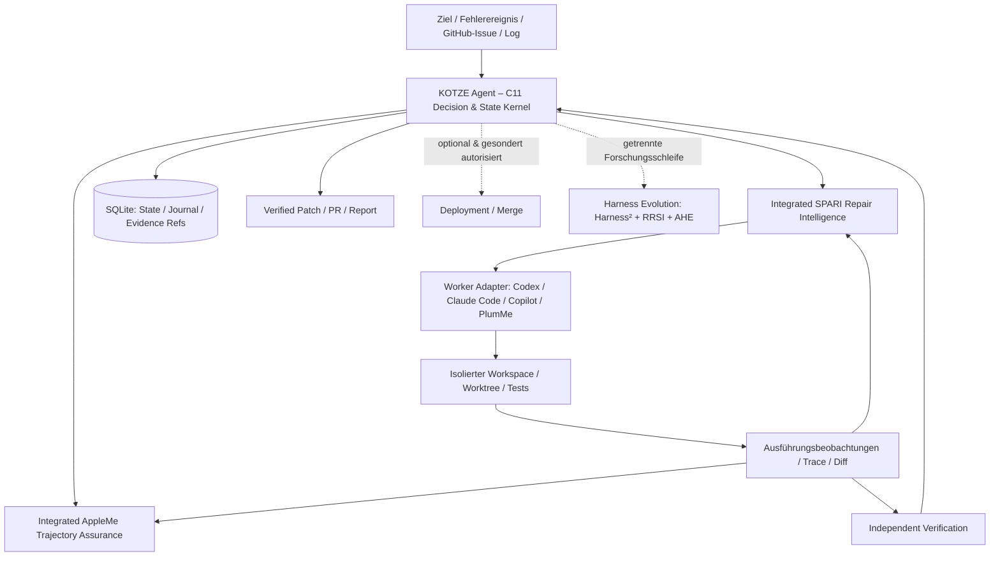
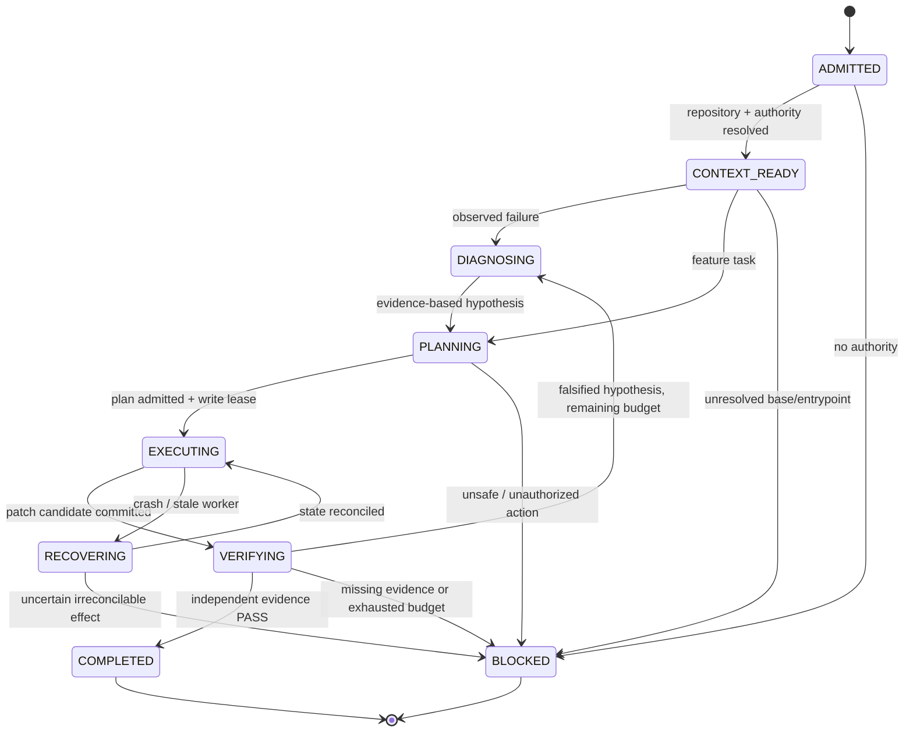
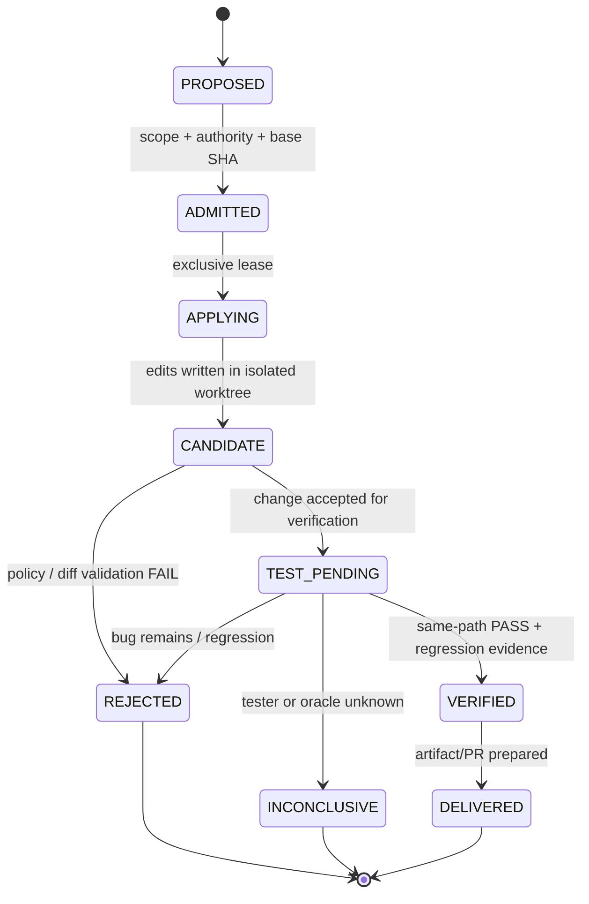
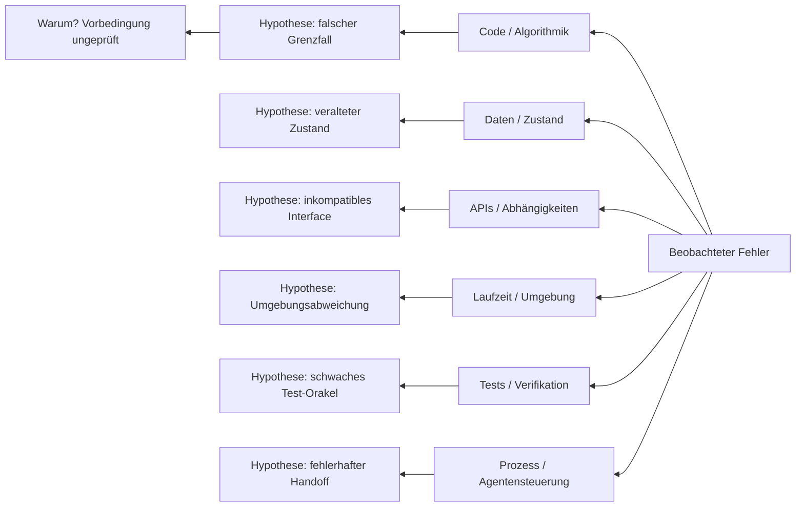

# KOTZE Agent

## Wissenschaftlich fundiertes Architektur-, Forschungs- und Produktkonzept

**Arbeitstitel:** KOTZE Agent  
**Langform:** **K**ontext · **O**bject · **T**rajectory · **Z**ero-Trust · **E**vidence  
**Produktkategorie:** Fully Autonomous Coding Agent / Autonomous Software Repair & Engineering Agent  
**Version:** Konzept 1.0, 12. November 2026  
**Status:** Forschungs- und Architekturkonzept; **kein Implementierungs- oder Produktivnachweis**  
**Leitmotiv:** *Wenig zusätzlicher Code, große nachweisbare Wirkung.*

> **Produktentscheidung.** Der Produktname ist **KOTZE Agent**. „Harness“ bezeichnet seine Laufzeit- und Kontrollumgebung, nicht das Gesamtprodukt. KOTZE Agent ist ein eigenständig einsetzbarer autonomer Coding-Agent. Seine **erste und wichtigste Kernkompetenz** ist die selbstständige Erkennung, Reproduktion, Ursachenanalyse, Behebung und unabhängige Verifikation von Softwarefehlern. Die autonome Neuentwicklung, Weiterentwicklung und Wartung von Software ist Teil des Zielbildes, aber darf den Repair-Fokus nicht verwässern.
>
> **Architekturentscheidung.** Der deterministische Kontrollkern wird **in C11** konzipiert. Er enthält explizite, persistente State Machines für Auftrag, Diagnose, Agentenlauf, Änderung, Verifikation und Recovery. Die fachlichen Mechanismen aus **SPARI** und **AppleMe** werden **in die eigene KOTZE-Agent-Codebasis integriert bzw. dupliziert**; zur Kernfunktion dürfen **keine laufenden SPARI-/AppleMe-Fremddienste erforderlich** sein. Wiederverwendung bedeutet hier auch gezieltes Portieren und Adaptieren von Code – nicht nur einen externen API-Aufruf.

---

## 0. Executive Summary

KOTZE Agent soll einen Softwaredefekt vom beobachtbaren Fehlersignal bis zur nachweislich wirksamen Korrektur **ohne permanente menschliche Steuerung** bearbeiten. Der Agent erhält ein Ziel oder ein Ereignis, beschafft selbstständig den minimal notwendigen Kontext, entscheidet, ob eine Korrektur erforderlich ist, grenzt den ausführbaren Fehlerpfad ein, reproduziert den Defekt, entwickelt und implementiert eine zielgerichtete Änderung, validiert diese gegen denselben Fehler und relevante Regressionen, dokumentiert die Beweiskette und kann nach Unterbrechungen aus einem dauerhaften Zustand fortfahren.

Die **autonome Software-Reparatur** wird als geschlossener, evidenzgesteuerter Engineering-Prozess verstanden, nicht als Prompt-Schleife, die bis zur Meldung „DONE“ wiederholt wird. Abschluss ist ein unabhängiger technischer Sachverhalt, keine subjektive Behauptung eines Coding-Workers.

Die vorgeschlagene Architektur kombiniert:

1. **Einen kleinen nativen C11-Kern** für Zustandsmaschinen, Transaktionen, Budgets, Aktionszulassung, deterministische Übergänge, Deadlines und Recovery.
2. **Integrierte SPARI-Mechanismen** für *trace-first debugging*, ausgeführte Codepfade, Build-vs-Borrow, minimale Änderungen und Retest des ursprünglichen Pfads.
3. **Integrierte AppleMe-Mechanismen** für Agent-Trajectory, Fortschrittsnachweis, Detektion von Schleifen/Stillstand, kontrollierte Diagnose-Probes und begrenzte Revival-Versuche.
4. **Austauschbare Coding-Worker** (unter anderem Codex CLI/App Server, Claude Code, GitHub Copilot SDK/CLI, lokale oder über PlumMe angebotene Modelle). Der Worker bearbeitet Code; KOTZE kontrolliert den technischen Lebenszyklus.
5. **Beweisorientierte Verifikation** mit reproduzierbaren Tests, Ausführungs- und Regressionsnachweisen, getrennten Berechtigungen und einer unveränderlichen Baseline.
6. **Eine optionale, geschützte Self-Improvement-Schleife**, inspiriert von Google Harness², RRSI und AHE, die den Agenten-Harness nur nach nachweisbarer Verbesserung auf zurückgehaltenen Aufgaben verändert.

**Wissenschaftlicher Kernbefund:** Die Forschung spricht **nicht** pauschal für möglichst komplexe Agentenarchitekturen. Sie spricht für den **geringsten wirksamen Kontrollaufwand** je Aufgabe. Ein einfacher, leistungsfähiger Coding-Worker sollte direkt arbeiten können; zusätzliche Recherche, Subagenten, Kontextkomprimierung oder parallelisierte Lösungen werden nur dann zugelassen, wenn der erwartete Erkenntnis- oder Erfolgsgewinn ihren Preis rechtfertigt [R04–R06, R14–R15].

**Abnahmekriterium der ersten Produktstufe:** Auf einem realen, isoliert reproduzierbaren Repository-Defekt kann KOTZE Agent selbstständig eine korrekte Reparatur durchführen, den Originalfehler vor/nach dem Patch nachweisen, relevante Regressionen ausschließen, einen verifizierbaren Patch erzeugen und nach einem simulierten Absturz ohne unkontrollierte Doppelaktionen weiterarbeiten. Dabei läuft **keine kostenpflichtige CI** als implizite Nebenwirkung.

---

## 1. Begriffsklärung: Agent, Harness, Autonomie und Selbstheilung

### 1.1 Warum „KOTZE Agent“ präziser als „KOTZE Harness“ ist

Ein **Coding-Agent** verfolgt ein Entwicklungsziel, wählt Handlungen, liest und ändert Code, führt Werkzeuge aus, bewertet Beobachtungen und iteriert. Ein **Harness** umfasst die Ausführungsumgebung des Modells: Werkzeuge, Kontext, Policies, Zustandsverwaltung, Session-Kontrolle, Memory und Beobachtungs-/Evaluationsschnittstellen. KOTZE ist das **vollständige Produkt**; sein Harness ist eine interne Komponente [R01, R17–R20].

Der Name beschreibt die technische Leitlinie:

| Buchstabe | Bedeutung | Verbindlicher Architekturgedanke |
|---|---|---|
| **K** | **Kontext** | Aufgaben-, Repository-, Laufzeit- und Fehlerversuchs-Kontext werden zielgerichtet bereitgestellt und über Sessions dauerhaft erhalten. |
| **O** | **Object** | Repariert wird ein konkretes **Softwareobjekt**: Capability, API, Datei, Modul, Service, Anwendung oder Systemverbund, identifiziert durch verifizierte Referenzen. „Object“ ist nicht auf objektorientierte Sprachen beschränkt. |
| **T** | **Trajectory** | Der tatsächliche Agentenlauf wird überwacht: Schritte, Fortschrittsdeltas, Hypothesen, Schleifen, Deadlines und Budgetverbrauch. |
| **Z** | **Zero-Trust** | Ein Coding-Worker darf seine eigene Korrektheit und seine Berechtigungen nicht selbst bescheinigen; Tool-Ergebnisse und Ausführungsgrenzen werden vom Kontrollkern geprüft. |
| **E** | **Evidence** | Fertig ist nur, was anhand nachvollziehbarer, reproduzierbarer und ausreichend unabhängiger Nachweise belegt ist. |

### 1.2 Autonomiegrad

**Autonomie im Software-Engineering:** KOTZE plant und entscheidet innerhalb einer vorab erteilten, technisch durchgesetzten Autorisierung selbst. Es muss nicht für jeden Leseschritt, jeden lokalen Reparaturversuch und jeden Test erneut gefragt werden. Gleichwohl gilt: **Autonomie ist keine unbegrenzte Schreib- oder Produktionsberechtigung.** Kritische Effekte wie produktive Datenmigration, irreversible Löschung, veröffentlichte Releases oder Merge in geschützte Branches werden getrennt klassifiziert. Fehlt dafür eine vorherige Freigabe, bleibt der Agent autonom bis zum nächsten zulässigen Abschluss (z. B. verifizierter PR statt Produktionsdeploy).

### 1.3 Abgrenzung

- **Nicht:** reiner GitHub-Issue-Bot oder PR-Generator.
- **Nicht:** eine weitere generische Multi-Agent-Schwarm-Plattform.
- **Nicht:** ein Überwachungsdashboard ohne eigene Coding-Fähigkeit.
- **Nicht:** eine starre Folge von Shell-Skripten, die nur bekannte Fehler behandelt.
- **Sondern:** ein autonomer, fehlerorientierter Software Engineer mit persistentem, überprüfbarem Handlungskreislauf und optionaler allgemeiner Entwicklungsfähigkeit.

### 1.4 Die erste Produktfunktion ist Repair

Ein autonomer Coding-Agent kann später neue Software erstellen und bestehende Anwendungen erweitern. Die erste Produktstufe optimiert aber **Autonomous Program Repair (APR)**: Ohne nachgewiesenen Reparaturkreislauf würde ein vollständiger Produktentwicklungsagent dieselben Fehler wiederholt neu erzeugen. Die wissenschaftliche APR-Literatur nennt insbesondere Fault Localization, Patch-Kandidaten und Patch-Validierung als unterscheidbare Teilprobleme [R07, R08, R27].

---

## 2. Anforderungen und Nicht-Ziele

### 2.1 Funktionale Anforderungen

| ID | Anforderung | Akzeptanzprinzip |
|---|---|---|
| F-01 | Fehlerereignisse aufnehmen | CLI, Test, Log, Stacktrace, API-Fehler, UI-Fehler, Issue und später Monitoring-Event führen zu einer dauerhaften Work Identity. |
| F-02 | System und Kontext auflösen | Exakter Repository-Stand, betroffenes Objekt, Einstiegspunkt, Laufzeitumgebung und relevante Vorgeschichte sind zuordenbar. |
| F-03 | Fehler reproduzieren | Ein unabhängiges Signal unterscheidet zuverlässig `BUG_PRESENT`, `BUG_ABSENT` oder `UNKNOWN`. |
| F-04 | Ursachenanalyse | Evidenz des tatsächlich ausgeführten Pfads hat Vorrang vor Dateinamen und Architekturvermutungen. |
| F-05 | Bestehende Lösung verwenden | Relevante Implementierung, getesteter Fix oder Bibliothek wird vor zusätzlichem Code geprüft. |
| F-06 | Patch autononom erzeugen | Coding-Worker darf nur in seiner zugelassenen Workspace-/Worktree-Grenze ändern. |
| F-07 | Patch unabhängig prüfen | Original-Reproduktion, relevante Regression, Diff-Integrität und fachliche Akzeptanz werden getrennt geprüft. |
| F-08 | Fehlerhafte Strategien verwerfen | Widerlegte Hypothesen und unproduktive Wiederholungen werden gespeichert und nicht blind wiederholt. |
| F-09 | Crash-Recovery | Nach Prozessabbruch ist der Zustand rekonstruierbar; externe Effekte werden nicht blind doppelt ausgeführt. |
| F-10 | Kosten und Laufzeit begrenzen | Gemeinsame Budgetreservierung gilt für alle parallelen Worker und Kindaufrufe. |
| F-11 | Verifizierbaren Output bereitstellen | Patch, Git-Diff, Tests, Evidenz-Referenzen, Kosten und Einschränkungen sind nachvollziehbar. |
| F-12 | Wiederkehrende Defekte erkennen | Reparaturhistorie unterstützt deduplizierte Fehler und schnelle Wiederverwendung relevanter Erkenntnisse. |
| F-13 | Entwicklungsaufträge unterstützen | Gleicher Agent kann Feature- und Refactoring-Aufträge anhand spezifizierter Akzeptanzkriterien bearbeiten. |
| F-14 | Harness kontrolliert verbessern | Nur bewertete, reproduzierbare und zulässige Optimierungen werden zur neuen Standardkonfiguration. |

### 2.2 Nichtfunktionale Anforderungen

- **Eigenständigkeit:** Keine aktive Instanz von SPARI oder AppleMe erforderlich; relevante Mechanismen werden in KOTZE integriert/portiert.
- **Modellunabhängigkeit:** Adapter statt hart codierter Anbieterbindung.
- **Ressourcensparsamkeit:** C11-Kern; deterministische Schritte brauchen keinen Modellaufruf.
- **Reproduzierbarkeit:** Aufträge, Arbeitskopien, Testbedingungen, Modell-/Toolrevisionen und Ergebnisse werden versioniert.
- **Nachvollziehbarkeit:** Jeder schreibende Eingriff hat identifizierbare Autorität, Ursache, Eingabebasis und Resultat.
- **Transportneutralität:** CLI und lokale IPC sind zuerst ausreichend; HTTP/MCP ist Adapter, keine Pflicht im Kern.
- **Portable Ausführung:** Primär Linux; Windows-/macOS-Adapter möglich, Kern nicht an Container-Daemon gebunden.
- **Produktionsschutz:** Negative Rechte, Isolation, Schreibexklusivität, Budgetprüfung und Secret-Handling müssen vom Host technisch durchgesetzt werden.

### 2.3 Ausdrückliche Nicht-Ziele für die erste Implementierung

- Kein neues allgemeines LLM-Gateway neben bestehenden Coding-Worker-Integrationen und PlumMe.
- Keine neue umfassende Programmiersprachenanalyse durch einen selbstgeschriebenen Parser.
- Kein zweites globales FruitStack-Gedächtnis oder eine neue Wissensgraph-Plattform.
- Keine unbeschränkte Selbstmodifikation des Safety-/Evidence-Kerns.
- Keine automatische, kostenpflichtige GitHub-Actions-Ausführung als Standardtest.
- Keine Behauptung vollständiger Autonomie, solange die definierten End-to-End-Nachweise fehlen.

---

## 3. Forschungsstand und technische Konsequenzen

### 3.1 Warum weniger Harness oft mehr leistet

**Empirical Study of Harness Design for Coding Agents (2026).** 176 experimentelle Einstellungen über vier Modelle und zwei Benchmarks zeigen, dass die Wirkung von Planung, Werkzeugmenge und Kontextmanagement vom Modell und Kontextbudget abhängt. Regelbasierte Elision vor modellgestützter Zusammenfassung ist besonders effizient; starke Bash-fähige Modelle benötigen nicht zwingend große vordefinierte Tool-Register [R04].

**Beyond the Model (2026).** Die Wirkung komplexer Harnesses variiert nach Aufgabentyp: Einfache SWE-Reparaturen profitieren bei starken Modellen weniger von zusätzlichem Orchestrierungsaufwand; offene Repository-Aufgaben können von strukturierten Tools und geeigneten Subagenten gewinnen [R05].

**Apple/EPFL, Minimal Harness for MLE (2026).** Bei den untersuchten Machine-Learning-Engineering-Aufgaben zeigte der aufwendige Harness unter gleichen Modell-/Zeitbedingungen keinen Vorteil gegenüber einem einfachen Coding-Agenten. Das ist ein Warnsignal gegen unnötige Architektur, **kein allgemeiner Beweis**, dass zusätzliche Kontrollmechanismen für langlaufende Software-Reparatur wertlos wären [R06].

**Agentless / mini-SWE-agent.** Bereits kontrollierte, einfache Reparaturschritte oder eine sehr kleine Shell-basierte Ausführungsschleife können eine starke Baseline bilden. KOTZE darf nur dann komplexer werden, wenn zusätzliche Komponenten unter gleichen Bedingungen nachweislich mehr leisten [R07, R14].

**Entscheidung:** Der Standardpfad bleibt schlank. Eskalation zu CherryMe-artiger Alternativenanalyse, mehreren Coding-Workern, Memory-Recherche und Harness-Evolution erfolgt **ereignis- und evidenzabhängig**, nicht bei jeder Aufgabe.

### 3.2 Trace-first Repair statt Repository-Spekulation

**SWE-agent (2024)** zeigt den Einfluss des Agent-Computer-Interfaces auf die Qualität von Codeänderungen und Debugging [R08]. **TestPrune (FSE 2026)** verwendet vorhandene Regressionstests zielgerichtet für Reproduktion und Patchprüfung; die berichteten relativen Verbesserungen der Issue-Lösungsrate liegen je nach untersuchter Pipeline bei **8,0–12,9 %**, nicht bei 8–12,9 Prozentpunkten [R09].

Die bestehenden **SPARI Runtime Evidence Gate**-Regeln verlangen bereits:

1. kanonischen Einstiegspunkt bestimmen;
2. Fehler reproduzieren;
3. ausgeführten Pfad nachweisen;
4. erste ursächliche Fehlbedingung identifizieren;
5. exakt passende Wiederverwendung prüfen;
6. kleinste architekturkonforme Änderung erstellen;
7. denselben ursprünglichen Pfad erneut testen.

KOTZE übernimmt diesen Ablauf **als native, eigenständige Repair-Entscheidungslogik**. Er ist keine neue, unverifizierte Erfindung und muss deshalb nicht bei null beginnen [P01].

### 3.3 Kontext, Editing und kompakte Erfahrungen

**Microsoft SWE-Edit (2026)** trennt das Lesen relevanter Codestellen von der Editierausführung. Die publizierte Untersuchung berichtet auf SWE-bench Verified **+2,1 Prozentpunkte** bei **17,9 % geringeren Inferenzkosten** für die getestete Konfiguration. Allerdings beruht das gesamte Verfahren zusätzlich auf einem trainierten Editor; ein einfacher Adapter allein garantiert diese Werte nicht [R10].

**Scaling Test-Time Compute for Agentic Coding (2026)** komprimiert umfangreiche Agentenläufe in strukturierte Zusammenfassungen mit Hypothesen, Fortschritt und Fehlern. Der untersuchte Claude-4.5-Opus-Aufbau steigt beispielsweise auf SWE-bench Verified von 70,9 % auf 77,6 %; parallele/serielle Zusatzversuche verbrauchen dafür weitere Ressourcen [R11].

**Entscheidung:** KOTZE legt kompakte, maschinenlesbare `RepairEpisode`-Datensätze an. Die Modellkontexte enthalten aktuelle Problemstellung, relevante Beobachtungen, bereits widerlegte Hypothesen und die nächste Entscheidung – **nicht** vollständige alte Transkripte oder große ungefilterte Toolausgaben.

### 3.4 Langzeitautonomie: das ungelöste Kernproblem

**Multi-step SWE (November 2026)** untersucht 69 Aufgabenketten mit jeweils 5–15 abhängigen Entwicklungsschritten. Die stärkste Modell-Harness-Kombination löst **18,5 %** der vollständigen Aufgabenketten, obwohl sie **56,8 %** der einzelnen Schritte besteht. Diese Prozentangaben stammen aus unterschiedlichen Auswertungseinheiten; sie zeigen vor allem die Schwierigkeit kumulativer Codeentwicklung [R12].

**E2E-SWE** testet die vollständige Erzeugung installierbarer Repositories aus Spezifikationen (186 Aufgaben, 11 Sprachen); **CodeClash** misst iterativen Fortschritt auf offenen Zielen. Beide sind nützliche Ergänzungen zu Bugfix-Benchmarks [R13, R29].

**Entscheidung:** KOTZE benötigt neben der individuellen Patch-Abnahme ein **dauerhaftes Repository-Integritätsmodell**: jede Änderung beginnt von einem bekannten Commit, dokumentiert API-/Test-/Migrationswirkungen und lässt spätere Erweiterungen auf einem stabilen Stand aufbauen.

### 3.5 Unabhängige Evidenz statt selbstgeschriebener Scheinbeweise

**All Smoke, No Alarm (IEEE AITest 2026)** klassifiziert 86.156 Testdatei-Patches aus agentenverfassten PRs und findet bei **80,2 %** schwache oder keine expliziten Oracle-Signale. Diese Aussage ist eine syntaktische Klassifikation, keine vollständige semantische Bewertung aller Tests [R16]. IBM berichtet außerdem über Test-Overfitting bei SWE-bench-Reparaturen [R30].

**Entscheidung:** Tests, die nur erfolgreich starten, reichen nicht. KOTZE fordert – abhängig vom Fall – belastbare Assertions, Vergleich mit Baseline, Hidden/Held-out-Checks, API-/UI-/DB-Prüfungen oder andere unabhängige Orakel. Ein vom Worker erzeugter Test kann den Reparaturversuch stützen, aber nicht allein seinen Erfolg bescheinigen.

### 3.6 Selbstoptimierung auf Ebene des Harness

**Google Harness² (Oktober 2026)** nutzt zwei Rekursionsebenen: pro Aufgabe `Propose–Probe–Compose`, langfristig die Übernahme evidenzgestützter Verbesserungen in den Harness. Auf den untersuchten Professional-Work-Benchmarks werden task- und konfigurationsabhängige Verbesserungen berichtet; das ist nicht mit einem nachgewiesenen Coding-Repair-Effekt gleichzusetzen [R01].

**RRSI (September 2026)** adressiert Overfitting selbstoptimierter Harnesses durch begrenzte Änderungspakete, Kritik, Pruning und Evaluierung auf abweichenden Aufgaben. Die Autoren berichten unter anderem bis zu **4,7 Prozentpunkte** Gewinn auf fünf Out-of-Distribution-Benchmarks und 30 % weniger Policy-Tokens als eine unregulierte Evolution [R02].

**AHE (April/Mai 2026)** verbindet Komponenten-, Trajectory- und Entscheidungsbeobachtbarkeit. Auf Terminal-Bench 2 steigt pass@1 in der berichteten Untersuchung nach zehn Iterationen von **69,7 % auf 77,0 %**; die Ablationen verorten Effekte vor allem bei Tools, Middleware und Memory statt beim System-Prompt [R03].

**Entscheidung:** Späteres KOTZE Self-Improvement arbeitet auf einer **versionierten, begrenzten Änderungsliste** (`prompt_profile`, `tool_policy`, `context_filter`, `test_selection`, `repair_strategy`), nicht auf dem nicht vertrauenswürdigen freien Umschreiben des C11-Sicherheitskerns. Änderungen benötigen unabhängige Held-out-Evaluation und Rollback.

### 3.7 Grenzen der wissenschaftlichen Aussagen

- **Benchmarks sind keine Produktion.** Prozentwerte werden nicht addiert und dürfen nicht als KOTZE-Zielprognose verwendet werden.
- **Modell-Harness-Kombination zählt.** Ein veröffentlichtes Resultat einer Variante ist kein Beweis für alle Provider oder Modelle.
- **Paperstatus unterscheiden.** ArXiv-Preprints sind nicht automatisch peer-reviewed; Firmenblogs sind primäre Engineering-Berichte, aber keine kontrollierten wissenschaftlichen Studien.
- **Benchmarkqualität prüfen.** SWE-Bench Pro hat dokumentierte Qualitätskritik; Ergebnisse aus diesem Benchmark benötigen Aufgaben-Audit und Einschränkungen [R31].
- **Keine Quelle beweist allgemeine, fehlerfreie, unbegrenzt autonome Softwareentwicklung.** Das ist ein Forschungs- und Entwicklungsziel.

---

## 4. Konkurrenz- und Donor-Analyse

| Referenz | Nachgewiesene / dokumentierte Mechanik | Zu übernehmen | Nicht ungeprüft übernehmen |
|---|---|---|---|
| **Google Harness²** | Kontrastive Harness-Änderungen, zwei Rekursionsebenen [R01] | Experimentdesign, kompakte Erkenntnisse, Promotion von Verbesserungen | Offene Netzwerk-/Sandbox-Konfiguration aus Benchmark-Setups |
| **Google RRSI** | Regularisierte Auswahl, Schutz vor Benchmark-Overfitting [R02] | Edit-Budget, Kritiker, Pruner, Held-out-Auswahl | Automatische Promotion sicherheitskritischer Policies |
| **AHE** | Falsifizierbare Harness-Edit-Hypothesen, Observability [R03] | Edit-zu-Ergebnis-Provenienz, Ablationen | Unbegrenzte Optimierungskosten |
| **GitHub Copilot** | Agenten über Issues, Zeitpläne und Events; Hooks, Agentic Workflows [R21–R23] | Trigger, kontrollierte Workflows, Hook-Prüfungen | GitHub-Actions-Pflicht und ungeprüfte externe Aktionen |
| **OpenAI Codex** | Agenten-CLI/App-Server, Engineering-Harness, Tool-/Session-Kontrolle [R17–R18] | Coding-Worker-Protokoll, App-Server/SDK-Integration, Observability | Einen zweiten vollständigen Codex-Kern neu bauen |
| **Anthropic Claude Code** | Persistente Artefakte, Session-Handoff, Generator/Evaluator, Playwright [R19–R20] | Evaluator-Trennung, Recovery-Verträge, UI-/API-/DB-Prüfung | Lange Prompt-Schleifen ohne unabhängigen Evidenz-Gate |
| **mini-SWE-agent** | Einfache Shell-orientierte Loop als starke Baseline [R14] | Minimalität, messbare Vergleichs-Baseline | Shell ohne Host-Grenzen als Sicherheitsmodell |
| **SWE-agent / SWE-Edit** | Agent-Computer-Interface; getrennte Codeansicht und Editierausführung [R08, R10] | Kleiner Viewer/Editor-Adapter, strukturierte Edit-Resultate | Zusätzliche trainierte Modelle als ungeprüfte Pflicht |
| **SPARI (eigener Donor)** | Authority Attestation, Economy Gate, Runtime Evidence Gate, Recomposition [P01–P02] | **Direkt in KOTZE duplizieren/portieren** | Unnötige Abhängigkeit von laufendem SPARI-Dienst |
| **AppleMe (eigener Donor)** | Plan-/Trajectory-Assurance, Probes, Revival, Provenienz [P03–P04] | **Direkt in KOTZE duplizieren/portieren** | Zweites unabhängiges Pflicht-Deployment |
| **PomeloMe / MangoMe / PeachMe** | Effektkontrolle, durable Work Identity, Session-/Budget-Gates [P05–P07] | Kontrakte oder selektive Funktionen als Donor | Den gesamten FruitStack als Voraussetzung erzwingen |

### 4.1 Build-vs-Borrow: ausdrücklich kein Anti-Duplikationsdogma

SPARI ist in der bisherigen Entwicklung ein wiederverwendungsorientierter Entscheidungsmechanismus. **Die Nutzerentscheidung für KOTZE lautet ausdrücklich, funktional eigenständige Kopien seiner relevanten Logik aufzunehmen.** Dasselbe gilt für AppleMe. Zweck: eine autonome, auch ohne laufenden FruitStack funktionsfähige Einheit. Der C-Kern kann diese Logik in schlankem, überprüfbarem Zustandscode implementieren; nicht alle bestehenden Python-Funktionen müssen 1:1 übersetzt werden.

Für jede portierte Fähigkeit ist jedoch eine `PARITY_MATRIX` mit Quellrevision, Quelltest, KOTZE-Verhalten, bewusst ausgelassenen Varianten und eigenständigem Regressionstest erforderlich. **Code-Duplikation ist beschlossen; unkontrollierte Verhaltensdivergenz ist es nicht.** Die Lizenz- und Vertraulichkeitsbedingungen der jeweiligen Quell-Repositories sind vor einer öffentlichen KOTZE-Veröffentlichung gesondert zu prüfen. Besonders interne/private FruitStack-Implementierungen und konfigurierte Provider-/Policy-Daten dürfen nicht unbeabsichtigt öffentlich werden.

---
## 5. Zielarchitektur: schlanker autonomer Agent mit C11-Kern

### 5.1 Schichtenbild



Die Mermaid-Darstellung beschreibt **logische Verantwortung**, nicht den Zwang zu separaten Prozessen. SPARI- und AppleMe-Funktionalität soll als Bestandteil von KOTZE laufen. Für Worker, isolierte Ausführung und externe Verifikation können separate Prozesse trotzdem sinnvoll sein.

### 5.2 Warum C11 – und warum nicht alles in C?

**C11 ist für den deterministischen Kern geeignet**, weil Zustandsübergänge, Budgets, Zeitlimits, Prozesssteuerung, Event-Verarbeitung und SQLite-Transaktionen ohne Laufzeit-LLM und mit begrenztem Ressourcenverbrauch implementierbar sind. Ein kleiner C-Kern kann unabhängig von Python-Umgebungen starten und einen fehlerhaften Coding-Worker überwachen. C löst jedoch nicht das semantische Problem, welche Reparatur korrekt ist; das bleibt Aufgabe geeigneter Modelle, Tests und überprüfbarer Orakel.

**In C:**

- Typisierte Zustandsmaschinen und deterministische Übergangsregeln.
- Transaktionales Aufgaben-/Ausführungsjournal, idempotente Eventverarbeitung.
- Deadlines, Stop-/Retry-Grenzen, Budgetreservierung, Lease-/Write-Ownership.
- SPARI-Kernregeln: evidenzabhängiger Eintritt in Diagnose, Hypothesenstatus, Scope-Begrenzung und Same-path-Retest-Gate.
- AppleMe-Kernregeln: Trajectory-Signale, Loop-/Thrashing-/No-Progress-Erkennung, kontrollierte Probe-/Revival-Entscheidungen.
- Prozess- und Adapterüberwachung, strukturierte Tool-Receipts, Integritäts-/Hash-Prüfung.
- Fail-closed-Entscheidungen für Effekte, Quellrevisionen und Verifikation.

**Über vorhandene Prozesse, SDKs oder Adapter:**

- Modell-Inferenz, Streaming, Tool-Calling und Provider-Routing.
- Bearbeitung großer Codeänderungen durch Codex/Claude Code/Copilot.
- Betrieb konkreter Testframeworks (pytest, PHPUnit, Jest/Vitest, Go test, CMake/CTest usw.).
- Browser-Automation, UI-Prüfung, Datenbankintegration und API-Simulation.
- Repository-Hosting, PR-Erstellung und ggf. externe Sandbox-Backends.

**Nicht neu implementieren:** HTTP-Stack, Git-Protokoll, Datenbankengine, universeller Parser, vollständiger Container-Scheduler oder neue eigene Modellinferenz, sofern belastbare Bibliotheken/Schnittstellen existieren.

### 5.3 Kandidaten für C-Bibliotheken

| Komponente | Nutzen | Entscheidung |
|---|---|---|
| **SQLite** (C, Public Domain) | Transaktionale Durable State, Journal, Lease-Tabellen, lokale Indexe | **Kernabhängigkeit vorgeschlagen**; SQLite WAL, feste Migrationsversionen, Integrity-Checks [R24] |
| **libgit2** (C, GPLv2 + Linking Exception) | Git-Objekte, Diffs, Commit-/Index-/Repository-Zugriff | **Optional**; zuerst vorhandene Git-CLI/Worktree-Semantik prüfen, um Code und Portabilitätsarbeit zu sparen [R25] |
| **Tree-sitter** (C-Runtime, MIT) | Schnelles Syntax-/Symbol-Parsing, optionaler präziser Kontext | **Optionales Profil**; nur bei nachgewiesener Verbesserung gegenüber `rg`/LSP/Worker-Suche [R26] |
| **System-Prozess-API** | Start, Stopp, Exit-Codes, Ressourcenlimit, Signalhandling | Kleine Linux-POSIX-Schicht; Windows als gesonderter Adapter |
| **Bestehende CLI/SDKs** | Inferenz, Browser, GitHub, Tests | **Adapter**, nicht fest einkompiliert |

**Integrationsprinzip:** Möglichst kleine C11-Kernbibliothek plus eine dünne CLI. Für flexible Provider-/Agenten-Anbindung sind ein versioniertes, zeilenorientiertes JSON-Protokoll oder eine andere kleine, typisierte IPC-Schnittstelle ausreichend. Der Kern muss keinen HTTP-Server und keinen Python-Laufzeitprozess hosten, wenn ein externer CLI-Worker bereits zuverlässig funktioniert.

### 5.4 Vorgeschlagene kompakte Modulstruktur

```text
kotze-agent/
  include/
    kotze.h                 # Versionierte öffentliche Typen und Statuscodes
    kotze_protocol.h        # IPC-/Event-Kontrakte
  src/
    core/                   # Zustandsmaschinen, Übergangs- und Gate-Logik
    store/                  # SQLite, Ereignisse, atomare Writes, Migrations
    repair/                 # Evidenzbasierte Diagnose und Reparaturregeln
    diagnosis/              # CausalMap: Ursachen-Graph, Evidenz und Hypothesen
    assurance/              # Integrierte AppleMe-Mechanismen
    runtime/                # Worker-/Prozessüberwachung, Budget, Lease
    verify/                 # Verifikationsfreigabe und Ergebnisbewertung
    cli/                    # Start, Status, Reconcile, Export
  adapters/
    codex/                  # Bestehende CLI/App-Server-Schnittstelle
    claude-code/            # Bestehende Headless-/SDK-Schnittstelle
    copilot/                # Copilot SDK/CLI, falls autorisiert
    plumme/                 # Optionaler FruitStack-Workerzugang
    test/                   # Projektspezifische Test-/Runner-Adapter
    git-host/               # GitHub-PR/I/O ohne CI-Zwang
  tests/
    state-machines/
    crash-recovery/
    parity-spari/
    parity-appleme/
    golden-repair/
    security/
  research/
    benchmarks/
    ablations/
    harness-evolution/
  docs/
    architecture/
    source-attribution/
    contracts/
```

Die Struktur ist ein **logischer Entwurf**, kein bereits existierender Dateibaum. Es ist ausdrücklich erlaubt, weniger Dateien zu verwenden, wenn dies den Code reduziert, ohne Verträge und Testbarkeit zu verschlechtern.

### 5.5 Isolierung ohne Docker-Zwang

Es gibt einen Unterschied zwischen einem **isolierten Git-Worktree** und einer **Sicherheits-Sandbox**. Ein Worktree verhindert gleichzeitige Änderungen in derselben Arbeitskopie, aber nicht den Zugriff eines fehlkonfigurierten Prozesses auf Host-Dateien oder Credentials. KOTZE verwendet deshalb zwei voneinander getrennte Mechanismen:

1. **Repository-Isolation:** eigener Worktree/Branch mit exakt gebundener Basisrevision, separaten temporären Build-Artefakten und exklusiver Schreibberechtigung.
2. **Prozess-/Effekt-Isolation:** eingeschränkter OS-User oder Sandbox, definierte Verzeichnis- und Netzwerkfreigaben, kontrollierte Secrets, Ressourcen-/CPU-Limits, erlaubte Tool- und Git-Operationen.

Für den ersten lokalen Offline-Prototyp sind isolierte Workspaces und kontrollierte Prozessaufrufe ausreichend, **nicht jedoch als Behauptung einer starken Sicherheitsgrenze**. Für fremden oder untrusted Code ist eine echte OS-/VM-/Sandbox-Grenze erforderlich. Externe Sandbox-Lösungen werden optional integriert; es besteht **keine Docker-Pflicht**.

---

## 6. Die State Machines – keine dekorative Modellierung

KOTZE verwendet mehrere **orthogonale endliche Zustandsautomaten**, statt einen einzigen undurchsichtigen Gesamtstatus. Jede Zustandsänderung ist explizit, persistent, autorisiert, durch eine Observation oder ein Ereignis begründet und kann nach einem Prozessneustart rekonstruiert werden.

### 6.1 Globale Regeln

1. Jede Transition benötigt `work_id`, `object_id`, `base_revision`, `actor`, `event_id`, Zeitstempel und eine gültige Vorbedingung.
2. Transitionen und ausgehende Aktionen werden **vor** externen Effekten transaktional persistiert.
3. Jeder Event-Key ist deduplizierbar; ein wiederholtes Event darf keine zweite unabhängige Arbeitsidentität erzeugen.
4. Fehlende Beweise bleiben `UNKNOWN`, nicht `PASS`.
5. Eine gescheiterte Hypothese führt nicht automatisch zu einer Änderung an anderen Modulen.
6. Für dieselben Dateien und denselben Worktree existiert höchstens ein aktiver Schreib-Lease.
7. Abschlusszustände sind nur über vordefinierte Gates erreichbar – ein Worker-Text wie „done“ ist lediglich `WORKER_CLAIMED`.
8. Retry-Budgets gelten global je Arbeit bzw. je spezifizierter Unteraufgabe und werden **vor** der Ausführung reserviert.
9. Bei inkonsistentem Zustand wird der Run eingefroren und reconciliert, nicht blind wiederholt.

### 6.2 FSM A: Auftragslebenszyklus (`WorkFSM`)



**Wichtig:** `COMPLETED` ist die letzte fachliche Anerkennung, nicht ein Echo von `EXECUTING`. `BLOCKED` ist ein legitimer, vollständiger Bericht ohne fingierten Erfolg. Ob ein blockierter Auftrag später erneut zugelassen wird, ist ein neuer autorisierter Übergang.

### 6.3 FSM B: Diagnose und Hypothesen (`DiagnosisFSM`)

| Zustand | Bedeutung | Zulässiger nächster Schritt |
|---|---|---|
| `ENTRYPOINT_UNKNOWN` | Kanonischer Fehlerpfad nicht bekannt | Minimale Quelle zur Auflösung lesen |
| `REPRODUCER_PENDING` | Reproduktionsfall wird ermittelt | Bounded Probe/Test |
| `REPRODUCED` | Verlässliches BUG_PRESENT-Signal | Tatsächlichen Pfad instrumentieren |
| `PATH_TRACED` | Ausgeführter Pfad mit Provenienz erfasst | Erste Fehlbedingung identifizieren |
| `HYPOTHESIS_OPEN` | Falsifizierbare Ursache und Vorhersage | Gezielt prüfen |
| `HYPOTHESIS_REFUTED` | Vorhersage widerlegt | Historie speichern und neu priorisieren |
| `ROOT_CAUSE_SUPPORTED` | Ursache mit passendem Laufzeitnachweis | Minimalen Fix autorisieren |
| `NOT_REPRODUCED` | Ursache nicht nachgewiesen | Weitere zulässige Instrumentierung oder Blockierung |
| `EVIDENCE_INSUFFICIENT` | Keine belastbare Diagnose | Keine spekulative Codeänderung |

**SPARI-Parität:** Runtime Evidence Gate und Economy Gate werden als Eintritts- und Übergangsregeln abgebildet. Nach einer begrenzten Zahl widerlegter Diagnosezyklen wird `RECOMPOSE` ausgelöst: die Annahmen zum echten Entry-Point und zur aktiven Implementierung werden neu bewertet. Ein bereits widerlegter Ansatz wird nicht kommentarlos wiederholt.

### 6.4 FSM C: Agenten-Trajectory (`TrajectoryFSM`)

| Zustand | Beobachtung | Konsequenz |
|---|---|---|
| `HEALTHY` | Verifizierbarer Fortschritt, im Plan | Weiterarbeiten |
| `SUSPECT` | Wiederholtes Muster / zweifelhafte Abweichung | Günstige diagnostische Probe |
| `STALLED` | Kein neuer Informations-/Artefaktgewinn | Probe, Replan oder Recovery |
| `LOOPING` | Gleiche Handlung/Fehler ohne Informationsgewinn | Wiederholung unterbrechen |
| `THRASHING` | Oszillation zwischen Phasen/Hypothesen | Replan oder last-known-good |
| `RECOVERY_RECOMMENDED` | Probe unbeantwortet oder unzureichend | Kontrollierte Revival-Entscheidung |
| `REVIVED` | Neuer zulässiger Lauf ab Checkpoint | Alter gescheiterter Tail bleibt historisiert |
| `DISCHARGED` | Wiederherstellungsbudget verbraucht | Blockieren und begründen |

**AppleMe-Parität:** AppleMe unterscheidet `ACTIVITY != PROGRESS` und differenziert `WORKER_CLAIMED`, `HARNESS_OBSERVED`, `EXTERNALLY_VERIFIED`. Die relevanten Detektoren, Probe-Regeln und Revival-Pakete werden übernommen. Die FSM basiert **nicht** auf privater Chain-of-Thought, sondern auf sichtbaren, versionierten Aktionen, Artefakten, Erfolgs-/Fehlersignalen und Budgetverbrauch [P03].

### 6.5 FSM D: Patch-Lebenszyklus (`PatchFSM`)



Patch und verifizierter Auftrag sind getrennte Zustände: Ein technisch korrekt erscheinender Diff kann Tests bestehen, während eine übergeordnete Anforderung noch offen ist. Ebenso darf ein geänderter Test nicht ohne unabhängigen Review einen originalen Fehltest ersetzen.

### 6.6 FSM E: Verifikation (`VerificationFSM`)

| Zustand | Voraussetzung |
|---|---|
| `UNCONFIGURED` | Akzeptanzkriterien fehlen; kein Erfolgsnachweis möglich |
| `BASELINE_CAPTURED` | Ursprüngliches Fehlerverhalten und genaue Revision belegt |
| `CHECKS_PREPARED` | Prüfauswahl und Orakel versioniert, vor Ausführung fixiert |
| `RUNNING` | Verifier auf unverändertem Kandidatenstand |
| `PASS` | Originalfehler verschwunden, erforderliche unabhängige Checks erfolgreich |
| `FAIL` | Originalfehler weiterhin vorhanden oder relevante Regression nachgewiesen |
| `INCONCLUSIVE` | Testausfall, Flakiness, unvollständige Abdeckung oder fehlende Evidenz |
| `STALE` | Prüfergebnis bezieht sich nicht mehr auf aktuellen Kandidaten-SHA |

Ein erfolgreiches Prüfergebnis ist **an einen exakten Kandidaten-Hash gebunden**. Jede nachträgliche Codeänderung invalidiert betroffene Verifikationsresultate. Kein „PASS“ ohne nachprüfbare, gleichbleibende Artefaktidentität.

### 6.7 FSM F: Recovery und externe Effekte (`EffectFSM`)

```text
PLANNED -> AUTHORIZED -> RESERVED -> DISPATCHED -> {CONFIRMED, FAILED, UNKNOWN}
                                                            |
                                                          UNKNOWN
                                                            v
                                                 RECONCILE / PROBE
                                                   /             \
                                             CONFIRMED        SUSPENDED
```

`UNKNOWN` bedeutet, dass der Effekt nach dem Dispatch passiert sein **könnte**, der endgültige Ausgang aber nicht zweifelsfrei vorliegt. Eine Aktion mit externen Folgen darf dann **nicht blind erneut** ausgeführt werden. Bei Git-Push, PR-Erstellung, Deployment, DB-Migration und ähnlichen Effekten muss zuerst der reale externe Zustand abgefragt oder die Aktion sicher suspendiert werden. Das Muster entspricht der Produktgrenze und den Invarianten von PomeloMe [P05].

### 6.8 Invarianten über alle State Machines

```text
I-01  WORKER_SAYS_DONE                  != VERIFIED
I-02  TEST_PROCESS_EXIT_0               != SEMANTIC_CORRECTNESS
I-03  WORKER_CLAIMED_EVIDENCE           != EXTERNALLY_VERIFIED
I-04  PATCH_SHA_CHANGED                 -> REVERIFY_REQUIRED
I-05  EFFECT_UNKNOWN                    -> NO_BLIND_REDISPATCH
I-06  WRITE_LEASE_ACTIVE(worktree)      <= 1
I-07  CHILD_RESERVED_BUDGET             <= PARENT_REMAINING_BUDGET
I-08  HYPOTHESIS_REFUTED                 -> DO_NOT_REPEAT_WITHOUT_NEW_EVIDENCE
I-09  SOURCE_UNRESOLVED                 -> NO_VERSION_SENSITIVE_MUTATION
I-10  ORIGINAL_FAILURE_NOT_RETESTED     -> REPAIR_NOT_VERIFIED
I-11  WORKER_UNTRUSTED                  -> NO_SELF_CERTIFIED_ACCEPTANCE
I-12  CRITICAL_ACTION_NOT_AUTHORIZED    -> NO_EFFECT
```

Diese Invarianten sind **ausführbare Anforderungen**: Jeder Eintrag erhält deterministische Unit-Tests, Crash-Tests und adversarielle Gegenbeispiele. Sie werden nicht nur als Prompt-Anweisungen formuliert.

---

### 6.9 CausalMap – navigierbare Ishikawa- und Ursachenbaum-Ansicht

**Modulname:** `CausalMap` (Root Cause Intelligence), intern `src/diagnosis/cause_map.c` und `include/kotze_cause_map.h`. **Eigentümer:** die Diagnose-Engine. Die spätere kontinuierliche Verbesserung verwendet dieselben Ursachendaten, betreibt aber keinen zweiten Graph-Store.

**Entscheidung:** Das klassische Ishikawa-/Fischgrätendiagramm ist nur eine *Ansicht*. Die kanonischen Daten sind ein persistierter, versionierter gerichteter Ursachengraph. Das vermeidet die falsche Annahme, dass jede Ursache nur einen einzigen Elternknoten oder jeder Fehler genau eine Grundursache besitzt. Kausalitätskanten können mehrere Wirkungen, gemeinsame Voraussetzungen und alternative Erklärungen ausdrücken. Die Visualisierung bietet drei Projektionen desselben Datensatzes: Fischgräte (Kategorien), aufklappbarer Warum-Baum (5 Whys) und Evidenzgraph (Querverbindungen).

**Kategorien für Softwarefehler** werden aus dem beobachteten Fehler abgeleitet und können angepasst werden: Code/Algorithmik, Daten/Zustand, APIs/Abhängigkeiten, Laufzeit/Umgebung, Tests/Verifikation, Entwicklungsprozess/Agentensteuerung. Diese Kategorien dienen der Hypothesenvollständigkeit; sie sind **keine Behauptung**, dass jede Kategorie an einem konkreten Fehler beteiligt ist.



Das Diagramm zeigt *illustrative* mögliche Äste und keine festgestellten Ursachen. Sichtbar werden bei jeder aufklappbaren Ursache: Status, Beobachtung, ausführbare Falsifikationsprobe, betroffene Revision, verursachende und widerlegende Evidenz, wahrscheinliche Wirkung sowie offene Alternativen. „Kausal“ ist eine **Hypothese**, bis Experimente und unabhängige Nachweise ihre Unterstützung liefern. Eine Korrelation aus Coverage ist kein Beweis einer Kausalbeziehung.

| Graph-Element | Pflichtfelder | Bedeutung |
|---|---|---|
| `cause_node` | `node_id, work_id, kind, label, status, revision` | Fehlersymptom, Kategorie, Hypothese, Zwischenursache oder bestätigte Bedingung |
| `cause_edge` | `edge_id, work_id, source_id, target_id, relation, status, revision` | `MAY_CAUSE`, `REQUIRES`, `CONTRADICTS`, `EXPLAINS`; gerichtet, kein Zwang zum Tree |
| `cause_evidence` | `node_id, evidence_id, polarity, provenance, base_sha, artifact_hash` | `SUPPORTS`/`REFUTES`; Artefakte revisions- und quellgebunden |
| `cause_probe` | `probe_id, node_id, prediction, reproducer_hash, result, attempt_id` | Vorhersage und falsifizierender Lauf; protokolliert mit Ergebnis |
| `cause_snapshot` | `work_id, graph_revision, snapshot_hash, created_at` | Deterministische Ansicht und wiederholbare Rekonstruktion |

**Verhalten und Zustandskopplung:**
1. Ein reproduzierter Fehler erzeugt genau einen versionierten Symptomknoten pro `work_id`/Fehlersignatur; Kategorien und Hypothesen entstehen bei Bedarf.
2. Die Diagnose-FSM legt bei `HYPOTHESIS_OPEN` einen Hypothesenknoten und eine prüfbare Vorhersage an; der Kernel verlangt eine konkrete Gegenprobe, bevor ein riskanter Patch autorisiert wird.
3. Externe Test-/Trace-Ereignisse hängen Evidence-Referenzen an den passenden Knoten. `HYPOTHESIS_REFUTED` markiert den Knoten widerlegt, ohne seine Historie zu löschen; `ROOT_CAUSE_SUPPORTED` markiert einen Knoten *gestützt*, nicht mathematisch bewiesen.
4. Der Fehlerlokalisierungs-Score (z. B. Ochiai) darf nur als **Rankinghinweis** angezeigt werden, niemals als `P(Fehlerursache)`. Für kalibrierte Posterior-Wahrscheinlichkeiten wären dokumentiertes Wahrscheinlichkeitsmodell, Priors und externe Kalibrierung nötig.
5. Bei `PATCH_CANDIDATE` wird die Kandidatenrevision mit den adressierten Ursachen verknüpft. Nur ein eingefrorener Original-Reproducer plus unabhängige Folgeprüfung kann das Wirkungsergebnis `REPAIRED_VERIFIED` auslösen.
6. Veränderte Evidenz, ein abweichender Runtime-Pfad oder ein neuer Gegenbeweis führen zu einer neuen Graphrevision und gegebenenfalls `RECOMPOSE`; alte Kanten bleiben historisch, aber gelten nicht stillschweigend als aktuell.
7. Nach einer erfolgreichen Reparatur untersucht die kontinuierliche Verbesserung wiederkehrende *Ursachenklassen* quer über Aufträge und schlägt präventive Kontrollen vor. Diese werden gegen Held-out-Fälle evaluiert, bevor sie zur Standardregel werden.

**Oberfläche:** Der C-Kern liefert einen read-only Graph-Snapshot in einem versionierten JSON-Protokoll. Ein optionaler Web-View kann dafür `@xyflow/react` (MIT; Drag/Pan/Zoom/expandierbare Nodes) verwenden; Layout und Interaktion liegen nicht im C-Kernel. Die Fishbone-Ansicht ist eine feste Projektion des Graphen, kein unabhängiger Datenspeicher. Alternativansichten benutzen dieselben `node_id` und `edge_id`.

**Akzeptanz:** Derselbe reproduzierte Fehler erscheint in Fishbone und Warum-Tree mit identischen IDs, Evidenz und Status. Eine widerlegte Ursache verschwindet nicht aus der Historie. Ein mehrfach wirksamer Ursachen-Knoten lässt sich in mehreren Zweigen darstellen, ohne ihn zu duplizieren. Crash/Restart erhält alle Belege, Graphrevisionen und Kanten. Keine Oberfläche oder Modellbewertung kann ein unbelegtes Ursachenlabel auf `VERIFIED` setzen.

**Primärquellen:** ASQ, *Fishbone Diagram* (https://asq.org/quality-resources/fishbone), IHI, *Cause and Effect Diagram* (https://www.ihi.org/library/tools/cause-and-effect-diagram). Für die UI: React Flow, *Node-Based UIs in React* (https://reactflow.dev/), MIT-Lizenz. Die Quellen stützen die Visualisierungs- und Analysegrundidee, nicht eine bereits gemessene Erfolgsquote von KOTZE Agent.

---

## 7. Autonomous Repair Loop im Detail

### 7.1 Eintritt und Fehlersignal

Eingaben können ein GitHub-Issue, eine konkrete Nutzerbeschreibung, ein failing test, ein Stacktrace, ein API-/MCP-Fehler, ein Log-Ausschnitt, eine geänderte UI-Funktion oder ein in einer Regression erkanntes Verhalten sein. Der Eingangsadapter muss **beobachtete Fakten** von **Annahmen** trennen. Das Eingangssignal erzeugt eine eindeutige `work_id` und bindet den exakten Repository-Commit. Kein pauschales „Fix everything“ ohne isolierbaren Auftrag und Budget.

### 7.2 Kontext bestimmen – minimal vor breit

`ContextContract` enthält: `repo_id`, `base_sha`, `object_id`, `entrypoint`, `observed_failure`, `reproducer`, `allowed_scope`, `accepted_invariants`, `recent_changes`, `relevant_history_refs`, `authority`, `budget`. Der Context-Broker priorisiert:

1. aktuellen Fehlereinstieg und Stacktrace;
2. konkrete Ausführungs-/Coverage-Spur;
3. Signatur, Symbol, API-Route und unmittelbare Abhängigkeiten;
4. exakte vorherige Reparaturepisoden;
5. erst bei Entscheidungslücken semantische Suche oder breitere Recherche.

Die Reihenfolge operationalisiert SPARIs `Decision-changing evidence only` [P01–P02]. Große Codebasisindizes werden nicht aus Routine erzeugt.

### 7.3 Reproduzieren und lokalisieren

Der Fehler muss von der angenommenen Codeursache unabhängig nachweisbar werden. Ein Reproducer kann ein vorhandener Unit-/Integrationstest, ein API-Request mit definiertem Soll-Ergebnis, ein deterministischer UI-Schritt oder ein aufgezeichneter, zulässiger Trace sein. Erst dann wird die ausgeführte Implementierung lokalisiert.

Wenn keine verlässliche Reproduktion möglich ist, darf KOTZE gezielte Instrumentierung oder eine zeitlich begrenzte Nachbeobachtung einsetzen. **Es darf keinen beliebigen Fix erfinden**, nur um einen positiven Abschluss zu produzieren.

### 7.4 Diagnostische Hypothesen

Jede Hypothese besteht aus `cause`, `scope`, `predicted_observation`, `falsifier`, `evidence_refs`, `risk`, `estimated_probe_cost`. Eine gezielte Probe muss die Entscheidung zwischen mehreren Ursachen tatsächlich beeinflussen. Nach einem widerlegten Pfad wird die Hypothese vermerkt; ein Recomposer kann einen anderen Entry-Point, ein anderes Modul oder einen Fehler in der Testumgebung als Ursache aufdecken.

Für komplexe Fälle dürfen parallele unabhängige Hypothesen von verschiedenen Modellen erzeugt werden. Sie ändern **nicht gleichzeitig** dieselben Dateien.

### 7.5 Patch-Synthese

Der zuständige Coding-Worker erhält einen begrenzten Auftrag: bestätigter Fehlerpfad, Hypothese, erwartete Korrekturwirkung, einzuhaltende Schnittstellen und erlaubte Änderungspfade. Der Patch wird in einer isolierten Arbeitskopie erzeugt. Der Kernel prüft Version, Scope, Dateiliste, Binärdateien, unzulässige neue Abhängigkeiten, Auswirkungen auf Testdateien und die tatsächliche Write-Ownership.

**Minimaler Patch** bedeutet nicht „möglichst wenige Zeichen“. Wenn die nachgewiesene Ursache eine Schnittstellenkorrektur oder Datenmigration erfordert, darf die fachlich richtige Änderung größer sein. SPARIs Regel lautet: **kleinstes ausreichendes, architekturkonformes Delta am echten Ausführungspfad**.

### 7.6 Verifikation und unabhängiges Urteil

1. **Originalfehler:** identischer oder nachgewiesen äquivalenter Eintrittspunkt war vorher defekt und ist jetzt korrekt.
2. **Gezielte Regression:** Tests der betroffenen Capability und ihrer direkten Aufrufer laufen.
3. **Vertragsprüfung:** explizite APIs, Datenintegrität, Format-/Schema- und Sicherheitsinvarianten bleiben erfüllt.
4. **Breitere Prüfung:** proportional zu Risiko und Abhängigkeitsscope; keine standardmäßige unbegrenzte Gesamttestsuite.
5. **Prüfung der Prüfer:** vom Worker geänderte/erzeugte Tests werden gegen Baseline und Verifikationsziel bewertet. Orakel darf nicht unbemerkt mit dem Patch weichgezeichnet werden.
6. **Ergebnis:** `PASS`, `FAIL` oder `INCONCLUSIVE` – niemals „Erfolg mangels Gegenbeweis“.

Der Verifier verwendet eine getrennte Laufzeitidentität bzw. zumindest getrennte Schreibberechtigungen und einen **fixierten Kandidaten-Commit**. Bei sicherheits- und produktionskritischen Aufgaben ist eine zusätzliche Prozess-/Host-Isolation erforderlich. Ein weiterer LLM-Reviewer kann helfen, ist aber **nicht** allein der unabhängige Beweis.

### 7.7 Feedback, Iteration und Abschluss

Bei `FAIL` speichert KOTZE die Beobachtung, modifiziert seine Hypothese oder erzeugt eine neue, und startet eine begrenzte Folgeiteration. Bei `INCONCLUSIVE` wird die Beweisgrenze ausdrücklich ausgewiesen. Bei `PASS` erstellt KOTZE einen verifizierbaren Deliverable-Report; PR oder Merge werden anhand der festgelegten Rechte vorbereitet bzw. ausgeführt.

Der Auftrag endet nicht, wenn der Worker keine Tokens mehr hat, die Zeit abläuft oder „fertig“ ausgibt. Er endet mit **begründetem Status** plus Evidenz oder korrekt deklariertem Blocker.

---

## 8. Context, Object, Trajectory, Zero-Trust, Evidence als Datensystem

### 8.1 Object Identity

Ein `SoftwareObject` muss repoübergreifend identifizierbar sein und sich auf eine Revision beziehen. Beispielhafte Felder: `repo_uri`, `base_sha`, `kind` (`FUNCTION`, `API_ROUTE`, `SERVICE`, `DATABASE_CONTRACT`, `UI_FLOW`, `MODULE`), `symbol_or_endpoint`, `runtime_fingerprint`, `entrypoint_refs`, `dependencies`. Eine bloße Datei `utils.py` ist **keine** hinreichend eindeutige Identität für ein veränderliches System.

### 8.2 Repair Episode und Trajectory

Eine `RepairEpisode` speichert: Ausgangsfehler, Basisrevision, Reproducer, ausgeführte Pfade, ausgewählte Hypothese, Widerlegungen, Patch-Hash, Tests, Kosten, Provider-Receipts, Ergebnis und verbleibende Unsicherheit. Die `Trajectory` enthält kompakte **beobachtbare** Zustandsübergänge. Ausführliche rohe Agententranskripte sind nur als gesondert geschütztes, optionales Audit-Artefakt nötig; sie werden nicht wahllos erneut in Modellkontexte geladen.

### 8.3 Evidence Provenance

| Vertrauensklasse | Herkunft | Zulässige Verwendung |
|---|---|---|
| `WORKER_CLAIMED` | Sprachliche Aussage des Coding-Workers | Hinweis, aber niemals alleiniger Abschluss |
| `HARNESS_OBSERVED` | Vom KOTZE-Kern beobachteter Tool-Call, Exit-Code, Artefakt-Hash | Belastbarer Prozess-/Werkzeugnachweis, abhängig vom Kontrollumfang |
| `EXTERNALLY_VERIFIED` | Separater, autorisierter Prüfer mit reproduzierbarer Observation | Kann Akzeptanzkriterium erfüllen |
| `UNKNOWN` | Fehlendes oder widersprüchliches Ereignis | Muss offen bleiben; kein impliziter PASS |

AppleMe verwendet bereits die ersten drei Klassen; KOTZE übernimmt die Semantik und ergänzt die feste Bindung an Patch-, Tester- und Baseline-Revisionen [P03–P04]. **Ein Hash belegt Unverändertheit eines aufgezeichneten Werts, nicht von sich aus seine inhaltliche Wahrheit.**

### 8.4 Deterministisches Gedächtnis vor Vektorsuche

Zuerst SQL-Indizes nach `repo`, `symbol`, `failure_signature`, `base_sha`, `test_id`, `patch_id`. Nur wenn diese Treffer fehlen, semantische Retrieval-Kandidaten (z. B. über eine optionale FruitStack-Integration). Treffer sind **Erinnerungshinweise**, keine Ursachenbeweise. Eine ähnliche alte Reparatur darf nach API- oder Versionsänderungen nie stillschweigend als gültig gelten.

---
## 9. Ausführungsmodell, Coding-Worker und Worker-Recovery

### 9.1 Ein einzelner Worker ist die Default-Strategie

Ein einfacher, unmittelbar steuerbarer Coding-Worker wird auf kleine, klar begrenzte Fehler angesetzt. Dieser Worker darf über geeignete Werkzeuge Code untersuchen, Tests ausführen und Änderungen vornehmen. Die C11-Laufzeit kontrolliert **außerhalb des Modells** Berechtigung, Zeit, Ressourcen, Progress und Abschluss. Dieses Prinzip vermeidet unnötige Modellrunden und entspricht dem „minimal harness“-Forschungsstand [R04–R07, R14].

### 9.2 Escalation Levels

| Profil | Auslöser | Orchestrierung | Sollwert |
|---|---|---|---|
| `FAST_REPAIR` | eindeutiger Reproducer, Scope klein, geringes Risiko | ein Worker, gezielter Test | schnellster belastbarer Fix |
| `TRACE_REPAIR` | unklare Laufzeitursache | SPARI-Pfad, gezielte Diagnose | erste konkrete Fehlbedingung |
| `RECOMPOSE` | Hypothesen widerlegt oder falscher Codepfad | Kontext-/Entry-Point-Korrektur | keine spekulativen Patch-Ketten |
| `INDEPENDENT_REVIEW` | kritische API, Datenintegrität, Security | separater Verifier, ggf. zweites Modell | unabhängige Abnahme |
| `PARALLEL_SEARCH` | mehrere plausible Ursachen, große Unsicherheit, hoher Reparaturwert | isolierte Arbeitskopien, mehrere Hypothesen | zusätzlicher Erkenntnisgewinn pro Kosten |
| `LONG_HORIZON` | umfangreiche Feature-Kette oder Repo-Migration | persistente Teilaufgaben, Checkpoints | langfristige Kohärenz |

**Kein starrer Token-Schwellwert** wird als wissenschaftlich begründet behauptet. Escalation-Kosten sind über reale Messungen und Aufgabenklassen zu kalibrieren. SPARIs Economy Gate kann dafür als direkte Vorlage dienen [P02].

### 9.3 Worker Adapter Contract

Die Adapter bieten logisch wenige Funktionen:

- `start`: gebundene Ausführung für einen konkreten `work_id`/`workspace_id`.
- `resume`: nur mit gespeichertem Session-/Turn-Identifier, nicht „letzte Session“.
- `steer`: neue Information an denselben kontrollierten Lauf binden.
- `interrupt`: laufende Aktion kontrolliert unterbrechen.
- `observe`: strukturierte Tool-/Status-/Artefakt-Ereignisse liefern.
- `shutdown`: temporäre Worker-Ressourcen kontrolliert beenden.

Der bekannte **Codex Session Controller v2.0** beschreibt bereits persistente Codex-Threads, exakte Session-Identität, Live Steering, Single Writer, Recovery und unabhängige Diff-Prüfung [P08]. KOTZE übernimmt die **nötige Interoperabilität**, muss diesen Controller aber nicht als eigenen permanenten externen Dienst erfordern.

### 9.4 Vermeidung des „Agent babysitting“

Der Worker erhält zu Beginn einen konkreten Arbeitsvertrag und autonome Zwischenentscheidungsrechte innerhalb seines Budgets. AppleMe-artige Assurance reagiert auf **objektiv wiederkehrende Muster**, nicht auf jede triviale Abweichung. Ein Probe kann eine falsche Hypothese korrigieren, ohne sofort einen teuren Session-Neustart auszulösen. Wenn der Worker auf einen anderen Ansatz umschwenkt, wird der bestätigte Kontext erhalten; entwertete Teile werden nicht erneut als Tatsache eingeblendet.

### 9.5 Reale Wiederaufnahme

Crash-Recovery kann nur so stark sein wie die Kontrollschnittstelle des Providers. Einige Worker erlauben die Wiederaufnahme einer bestimmten Session, andere nur den Neustart mit einer kompakten Work-State-Zusammenfassung. KOTZE muss dieses Fähigkeitsprofil je Adapter ausdrücklich dokumentieren. Nicht verfügbare Session-Recovery ist **kein** Grund, die bereits sicher verifizierten Arbeitsartefakte und Erkenntnisse zu verlieren.

---

## 10. Transaktionen, Crash-Konsistenz und Budgets

### 10.1 Durable Journal

Der C11-Kern verwendet transaktional geschriebene Tabellen bzw. Entitäten wie:

```text
work             work_id | repo_id | base_sha | status | revision
object           object_id | object_kind | stable_locator | revision
run              run_id | work_id | worker_id | session_id | status
lease            lease_id | work_id | resource | owner | expires_at | fencing_token
hypothesis       hypothesis_id | work_id | status | prediction | evidence_ref
patch            patch_id | work_id | parent_sha | candidate_sha | state
verification     verification_id | patch_id | check_id | result | provenance
observation      event_id | run_id | type | observed_at | payload_hash
budget           budget_id | limit | reserved | consumed | state
outbox           effect_id | kind | target | state | idempotency_key
repair_episode   episode_id | failure_signature | context_refs | outcome
```

Die genaue Tabellenstruktur wird erst nach Prüfung der vorhandenen AppleMe-/SPARI-Modelle festgeschrieben. Tabellenlisten sind hier **Datenverträge**, noch kein Migrationsskript.

### 10.2 Crash-Sicherheit

Drei Kategorien müssen unterschieden werden:

- **Pure Transition:** deterministische Entscheidung ohne externen Effekt; nach Reboot über den Journal-Stand wiederholbar.
- **Idempotent Effect:** erneuter Aufruf nur mit stabilem Idempotency-Key und zuverlässiger externer Deduplizierung.
- **Unknown External Effect:** ein Aufruf könnte bereits ausgeführt worden sein; zuerst `probe/reconcile`, sonst `SUSPENDED`.

Die zentrale Zusicherung lautet daher **keine unbeabsichtigte Doppelwirkung unter dem dokumentierten Effektmodell**, **nicht** das pauschale Versprechen universellen Exactly-once-Verhaltens über beliebige Fremdsysteme hinweg. Eine Git-Push-Antwort kann verloren gehen, obwohl der Push erfolgreich war; KOTZE muss den Remote-Ref nachprüfen, statt blind erneut dieselbe Änderung zu veröffentlichen.

### 10.3 Hierarchische Budgets

Jeder Auftrag enthält zulässige Grenzen für:

- maximale Modellaufrufe und gesamtes Tokenbudget;
- EUR-/USD-Kosten bzw. FREE_ONLY, soweit die Provider-Receipts dies belegen;
- Laufzeit und CPU-/RAM-/IO-Nutzung;
- Zahl paralleler Worker;
- Zahl fehlgeschlagener Hypothesen und Revival-Zyklen;
- Zahl und Art schreibender externer Effekte.

**Budgetvererbung muss atomar sein:** Ein Hauptauftrag mit N Token darf bei drei parallelen Unteraufträgen nicht drei vollständige Kopien von N ausgeben. Der C-Kern reserviert die Obergrenze **vor** der Dispatch-Freigabe. Unbekannte Providerkosten oder unvollständige Receipts werden als `UNKNOWN`, nicht als kostenlos verbucht. Das folgt dem Grundprinzip hierarchischer Parent-Budgets aus dem bestehenden PomeloMe-Kern [P05] und adressiert bekannte Parallel-Accounting-Fehlermuster.

### 10.4 Kein kostenpflichtiger CI-Default

KOTZE führt seine kontrollierten Tests zunächst **lokal** oder in einer ausdrücklich bereitgestellten, kostenkontrollierten Umgebung aus. Kein Push, der kostenpflichtige Runner auslöst, ohne dafür erteilte Effektberechtigung. GitHub Actions bleibt eine mögliche spätere Integrationsoption, kein Ersatz für den lokalen Nachweis. Das Ergebnis muss unterscheiden zwischen `LOCAL_VERIFIED` und `EXTERNAL_CI_VERIFIED`.

### 10.5 Konflikte und Parallelität

Ein einzelnes Workspace-Schreib-Lease wird mit einem monotonen **fencing token** an den ausführenden Worker gebunden. Beim Ablauf oder Abbruch einer Session muss ein verspätetes Ereignis mit altem Token abgewiesen werden. Mehrere Analytiker dürfen denselben read-only Snapshot untersuchen. Mehrere Patches werden auf getrennten Worktrees erzeugt und vor Integration gegeneinander sowie gegen die aktuelle Basis geprüft.

---

## 11. Sicherheitsmodell und Zero-Trust-Grenzen

### 11.1 Durchgesetzte Rechte statt Prompt-Vertrauen

Ein Prompt kann einen Coding-Worker auffordern, nur erlaubte Dateien zu ändern. Er kann dies **nicht** zuverlässig erzwingen. Die C-Laufzeit und der Host-Adapter kontrollieren deshalb Eingabe-Artefakte, Arbeitsverzeichnis, erlaubte Prozesse, Netzwerk-/Filesystem-Zugriff und Schreibreichweite. Der Kontrollpfad darf nicht durch einen unkontrollierten Shell-/Tool-Aufruf des Workers umgangen werden.

### 11.2 Tool-Ausführung

- Keine zusammengesetzten Shell-Strings aus untrusted Modelltext, wenn eine typisierte `argv`-/Tool-API möglich ist.
- Direkte Prozessaufrufe nur über definierte Adapter mit Arbeitsverzeichnis, Umgebungsfreigaben und Laufzeitgrenzen.
- Für untrusted Code: echte Prozess-/Namespace-/VM-Isolation, kein gemeinsames Produktionscredential.
- Modell-Ausgaben und GitHub-Issue-Text sind **Daten**, keine neuen Kontrollanweisungen des Kerns.
- Vor schreibenden externen Effekten ist der konkrete Zielzustand nochmals zu autorisieren.

### 11.3 Secrets und Datenschutz

KOTZE soll niemals komplette `.env`-, Datenbank- oder Zugangsdaten in frei zugängliche Modellkontexte kopieren. Sensitive Werte werden über kurze, scopespezifische Handles und hostkontrollierte Auflösung bereitgestellt. **BlueberryMe** kann hierfür optional als Donor/Schnittstelle dienen [P09]; ein harter FruitStack-Zwang wird vermieden. Logs und Evidence-Artefakte erhalten Privacy-Klassifikation und Retention-Regeln.

### 11.4 Selbstmodifikation des Agenten

KOTZE darf eigene Heuristiken, Tool-Filter und Kontextprofile experimentell ändern. Die folgenden Komponenten liegen außerhalb der automatischen Promotionsberechtigung:

- Autorisierungs- und Geheimnisregeln,
- Definition unabhängiger `PASS`-Evidenz,
- Journal- und Effekt-Integritätskontrollen,
- Budgetreservierungssemantik,
- Worktree-/Sandbox-Schutz,
- die Fähigkeit, nicht bestandene Checks als bestanden zu deklarieren.

Diese Beschränkung widerspricht nicht der Autonomie des Coding-Agenten: Der Agent kann die betreffenden Komponenten **als Kandidaten im Quarantäne-Branch weiterentwickeln**, aber nicht ungeprüft seine eigene Sicherheits- und Wahrheitsgrundlage austauschen.

### 11.5 Lizenz- und Supply-Chain-Sicherheit

Die Aufnahme externen Codes erfordert Quellrevision, Original-Lizenz, Copyright-Hinweise, Änderungen und Abhängigkeitsmanifest. Speziell gilt:

- **SQLite:** Public Domain [R24].
- **Tree-sitter:** MIT-Lizenz [R26].
- **libgit2:** GPLv2 mit spezieller Linking Exception; Modifikationen an libgit2 selbst sind gesondert zu behandeln [R25].
- **SPARI/AppleMe und private FruitStack-Repositories:** Eigentümerschaft und Freigabestatus werden getrennt geprüft; keine Übernahme privater Betriebsgeheimnisse in öffentliche Repositories ohne ausdrückliche Entscheidung.

---

## 12. Forschungshypothesen: wenig Code, große Wirkung

Die folgenden Aussagen sind **testbare Hypothesen**, keine schon nachgewiesenen Eigenschaften von KOTZE.

| Hypothese | Minimaler Eingriff | Erwartete Wirkung | Falsifikation |
|---|---|---|---|
| **H1: Trace-first** | SPARI-Repair-Entscheidungsregeln als C-FSM | Weniger irrelevante Dateisuche, schnellere Root-Cause-Findung | Kein Unterschied gegenüber gleicher Baseline auf echten Fehlern |
| **H2: Trajectory Assurance** | AppleMe-Detektoren und Probe/Revival | Weniger Endlosschleifen und Scheinfortschritt | Mehr False Positives oder gleiche Endquote bei höheren Kosten |
| **H3: Targeted Tests** | TestPrune-artige Testauswahl über vorhandene Testframeworks | Schnellere Iteration, höhere Reparaturqualität pro Kosten | Mehr übersehene Regressionen / kein Nettoeffekt |
| **H4: Elision First** | Deterministische Kürzung großer Tool-Outputs | Weniger Kontextüberlauf und Inferenzkosten | Verlust relevanter Beobachtungen / sinkende Lösungsquote |
| **H5: Independent Verifier** | Separater Test-/Akzeptanzprozess je Patch | Weniger falsch-positive DONE-Meldungen | Kein Gewinn bei Fehlerentdeckung / erheblicher Overhead |
| **H6: Structured Episodes** | Kleine persistente RepairEpisode-Datenstruktur | Weniger Wiederholung widerlegter Lösungswege | Ähnliche/gleiche Aufgaben ohne nachweisbaren Vorteil |
| **H7: Adaptive Parallelism** | Mehrere Worker nur bei hoher Unsicherheit | Mehr gelöste schwierige Fehler | Kosten pro gelöstem Fall steigen stärker als Erfolgsquote |
| **H8: Harness Evolution** | Begrenzte Propose/Probe/Promote-Schleife | Nachhaltige Verbesserung über neue Fehlerklassen | Effekte verschwinden auf Held-out-Tasks oder verändern Safety Gates |
| **H9: C11 Control Kernel** | FSM, SQLite, Prozesse und Budget in nativem Kern | Geringere Kontrollkosten, robuste Wiederanläufe | Höhere Wartungs-/Fehlerkosten als schmaler Referenz-Harness |

### 12.1 Priorisierungsformel

Für jede mögliche Funktion wird ein Entwicklungswert dokumentiert:

```text
Erwarteter Netto-Wert =
  Verbesserung vollständiger, unabhängig verifizierter Aufgaben
  + vermiedene Human-Intervention
  + vermiedene Wiederholungskosten
  - zusätzliche Modell-/Rechen-/Integrationskosten
  - zusätzliche Fehler-, Sicherheits- und Wartungsrisiken
```

Die Bestandteile sind zunächst getrennte Messgrößen und **werden nicht ohne definierte Gewichtung zu einer fiktiven Zahl verrechnet**. Effektgröße und Unsicherheit müssen aus kontrollierten Versuchen stammen. „Mehr Lines of Code“ oder „mehr Agenten“ zählen ausdrücklich **nicht** als Fortschritt.

### 12.2 Entscheidungsregel bei neuen Komponenten

Eine neue Komponente wird nur zugelassen, wenn sie mindestens eine konkrete, messbare Lücke schließt und ihre Wirkung in einer Ablation isoliert werden kann. Vor jeder größeren Implementierung: `BORROW → ADAPT → COMPOSE → BUILD`. Bei einem vorhandenen, einsatzfähigen Agentenadapter kann ein einzelner Hook wertvoller sein als ein neuer Planner, Router oder Graph-Speicher.

---

## 13. Evaluationsprogramm und Benchmark-Design

### 13.1 Warum ein Benchmark nicht genügt

**SWE-bench Verified** bewertet konkrete Issue-Reparaturen; **Multi-step SWE** prüft kumulative Entwicklung; **E2E-SWE** vollständige Neuprojekte; **CodeClash** fortgesetzte Optimierung. Für KOTZE muss aber auch die Wiederherstellung der **eigenen Ausführungs-/Agenten-Infrastruktur** geprüft werden. Deshalb entsteht ein Testportfolio mit externen und eigenen Aufgaben.

| Kategorie | Datengrundlage | Primärmetrik |
|---|---|---|
| Reale Bugfixes | SWE-bench Verified; geprüfte SWE-bench-Pro-Teilmenge | verifizierte Lösungsquote |
| Komplexe Repair-Szenarien | eigene Multi-Repo-Fehler und API-Brüche | Root-Cause/End-to-End-Erfolg |
| Full-stack-Neuentwicklung | E2E-SWE | vollständig installierbare, getestete Codebasis |
| Langzeit-Weiterentwicklung | Multi-step SWE | vollständige Kette erfolgreich |
| Progressive Optimierung | CodeClash | messbarer Zielgewinn bei stabilem Code |
| Agentenpathologien | AppleMe-Szenarien und echte Trajektorien | Precision, Recall, falsche Revivals, Zeit bis Intervention |
| Crash-Recovery | deterministische Fault Injection im C-Kern | keine doppelte Wirkung, korrekte Zustandsrekonstruktion |
| Wirtschaftlichkeit | aggregierte Provider-/Test-/Systemreceipts | Kosten pro unabhängig erfolgreichem Task |

### 13.2 Vergleichsarme

Die Evaluation muss die Wirkung kleiner Zusatzmechanismen sichtbar machen:

| Arm | Konfiguration | Zweck |
|---|---|---|
| `A0` | Coding-Worker + minimaler sicherer Ausführungsadapter | echte Baseline |
| `A1` | A0 + SPARI-Port | Effekt der Diagnoseführung |
| `A2` | A0 + AppleMe-Port | Effekt der Trajectory-Assurance |
| `A3` | A0 + SPARI + AppleMe | Wechselwirkung der Donoren |
| `A4` | A3 + targeted tests / context elision | Effizienzgewinn |
| `A5` | A4 + structured episodes / adaptive escalation | Learning und Budgetsteuerung |
| `A6` | A5 + regulierte Harness-Optimierung | Held-out-Generalisation |

Ein Modellwechsel während eines Vergleichs macht die kausale Zuordnung ungültig. Ebenso müssen Tool-Version, Repo-SHA, Skill-Anweisungen, Testumgebung, Zeitlimit und Providerbedingungen festgehalten werden. Für statistische Auswertung sind wiederholte Läufe und passende Unsicherheitsintervalle nötig; keine erfundenen Erfolgsquoten.

### 13.3 Verbindliche Metriken

**Funktional:**

- `verified_resolution_rate`: Anteil wirklich behobener Fehler.
- `same_path_retest_rate`: Anteil mit nachgewiesenem Originalpfad-Retest.
- `regression_escape_rate`: später nachgewiesene Regressionen je akzeptierter Änderung.
- `full_chain_completion_rate`: erfolgreiche mehrstufige Aufgabenketten.
- `false_done_rate`: vom Agenten als fertig gemeldete, unabhängig nicht bestandene Aufgaben.

**Autonomie:**

- `human_interventions_per_verified_task` – getrennt nach Erlaubnisentscheidung und inhaltlicher Hilfestellung.
- `mean_time_to_first_root_cause_evidence`.
- `resume_success_rate` nach Abbruch oder Kontextreset.
- `recovery_without_duplicate_effect_rate`.
- `unjustified_patch_count` und `irrelevant_files_inspected`.

**Wirtschaftlichkeit:**

- Providerkosten je Aufgabe und je **verifizierter** Lösung.
- Tokens pro Phase, nicht nur Gesamtoutput.
- Lokale CPU-/RAM-/Energie-/Wall-Time-Kosten getrennt von Providerkosten.
- Anzahl redundanter Modellaufrufe, Doppelaktionen und nicht progressiver Schleifen.
- Nutzbare Reparaturen pro 100 Aufgaben bei fixiertem Ressourcenbudget.

**Assurance:**

- Precision/Recall der AppleMe-Detektoren an gelabelten Trajektorien.
- Negative Kontrollfälle (langsam, aber produktiv; flaky, aber konvergent).
- Verifikationsprovenienz und Anzahl `INCONCLUSIVE`-Fälle.

### 13.4 Ein strenger Verifikationsvergleich

Ein Agent darf nicht die Benchmarkaufgaben oder die geheimen Prüfkriterien seiner eigenen Evaluation verändern. Aufgaben werden in `TRAIN` (Harness-Optimierung) und `HELD_OUT` (unabhängige Überprüfung) getrennt. Eine Verbesserung, die lediglich die gelesenen Aufgabenbeispiele memorisiert, darf nicht in die Standardkonfiguration gelangen. Die Unabhängigkeit der Bewertung ist stärker als eine zusätzliche Modellmeinung.

### 13.5 Nutzung des existierenden FruitStack-Eval

Das Repository **FruitStack-Eval** implementiert beziehungsweise beschreibt bereits externe Auswertung, Ablationen, Drift-/Budget-/Evidence-Checks und Replay-Funktionen [P10]. Seine Prinzipien sollten für KOTZE übernommen werden. Die KOTZE-Auswertung muss aber **als eigenständiger Evaluator außerhalb des Produktkerns** laufen, damit der getestete Agent nicht selbst seinen Erfolg benotet.

**Wichtig:** Früher deklarierte Tests oder Eval-Pipelines sind keine bereits ausgeführten Produktionsnachweise. Das Konzept fordert die **Durchführung** unabhängiger Vergleiche, behauptet sie nicht.

### 13.6 Konkreter erster Acceptance Case

Ein kontrollierter, echter Repository-Fehler mit:

1. vorab fixiertem `base_sha`;
2. original reproduzierbarer Fehlersituation;
3. zwei plausiblen, aber unterschiedlichen Hypothesen;
4. nachweisbarer Ursache an einem konkreten Runtime-Pfad;
5. einer korrekten Reparatur ohne unerlaubte Nebenumfänge;
6. einem extern festgelegten Regressionstest;
7. einer absichtlich erzeugten Worker-Unterbrechung zwischen Patch und Test;
8. einer absichtlich erzeugten Ungewissheit bei einem idempotent/dedup-fähigen Effekt;
9. vollständiger, persistierter Kosten- und Statushistorie;
10. einem finalen verifizierbaren Ergebnis oder nachvollziehbaren `BLOCKED`.

Ein solcher Task ist wesentlich aussagekräftiger als eine synthetische Fehlermeldung, die nur per String-Ersetzung verschwindet.

---

## 14. Einführungsschritte und Definition of Done

### Phase 0 – Quellenbaseline und Donor-Parität

**Ziel:** Keine Architektur auf veralteten oder unvollständig gelesenen Donorversionen aufbauen.

**Arbeiten:** Alle tatsächlich erforderlichen SPARI-/AppleMe-Quellmodule, Tests, Schemas und öffentlichen API-Kontrakte inventarisieren. Auf exakte Commit-SHAs pinnen. Scope für C-Port vs. Adapter festlegen. Öffentliche und private Herkunft trennen. Die vorhandenen Codex-Controller-/PeachMe-/PomeloMe-Kontrakte nur in dem Umfang lesen, der einen konkreten Integrationsentscheid beeinflusst.

**DoD:** Vollständige `PARITY_MATRIX`, überprüfte Quellen-/Lizenzmatrix, benannte Testfälle und enger MVP-Vertrag; **noch kein neuer Orchestrator**.

### Phase 1 – Eigenständiger C11-Kontrollkern

**Ziel:** Der Agentenlebenszyklus funktioniert ohne laufenden FruitStack-Dienst.

**Arbeiten:** `WorkFSM`, `EffectFSM`, SQLite-Journal, Work-ID, exakter Base-SHA, ein Workspace-Schreib-Lease, ein Worker-Adapter, Budget-/Deadline-Gates, Reconcile-Befehl.

**DoD:** Nach jedem definierten Crash-Point rekonstruiert der C-Kern den zulässigen Zustand. Gleiche Eingangsereignisse erzeugen keine Doppelaufträge. Effekte mit ungewissem Ergebnis werden nicht blind wiederholt.

### Phase 2 – SPARI- und AppleMe-Kern in KOTZE

**Ziel:** Integrierte trace-first-Diagnose und Trajectory-Assurance.

**Arbeiten:** Runtime Evidence Gate, Economy-Entscheidung, Hypothesenstatus, Same-path-Retest; Loop-/No-Progress-/Thrashing-Detektoren, Probes und Revival-Pakete. Relevante Donor-Tests als Paritätsfälle portieren und negative Kontrollen ergänzen.

**DoD:** Kein externer SPARI-/AppleMe-Dienst nötig; die gewählten Donor-Eigenschaften werden von eigenen KOTZE-Tests belegt. Abweichungen sind ausdrücklich dokumentiert.

### Phase 3 – Vollständiger autononomer Repair-Zyklus

**Ziel:** Ein realer Fehler wird Ende-zu-Ende autonom behoben.

**Arbeiten:** Reproducer-Vertrag, Worker-Steuerung, Git-Worktree, minimaler Patch, unabhängiger Verifier, Evidence-Bindung, Report. Lokale Offline-/Sandbox-Ausführung; keine CI-Pflicht.

**DoD:** Mindestens der definierte Akzeptanzfall aus Abschnitt 13.6 erfüllt alle Gates. Ein `PASS` ist an den exakten Patch-Hash gebunden; `INCONCLUSIVE` bleibt ehrlich ausgewiesen.

### Phase 4 – Adaptive Effizienz

**Ziel:** Mehr verifizierte Reparaturen je Kosten-/Zeitbudget.

**Arbeiten:** TestPrune-artige Auswahl, deterministisches Kontext-Eliding, kompaktes Episode-Memory, gezielte Eskalation zu mehreren Hypothesen bzw. Workern.

**DoD:** A/B-Ablationen gegen Phase 3 mit fixiertem Modell und vergleichbaren Aufgaben. Funktionen ohne belastbaren Zusatznutzen bleiben deaktiviert oder werden wieder entfernt.

### Phase 5 – Langlaufende Autonomie und Self-Improvement

**Ziel:** KOTZE führt mehrere abhängige Entwicklungs- und Reparaturaufträge ohne Kontextverlust und kann seinen Harness kontrolliert verbessern.

**Arbeiten:** Multi-step-Evaluation, progressive Feature-Entwicklung, Harness²-artige Propose/Probe/Compose-Experimente, RRSI-Pruning, AHE-Edit-Provenienz und Rollback.

**DoD:** Nachweis höherer *held-out* Erfolgsquote oder niedrigerer Kosten pro verifizierter Lösung, ohne schlechtere Sicherheits-/Regressionseigenschaften. Keine automatische Änderung der geschützten Kontroll- und Evidenzinvarianten.

### Phase 6 – Optionale operative Integration

**Ziel:** KOTZE kann über ausdrücklich konfigurierte Trigger und Rechte selbstständig an mehreren Projekten arbeiten.

**Arbeiten:** Event-Adapter für GitHub, CI-Log-Ingestion, optional Monitoring, IDE und Dashboard. Optional vorhandene Aurora-/AnanasMe-/MangoMe-/PlumMe-Schnittstellen anbinden, ohne sie für den Kernbetrieb vorauszusetzen.

**DoD:** Gleichwertiger Offline-/lokaler Modus bleibt erhalten. Jede externe Mutation hat klare Autorität, Audit und Reconciliation; der Agent kann ohne UI-Babysitting arbeiten.

---

## 15. Risikoanalyse und Gegenmaßnahmen

| Risiko | Warum es real ist | Gegenmaßnahme |
|---|---|---|
| **Overengineering** | Komplexe Harnesses verschlechtern je nach Task/Modell Aufwand und Leistung [R04–R06] | Kleine Baseline, Ablationen, adaptive Eskalation |
| **Blindes Fixen falscher Dateien** | Repo-Namen beweisen nicht ausgeführten Codepfad | SPARI Runtime Evidence Gate, Same-path-Retest |
| **Falsch-positive Fertigmeldungen** | Worker-Text ist kein Funktionsnachweis | AppleMe Provenienz und unabhängige Evidence Gates |
| **Endlos-Retry / Agenten-Stillstand** | Kein Progress trotz Tokens und Zeit | TrajectoryFSM, Probe, begrenztes Revival |
| **Test-Overfitting** | Patch/Tests werden aufeinander zugeschnitten [R16, R30] | fixe Baseline, unabhängige Orakel und withheld tests |
| **Kontext-Overload** | irrelevante Dateien/Logs verdrängen entscheidende Fakten | deterministische Elision, scoped retrieval |
| **C-spezifische Memory-Safety-Bugs** | C-Kern kontrolliert kritische Zustände | kleiner Umfang, statische Analyse, Sanitizer, Fuzzing, harte Ownership-/Length-Prüfungen |
| **Doppelte externe Aktionen** | Crash nach Dispatch vor Receipt | transaktionale Outbox, Effekt-FSM, Probing, Suspend |
| **Parallele Änderungen / Race Conditions** | mehrere Worker schreiben dieselben Dateien | Single Writer, Worktree Isolation, fencing tokens |
| **Sicherheitsgrenzen nur als Prompt** | untrusted Agent kann Toolzugriff missbrauchen | OS-/Tool-Enforcement und freigegebene Capabilities |
| **Budgetexplosion** | Parentbudget versehentlich mehrfach pro Worker vergeben | atomare Child-Reservations und Verbrauchsledger |
| **Harness-Selbstoptimierung überfittet** | Trainingseffekte übertragen sich nicht [R02] | Held-out-Evaluation, begrenzte Editgrößen, Rollback |
| **Provider-/SDK-Drift** | Adapter ändern Version und Verhalten | explizite Version-Fingerprints, Kompatibilitätstests |
| **Private Donor-Leaks** | interne Code-/Prompt-/Policy-Daten gelangen in öffentliche Quellen | Quell-/Lizenzmatrix, private Defaults, Public-Release-Gate |
| **SWE-bench-Ergebnis wird überinterpretiert** | Benchmark-Qualität, Scope und Generalisation begrenzt [R31] | mehrere Benchmarks + echte eigene Aufgaben |

### 15.1 Explizite Open Questions

1. Welcher bestehende Coding-Worker liefert auf unserem VPS oder lokalen Host die zuverlässigste Session-/Tool-Ereignisstruktur mit dem kleinsten zusätzlichen Code?
2. Welche AppleMe-Detektoren lassen sich vollständig deterministisch nach C übertragen, welche benötigen Host-/Log-Parser?
3. Welche SPARI-Entscheidungsartefakte müssen als C-Datentypen existieren, welche können über ein typisiertes JSON-Schema verbleiben?
4. Welche Testframeworks unserer Ziel-Repositories besitzen einen stabilen, schnellen reproduzierbaren Eintrittspunkt?
5. Welche Prozesse/Programme dürfen standardmäßig im isolierten Repair-Workspace laufen?
6. Welches unabhängige Verifikationsverfahren ist pro Aufgabentyp ausreichend, ohne immer einen zweiten teuren Modellworker aufzurufen?
7. Wann ergibt ein zweiter Worker unter fixiertem Gesamtbudget tatsächlich einen positiven Nettoeffekt?
8. Welchen isolierten Recovery-Pfad benötigt KOTZE, wenn sein bevorzugter Modellprovider ausfällt?

Dies sind **gezielte empirische und Implementierungsfragen**, keine Gründe, die Produktidee aufzuschieben oder ungefragt einen weiteren Architekturstack zu bauen.

---

## 16. Architekturentscheidungen (ADRs)

| ADR | Entscheidung | Status / Begründung |
|---|---|---|
| ADR-001 | Produktname **KOTZE Agent** | beschlossen; „Harness“ bleibt interne Schicht |
| ADR-002 | Schwerpunkt autonome Fehlerbehebung | beschlossen; allgemeine Entwicklung als anschließender Fähigkeitsausbau |
| ADR-003 | **C11 für den deterministischen Kern** | beschlossen als Konzeptentwurf; C-Portabilität und Memory Safety ausdrücklich testen |
| ADR-004 | **SPARI-/AppleMe-Mechanismen integriert und dupliziert** | beschlossen; eigenständiger Betrieb ohne deren Dienste |
| ADR-005 | **Mehrere persistente FSMs statt einer gigantischen Workflow-FSM** | beschlossen; Work, Diagnosis, Trajectory, Patch, Verification, Effect |
| ADR-006 | **SQLite als lokaler State Store** | technische Empfehlung; durch C11-Spike zu bestätigen |
| ADR-007 | **Coding-Modelle über austauschbare Adapter** | vorgeschlagen; native SDK/CLI-Kompatibilität prüfen |
| ADR-008 | **Single Writer je Worktree, separate unabhängige Verifikation** | Sicherheits-/Korrektheitsanforderung |
| ADR-009 | **No CI by default, zuerst lokale Evidenz** | verbindliche Entwicklungsrestriktion |
| ADR-010 | **Selbstoptimierung ist nachgeordnet und regularisiert** | vorgeschlagen gemäß Forschungsstand |
| ADR-011 | **Minimalität ist messbare Engineering-Regel** | neue Komponenten nur mit Ablationsnutzen |
| ADR-012 | **Private Donor-Inhalte nicht unkontrolliert veröffentlichen** | Vertraulichkeitsgrenze |

---

## 17. Konkreter Engineering-Auftrag für die Implementierung

**Auftragsziel:** Einen eigenständig startbaren, in C11 implementierten KOTZE-Kernel entwickeln, der SPARI- und AppleMe-Mechanismen intern integriert, einen vorhandenen Coding-Worker kontrolliert und den vollständigen Repair-Prozess mit unabhängiger Evidenz und Crash-Recovery abschließt.

**Verbindliche Arbeitsreihenfolge:**

1. Exakte Donor-Revisionen und die konkreten notwendigen Quellmodule von SPARI, AppleMe und Codex Session Controller lesen; keine generischen Nachbauten aufgrund einer README-Zusammenfassung.
2. Eine kleine *parity-first* Spezifikation aus vorhandenen Tests und Schemas ableiten.
3. Das C11-Kernmodell mit den getrennten FSMs und den 12 Invarianten aus Abschnitt 6 implementieren.
4. SQLite-Transaktionen, Budgetreservierung und externes Effekt-Reconciliation zuerst deterministisch absichern.
5. Einen realen Coding-Worker über eine minimal-invasive CLI-/SDK-Schnittstelle integrieren.
6. SPARIs Runtime Evidence Gate und AppleMes Trajectory-/Recovery-Mechanismen in die KOTZE-Codebasis aufnehmen; keine laufenden Donor-Dienste voraussetzen.
7. Einen **realen reproduzierbaren Fehler** auf bekanntem Commit autonom beheben und mit separatem, unveränderlichem Verifikationsvertrag nachprüfen.
8. Danach gezielte Performance-/Kostenoptimierungen ablatieren; keine unbewiesene Agentenarchitektur zusätzlich einführen.

**Verbotene Abkürzungen:**

- „DONE“, „Tests passed“ oder ein GitHub-PR ist ohne Originalpfad- und Regressionsbeweis kein Erfolg.
- Keine blinde Wiederholung ungewisser externer Effekte.
- Kein pauschaler Zugriff auf Produktionsverzeichnisse, Credentials oder Datenbanken.
- Kein automatischer Start kostenpflichtiger CI-Läufe.
- Kein Ausweiten von Scope wegen bloß interessanter Altdateien.
- Keine zweite komplette SPARI-/AppleMe-Serverlandschaft als Pflichtabhängigkeit.
- Keine Behauptung von Produktionsreife aus isolierten Unit-Tests.

**Erstes fertiges Artefakt nach dem Konzept:** ein Architektur-/Donor-Paritätsbericht mit genauem Dateibezug, Zustandskontrakten, Testplan und einer eigenständig ausführbaren C11-Kernfunktion – nicht ein kosmetisches Dashboard oder eine neue Prompt-Sammlung.

---

## 18. Schlussfolgerung

KOTZE Agent ist **kein Harness mit Bugfix-Plugin**, sondern ein **vollständiger autonomer Coding-Agent mit eigenem, kleinen C11-Execution- und Assurance-Kern**. Die bereits vorhandenen SPARI- und AppleMe-Funktionen werden bewusst in das neue Produkt integriert. Es soll dadurch einen eindeutigen technischen Mittelpunkt besitzen und auch unabhängig von einer laufenden FruitStack-Installation funktionieren.

Die wissenschaftlichen Arbeiten sprechen für drei Prioritäten: **eine einfache, leistungsfähige Ausführungsschleife**, **runtime- und evidenzgestützte Fehlerbehebung** und **einen sparsamen, nur bei Bedarf eskalierenden Kontrollmechanismus**. Google Harness², RRSI und AHE sind wertvolle zweite Entwicklungsstufe, wenn die erste autonom und nachweisbar repariert.

**Definition von Erfolg:** KOTZE findet nicht nur überzeugend aussehende Patches, sondern stellt **belegbar funktionierende Software** wieder her – zuverlässig über mehrere Sessions hinweg, ohne Endlosschleifen, ohne unkontrollierte Doppelaktionen und mit nachvollziehbaren Kosten.
