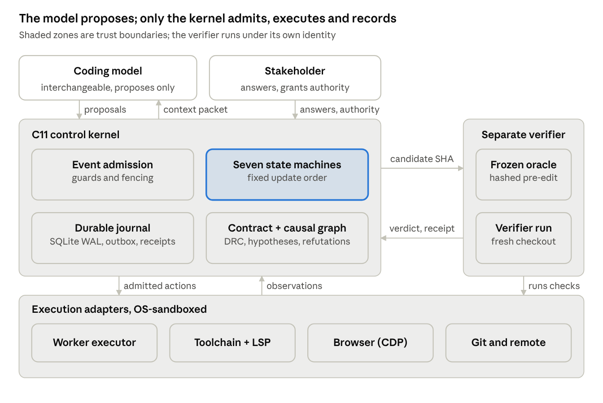

Manuscript v2.0 · Design study and falsifiable research proposal. No implemented, benchmarked or independently validated system is claimed; every number reported below belongs to the cited authors. Authorship, affiliations, competing interests and target venue are declared in the Declarations section before submission.

## Abstract

Autonomous coding agents can edit repositories, run toolchains and iterate on failures, yet a green test run is not evidence that the right behavior was restored. Agents misread the original business objective, assert technical facts they never observed, scan whole machines instead of the authoritative project source, revive refuted hypotheses after context compression, and rewrite the very tests that judge them. Web presentation defects add a further trap: the CSS rule that looks faulty in the source often does not decide the browser's computed style.

We propose **KOTZE Harness** (Kontext, Object, Trajectory, Zero-Trust, Evidence), the control and execution substrate of an autonomous software-repair agent. A coding model plus the harness forms the agent. The harness (i) preserves the original domain requirements as a versioned, hash-bound contract; (ii) admits searches only when they can change a pending engineering decision; (iii) validates the alleged defect before any edit; (iv) localizes faults through bidirectional dynamic slicing and a versioned AND/OR causal graph with explicit falsifiers; (v) separates competing hypotheses, which may run in parallel, from candidate patches, which never share a worktree; and (vi) accepts a repair only when an independent verifier runs a frozen oracle against an exact candidate revision. A compact C11 kernel with SQLite-backed finite-state machines governs requirements, work, diagnosis, trajectory health, patches, verification and external effects, and survives crashes without blind re-execution of uncertain side effects.

The kernel pattern generalizes to any agentic task with external effects and checkable oracles, and it emits evidence-labeled trajectories usable as training signal for agentic learning. We synthesize primary research on clarification, program repair, fault localization, loop behavior and harness design; specify seven state machines with transition tables, a cross-machine coupling order and an invariant catalogue; walk one defect through the full lifecycle; and define a preregisterable factorial evaluation that can show no benefit as well as a benefit. This paper reports a design and a protocol, not measured results.

**Keywords:** automated program repair; coding agents; requirements engineering; fault localization; dynamic slicing; causal graphs; test oracles; finite-state machines; crash consistency; CSS diagnosis; agent harness; preregistration.

## 1 Introduction

Large language models now drive agents that read issues, navigate repositories, run test suites and open pull requests \[3, 4, 7\]. On curated benchmarks these agents resolve a substantial share of real issues. In daily engineering work, however, the dominant failures are rarely syntax errors. They are process failures: the agent starts editing before a material ambiguity is resolved, a later session inherits a shortened summary instead of the original intent, a repository-wide scan replaces the search for the executed entry point, and a green unit test is mistaken for completion of the business objective.

The automated program repair (APR) literature has long known the deeper version of this problem. A patch that passes the available tests is *plausible*, not necessarily *correct* \[21, 22\], and the quality of every repair verdict is bounded by the quality of its oracle \[20\]. LLM agents inherit this weakness and add new ones. They can fabricate package names \[11\], they repeat identical tool calls far more often once their history is compressed \[28\], and long chains of dependent changes expose how quickly early mistakes compound \[31, 32\].

We argue that these failures are best treated as violations of an engineering process rather than as deficits of code generation. Professional repair requires an authoritative specification, bounded observation, admissible intervention, a repeatable acceptance test and an accountable handoff. None of these can live reliably inside a model's mutable context window. They need a deterministic substrate outside the model.

### 1.1 Terminology

We use *harness* in its current sense: the software layer between a model and its task environment, comprising the control loop, tool interface, context management and policies \[24\]. **KOTZE Harness** is such a layer, specialized for autonomous repair. A coding model combined with KOTZE Harness constitutes the autonomous repair agent. The model proposes; the harness decides what is admitted, executes it, records what happened, and determines when work is complete.

The acronym states the design commitments: **K**ontext (task, repository and runtime context are bound to exact revisions), **O**bject (repair targets a concretely identified software object, not a file name), **T**rajectory (the agent's run is observed for progress, loops and stalls), **Z**ero-Trust (no worker certifies its own correctness or permissions) and **E**vidence (done is what reproducible, independent evidence shows).

### 1.2 Contributions

This paper proposes, and does not claim to have validated:

1. **A Domain and Requirements Contract (DRC)** that separates normative truth, observed truth and hypotheses, binds every patch to a requirement or proven cause, and survives every session handoff by hash (Section 6).
2. **A search-admission policy** with an explicit source-of-truth order, which admits a scan only when its result could change a pending decision (Section 7).
3. **Evidence-governed diagnosis** combining failure-inducing chops \[14\], a versioned AND/OR causal graph with mandatory falsifiers, and a probe selector that ranks by discrimination rather than by persuasiveness (Section 8).
4. **A non-racing repair protocol** that allows parallel hypotheses but never parallel writers, using leases with fencing tokens and immutable candidate revisions (Section 9).
5. **A frozen-reproducer verification contract** that separates the author of the oracle from the author of the patch and binds every PASS to an exact candidate hash (Section 10).
6. **A compact C11 control kernel** with seven persistent state machines, a fixed cross-machine coupling order, a transactional outbox and an explicit crash model (Section 11).
7. **A deterministic loop-convergence gate** keyed on canonical execution state rather than message wording (Section 12).
8. **Conditional escalations** for browser-grounded CSS diagnosis, differential C micro-models and controlled rebuilds, each with an admission trigger (Sections 13 and 14).
9. **A preregisterable factorial evaluation** with prespecified endpoints, sample-size reasoning and negative controls, designed so that a null result is a publishable outcome (Section 17).

### 1.3 What is new

Individual mechanisms here, such as slicing, leases or outboxes, are established. To our knowledge, the following insights and their combination for LLM repair agents are not:

1. **Completion as a derived predicate.** Done is computed from hash-bound identities of contract, oracle, candidate and external effects (Section 3.2), so a false DONE becomes a measurable and preventable failure class instead of a model behavior to be prompted away.
2. **Oracle authorship as a role boundary.** The plausibility and overfitting problem of classical APR \[21, 22\] reappears in agents whenever the same worker writes the reproducer and the patch. Separating these roles (Section 10.1) transfers a known property of test-validated repair into an enforceable agent design rule.
3. **Loops defined on execution state.** Defining a loop on a canonical state tuple (Section 12.1) distinguishes legitimate retests from repetition, and gives a training-free, model-independent complement to learned loop suppression \[28\].
4. **Refutations as durable knowledge.** A refuted hypothesis, with its falsifying evidence, survives compaction and session resets as an invariant (I-08), addressing the documented rise of loops under history compression \[28\].
5. **No defect is a success.** RESOLVED\_NO\_DEFECT is a first-class terminal state, and negative controls with no real defect are part of the benchmark, whereas common repair benchmarks presuppose that a defect exists.
6. **The evaluator must be outside the editable surface.** Evidence that harness self-improvement overfits its evolve set \[27\] implies a structural rule: the definition of PASS, the oracle store and the effect model must never be editable by the process that is being improved (Section 15.2).
7. **Preregistered factorial evaluation of harness components.** Harness studies vary components \[24, 25\]; we add a preregistered factorial design with power analysis and negative controls, so each mechanism's contribution and interactions can be estimated and a null result is reportable (Section 17).

### 1.4 Organization

Section 2 reviews related work. Section 3 formalizes the repair task and the failure taxonomy. Section 4 states research questions and hypotheses. Sections 5 to 15 specify the architecture. Section 16 walks one defect through the whole lifecycle. Section 17 defines the evaluation protocol, Section 18 the implementation gates, and Section 19 the threats to validity. Section 20 shows how the design generalizes beyond software repair and why it matters for agentic learning. Appendix A relates the design to existing agent tooling, Appendix B lists the kernel's data contracts and invariants, and Appendix C maps every claim to the place where it is specified and the artifact that will make it checkable.

## 2 Background and Related Work

The literature supports a clear ordering: establish the problem, gather execution-grounded evidence, choose the cheapest informative intervention, preserve memory and verifiability, and add complexity only where a measured benefit is plausible. It does not show that more agents, more retrieval or more tests improve correctness by themselves.

### 2.1 Review method and evidence levels

This is a targeted review of primary publications and first-party technical documentation, current to 12 November 2026. A source was included when it could change a concrete design decision. It is not a PRISMA systematic review or a meta-analysis. We grade sources as **E1** (peer-reviewed venue with a proceedings record), **E2** (preprint, peer review unconfirmed) and **E3** (specification, source release or first-party engineering report). All quantitative results are author-reported and scoped to the cited setting; none is presented as a KOTZE outcome.

### 2.2 Automated program repair and the plausibility problem

Classical APR searches a patch space and validates candidates against a test suite \[1, 2\]. Two findings from that era shape this design. First, test-suite validation admits *plausible but incorrect* patches, often by deleting functionality or special-casing the tested input \[22\]. Second, patches overfit the tests used to produce them, so held-out tests are needed to judge generalization \[21\]. Both are instances of the oracle problem: a verdict is only as good as the oracle that produced it \[20\]. KOTZE therefore treats oracle integrity, not patch generation, as the scarce resource.

### 2.3 LLM coding agents

SWE-bench established repository-level issue resolution as an evaluation target \[3\]. SWE-agent showed that the agent-computer interface itself changes outcomes \[4\]. Agentless demonstrated that a fixed localize-repair-validate pipeline is a strong baseline \[5\]. AutoCodeRover added program-structure-aware search \[6\], OpenHands provides an open generalist platform \[7\], and mini-SWE-agent shows how far a minimal bash-only loop can go \[8\]. Our design takes the last point seriously: the default worker path stays minimal, and every added mechanism must earn its place in an ablation.

### 2.4 Fault localization

Program slicing restricts attention to statements that can affect a value \[12\]; dynamic slicing restricts it further to what actually executed \[13\]. Gupta et al. intersect a forward slice from the failure-inducing input with a backward slice from the wrong output to form a *failure-inducing chop* \[14\], and delta debugging minimizes the input itself \[15\]. Spectrum-based fault localization ranks statements by how strongly their execution correlates with failure; Ochiai is a standard metric \[16\], and a survey maps the wider field \[17\]. Recent LLM systems feed such evidence to the model: TraceRepair uses runtime traces as shared constraints in a multi-agent debate on Defects4J \[18\], and Farzandway and Ghassemi combine SBFL, runtime feedback and structured prompting for C programs \[19\].

### 2.5 Requirements and clarification

An interview study of 18 practitioners at 14 companies found that requirements as documented are too abstract to feed an LLM directly; developers decompose them into programming tasks and enrich them with design decisions and architectural constraints \[9\]. On an underspecified variant of SWE-bench Verified, an uncertainty-aware scaffold that decouples underspecification detection from execution reached 69.40% resolved versus 61.20% for a single-agent setup, in the authors' OpenHands and Claude Sonnet 4.5 configuration \[10\]. Selective clarification helps; indiscriminate questioning is not implied.

### 2.6 Harness design and self-improvement

A controlled study of 176 harness configurations across four models on SWE-Bench Verified and Terminal-Bench 2.1 found that planning, action-space and context-management choices have model- and budget-dependent effects \[24\]. Agentic Harness Engineering makes harness components, trajectories and edit decisions observable and reports pass@1 on Terminal-Bench 2 rising from 69.7% to 77.0% over ten automated iterations \[25\]. Harness² evolves the harness through task-level Propose-Probe-Compose recursion and harnessing-level experience extraction \[26\]. RRSI shows that such recursion overfits its evolve set unless proposal and selection are regularized, reporting gains of up to 4.7 points on five out-of-distribution benchmarks with 30% fewer policy tokens than unregularized evolution \[27\]. We draw one conclusion: self-improvement is admissible only after an independent evaluator with held-out tasks exists.

### 2.7 Long-horizon memory and loops

DeLoop documents that loops, defined as a repeated tool call returning an identical observation, appear natively in several model families and become far more common under history compression; preference training on the agent's own loops reduced the share of Qwen3-8B CodeGym tasks containing loops from 57.3% to 6.1% \[28\]. PMCoder couples a phase planner with episodic memory and replaces self-reported verdicts with script-derived signals, reporting +5.0 percentage points on SWE-bench Verified with Qwen3-Coder-30B \[29\]. Memory is not free: CTIM-Rover found that cross-task episodic memory degraded performance through distracting items \[30\]. Long-horizon benchmarks expose the compounding problem directly: Multi-step SWE chains 5 to 15 dependent steps over 69 tasks \[31\], and on SWE-EVO a leading agent resolved 21% of evolution tasks against 65% on SWE-bench Verified \[32\].

### 2.8 Positioning

| Line of work | What it contributes | What it leaves open | KOTZE decision |
| --- | --- | --- | --- |
| Test-validated APR \[1, 2, 21, 22\] | Search plus validation; overfitting evidence | Oracle trust, requirement fidelity | Frozen, independently executed oracle |
| Minimal agents \[5, 8\] | Strong cheap baselines | Durable state, crash recovery | Minimal default path, kernel outside the model |
| Trace-guided repair \[14, 18, 19\] | Runtime evidence narrows search | Persistence of refuted hypotheses | Versioned causal graph with falsifiers |
| Clarification \[9, 10\] | Selective questions help | Persistence of answers across sessions | Hash-bound DRC |
| Harness evolution \[25, 26, 27\] | Automated improvement | Overfitting, safety-relevant edits | Deferred, held-out gated, kernel excluded |
| Loop research \[28, 29\] | Loop prevalence, memory coupling | Deterministic runtime guard | State-identity loop gate |
| Long-horizon benchmarks \[31, 32\] | Compounding error measurement | Requirement continuity | DRC traceability metrics |

No surveyed system combines requirement preservation, search admission, causal diagnosis, non-racing patches, independent frozen verification and crash-consistent external effects in one deterministic substrate. That combination, not any single mechanism, is the subject of this paper.

## 3 Problem Formulation and Failure Taxonomy

A repair is verified only when a frozen oracle fails on the base revision, passes on the exact candidate, and the governing contract is unchanged in between. This section makes that statement precise and names the seven failure classes the design targets.

### 3.1 Task model

A repair task is a tuple of the original request R, a repository snapshot at base revision b, an execution environment E, a resource budget B and an authority grant A that states which effects are permitted.

$$
\tau = (R,\; S_b,\; E,\; B,\; A)
$$

From R the harness derives a Domain and Requirements Contract C with acceptance contract α and protected constraints π. The contract is sealed by a content hash h(C). An oracle Ω maps a revision and an environment to a verdict, and is frozen with hash h(Ω) before any edit.

$$
\Omega : \text{Rev} \times \text{Env} \rightarrow \{\text{PASS},\; \text{FAIL},\; \text{UNKNOWN}\}
$$

For nondeterministic oracles a verdict is defined over n repeated runs with a predeclared threshold k; anything between the thresholds is UNKNOWN, never PASS.

### 3.2 Verified repair and completed work

Let c be a candidate revision, Reg the set of selected regression checks and Δ(c) the set of paths changed between b and c. A candidate is a *verified repair* when all of the following hold:

$$
V(c) \;\Leftrightarrow\; \Omega(b)=\text{FAIL} \;\wedge\; \Omega(c)=\text{PASS} \;\wedge\; \text{Reg}(c) \;\wedge\; \text{cover}(\alpha, c) \;\wedge\; \text{Id}(c) \;\wedge\; \Delta(c) \subseteq \text{scope}(\pi)
$$

where all selected regression checks pass and the contract and oracle identities are unchanged:

$$
\text{Reg}(c) \;\Leftrightarrow\; \forall \rho \in R_{\text{sel}}:\ \rho(c) = \text{PASS}
$$

$$
\text{Id}(c) \;\Leftrightarrow\; h(C_{\text{active}}) = h(C_{\text{sealed}}) \;\wedge\; h(\Omega_{\text{used}}) = h(\Omega_{\text{frozen}})
$$

The predicate is deliberately conjunctive. A passing test with a changed oracle hash is not a repair. A passing oracle with an uncovered acceptance clause is not a repair. A repair that touches a path outside the authorized scope is not a repair.

Work is *complete* only when the repair is verified, every external effect it caused is confirmed, and every authorized deliverable exists:

$$
\text{Done}(\tau) \;\Leftrightarrow\; V(c) \;\wedge\; \forall e \in \text{Eff}(\tau):\ \text{state}(e) = \text{CONFIRMED} \;\wedge\; \text{Deliv}(\tau) \subseteq \text{Produced}(\tau)
$$

A third outcome is first-class: if the defect cannot be reproduced on b under a trustworthy oracle, or the report contradicts the contract, the correct result is RESOLVED\_NO\_DEFECT with evidence. Inventing a defect to produce a patch is a failure.

### 3.3 Failure taxonomy

| Failure class | Definition | Typical symptom | Primary mechanism | Measured by |
| --- | --- | --- | --- | --- |
| Domain-intent drift | A worker implements a derived interpretation instead of the original requirement | Tests pass, stakeholder rejects behavior | DRC with hash binding (Section 6) | Requirement coverage, drift rate |
| Ungrounded assertion | A fabricated API, package, branch state or test result is treated as fact | Install of a nonexistent package, call to a missing method | Claim classes and provenance (Section 14.3) | Unsupported-assertion rate |
| Unbounded reconnaissance | Search without a plan or source order | Home directory or unrelated project scanned | Search admission (Section 7) | Irrelevant files and bytes scanned |
| Premature causal closure | A local symptom triggers an edit before the executed path is known | Patch in a file that never ran | Chops and causal graph (Section 8) | Wrong-codepath edits |
| Trajectory cycling | Repeated actions or refuted hypotheses return after compression or handoff | Same failing command, same output, again | Loop gate and episode records (Section 12) | Repeated no-information actions |
| Self-certified success | The agent controls or weakens its own oracle | Assertion removed, test skipped | Frozen reproducer, separate roles (Section 10) | Oracle tampering, false-DONE rate |
| Uncontrolled parallel repair | Concurrent writers share a worktree or race to publish | Lost updates, duplicate PRs | Leases, fencing, outbox (Sections 9 and 11) | Lease violations, duplicate effects |

### 3.4 Design principles

1. **The model proposes, the host disposes.** Every action is a proposal until the kernel admits, executes and records it.
2. **Unknown is a state, not a pass.** Missing evidence, flaky results and lost responses remain UNKNOWN until resolved.
3. **Durable before effectful.** State transitions and effect intents are committed before any external side effect is dispatched.
4. **Minimal by default, escalation by evidence.** A mechanism is activated only when a recorded condition calls for it, and kept only when an ablation shows benefit.
5. **Separation of authorship.** The author of an oracle, the author of a patch and the verifier of the patch are distinct roles with distinct write permissions.

## 4 Research Questions and Falsifiable Hypotheses

Three hypotheses (H1 to H3) are confirmatory and tested first in one factorial study; three (H4 to H6) are exploratory and require their own protocol after positive pilot evidence.

| ID | Research question | Hypothesis | Primary endpoint | Falsified if | Status |
| --- | --- | --- | --- | --- | --- |
| H1 | Does contract binding with selective clarification reduce semantic errors compared with a worker that sees only the latest issue text? | The DRC raises independently judged requirement coverage at fixed budget | Verified complete resolution (Section 17.4) | No gain, or more unnecessary questions without a semantic gain | Confirmatory |
| H2 | Does source-of-truth routing plus executed-path diagnosis beat broad search and direct editing? | Diagnosis lowers irrelevant inspection and time to supported cause while raising verified repair | Verified complete resolution; secondary: irrelevant files read | Slower, or more missed causal paths | Confirmatory |
| H3 | Do a state-identity loop gate and a frozen independent verifier improve reliability? | Fewer repeated no-information actions and fewer false-DONE claims without blocking legitimate retests | False-DONE rate; repeated no-information actions | False-block rate above the prespecified margin | Confirmatory |
| H4 | Does browser-measured DOM, CSSOM and layout state produce more correct presentation fixes than source-only CSS editing? | Higher independently accepted layout correctness, fewer global overrides | Accepted layout fix rate | No gain at matched budget | Exploratory |
| H5 | When an implementation is structurally unsound, does a controlled rebuild lineage beat continued patching? | Better lifecycle correctness per cost in a predefined class of repeatedly failing defects | Correctness per cost over a task chain | Interface or migration regressions outweigh gains | Exploratory |
| H6 | Do learned or calibrated probe policies beat deterministic heuristics on held-out projects? | Calibrated gains persist out of distribution | Brier score, verified repair on held-out projects | No transfer, miscalibration or new failure modes | Exploratory |

Each hypothesis is stated so that it can fail. A mechanism whose only effect is higher cost, or whose benefit disappears on held-out tasks, is removed from the default configuration regardless of how plausible it seems.

## 5 System Overview

KOTZE Harness separates three trust zones: a model that may only propose, a kernel that admits, executes and records, and a verifier that judges candidates under its own identity. Everything that touches the outside world runs through sandboxed adapters.

{width=6.3in}

The model never executes anything directly. It proposes an action; the kernel checks the action against the contract, the lease, the budget and the loop gate, records the decision, and only then hands it to an adapter. Observations flow back into the journal and the causal graph, and the next proposal is made from a context packet rebuilt from that state (Section 12.5). A candidate leaves the kernel only as an exact SHA, and only the verifier's receipt can move it to VERIFIED.

### 5.1 Trust boundaries

| Component | Trusted for | Not trusted for |
| --- | --- | --- |
| Coding model | Proposing actions, hypotheses and patches | Any claim about its own correctness, permissions or completion |
| Kernel | Admission, ordering, durable state, budget and effect control | Semantic correctness of a fix |
| Verifier | Executing the frozen oracle on an exact candidate | Choosing or editing its own oracle |
| Adapters | Executing admitted actions and reporting raw observations | Interpreting results or widening scope |
| External evaluator (studies only) | Hidden-oracle judgments in Section 17 | Any role in the product's runtime |

### 5.2 Default path and escalation

The default path is deliberately small: one host-mediated worker, the contract, the reproducer, a bounded diagnosis loop, one candidate and one verifier run. Parallel hypotheses, browser capture, C micro-models, rebuild lineages and learned probe ranking are escalations admitted by recorded triggers (Section 14). This follows the evidence that harness components have model- and budget-dependent returns \[24\] and that minimal loops are strong baselines \[5, 8\].

## 6 Domain and Requirements Contract

The original request is the only authority on what correct behavior means; no model-written summary may overwrite it. The DRC makes that rule enforceable by storing the request, its interpretation and its open questions as versioned, hash-bound records outside the model.

### 6.1 Normative, observed and hypothetical truth

Every task maintains three disjoint sets:

- **N, normative truth:** the original request, authorized stakeholder decisions, business rules, terminology, accepted system contracts and prohibitions.
- **O, observed truth:** exact source revisions, executed traces, UI states, compiler messages, test results and verifier receipts.
- **H, hypotheses:** suspected causes, proposed APIs, implementation options, confidence statements and predicted effects.

Promotion between the sets is one-way and evidence-gated. A hypothesis becomes observed truth only through an execution receipt. Nothing becomes normative truth except through an attributed stakeholder decision, which creates a new contract revision; the old revision stays inspectable.

### 6.2 Contract schema

| Field | Semantics |
| --- | --- |
| contract\_id, revision, digest | Stable identity; every revision immutable and content-hashed |
| original\_request\_ref | Exact original text and attachments, by reference |
| business\_terms | Domain vocabulary, roles, data ownership, exceptions |
| acceptance\_contract | Observable behaviors, each with its evidence source |
| open\_questions | Material uncertainties and the decision each one blocks |
| assumption\_register | Interpretations proposed by the agent; never auto-promoted |
| architecture\_decisions | Approved design choices with rationale |
| protected\_constraints | Security, allowed paths, API and schema contracts, deployment limits |
| trace\_links | Requirement to design element to source element to check to receipt |
| source\_manifest | Authoritative locations with revision, freshness, trust and precedence |

At every handoff the next worker's context is rebuilt from these records. A truncated chat window or a compacted summary may accompany the contract but never replaces it.

### 6.3 Selective clarification

The agent asks a human only when a material ambiguity changes business semantics, scope, risk or an irreversible action, and the approved sources cannot resolve it. The question must present the specific competing interpretations and the consequence of each, not request a restatement. Otherwise the agent proceeds from accepted specifications and existing tests. This operationalizes the observation that developers enrich requirements with design decisions before prompting \[9\] and that selective clarification improves outcomes on underspecified tasks \[10\]. While a question is open, the work item waits in a resumable state (Section 11.3); it is not blocked permanently.

### 6.4 Contract invariants

- **DRC-01** Every patch links to at least one current requirement, supported cause or authorized maintenance objective.
- **DRC-02** A worker cannot change an acceptance condition because its implementation failed.
- **DRC-03** An unverified inference is stored as a hypothesis, never as an observation.
- **DRC-04** At the transitions from diagnosis to repair and from verification to completion, the active contract hash must equal the sealed hash; otherwise affected work is revalidated.
- **DRC-05** A contract amendment invalidates every verification result whose acceptance clauses it touches.

## 7 Source Navigation, Search Admission and the Definition of Done

An agent that scans a whole machine before reading its assigned project is not being thorough; it is violating a search contract. KOTZE replaces open-ended reconnaissance with an ordered source manifest and an admission test for every large search.

### 7.1 Source-of-truth order

Sources are consulted in a fixed precedence. A lower tier is opened only when the higher tiers cannot answer a consequential question.

1. **Assignment evidence:** the original task, the sealed DRC, attached files and recorded decisions.
2. **Repository authority:** the approved repository at its base revision; scoped project instructions; documented contracts and architecture decision records.
3. **Configured project knowledge:** only the documentation index, notes store or knowledge graph explicitly registered for this project.
4. **Active code path:** the exact command, route, UI interaction or failing test, its call chain and immediate dependencies.
5. **Targeted external documentation:** language, tool or library documentation relevant to an open decision.
6. **Broader search:** admitted only by an explicit policy event that records why the narrower tiers were insufficient.

Trust, revision and freshness are part of every retrieved fact. A stale note informs but cannot override an approved contract. A README is evidence of declared design, not proof that the runtime executes it.

### 7.2 Search admission record

Before any search above a configured size, the kernel requires a typed record:

| Field | Question it answers |
| --- | --- |
| proposition | Which exact unresolved claim is being investigated? |
| expected\_source | Which authoritative tier is likely to resolve it? |
| decision\_impact | Which result would change the next engineering decision, and how? |
| scope | What is the smallest directory, document set or endpoint that suffices? |
| limits | Maximum files, bytes, wall time and model or tool calls |

If no outcome would change a decision, the search is denied. A path outside the authorized workspace is denied regardless of the record. Each widening of scope is itself a logged event that names the prior search and why it fell short.

### 7.3 Tool registry: access is not permission

The Model Context Protocol standardizes how an agent reaches tools and data \[42\]; it does not define what the agent should read. KOTZE keeps a governed registry in which every connector records its tool descriptions, privilege scope, expected provenance, request budget and schema identity. Only connectors relevant to the current task are advertised to the worker. Tool output is untrusted data until attested, and instructions found inside tool output, issue text or repository files are never executed as kernel commands. Least privilege and injection resistance follow established guidance \[43\].

### 7.4 Definition of Done as a work contract

A passing local test run is not a finished work item. Completion requires five independent conditions:

1. **Domain correctness:** the behavior meets the approved contract, including exceptions and exclusions.
2. **Technical correctness:** the original failure is present on the base revision, absent on the candidate, and the selected regression and contract checks pass.
3. **Integration correctness:** interfaces, callers, UI behavior, persistence and the relevant execution paths are checked at a depth justified by risk.
4. **Operational completeness:** authorized configuration, migrations, documentation, pull-request artifacts and handoff notes exist.
5. **Evidence integrity:** results are reproducible, bound to exact source and oracle revisions, and independently attested; anything not executed is reported as NOT\_RUN.

### 7.5 Local evidence versus hosted CI

Continuous integration denotes automated build and test checks; it does not require a hosted runner. KOTZE runs lint, compile, unit, integration and focused end-to-end checks locally in an isolated workspace when tools and data are available. Results carry one of four labels: LOCAL\_VERIFIED, HOSTED\_CI\_VERIFIED, PRODUCTION\_VALIDATED or NOT\_RUN. By default no push triggers a hosted workflow and no paid runner is consumed without explicit authority. A check that contacts external services is itself an effect governed by budget and effect policy, and exhausting a local budget is never reinterpreted as permission to use a paid pipeline.

## 8 Bidirectional Diagnosis and the Causal Map

No source line is edited until the reported symptom is reproduced, the executed path is known and a falsifiable cause is supported by evidence. Diagnosis is a sequence of probes that discriminate between live explanations, recorded in one versioned graph.

### 8.1 Challenge the report first

Before any patch, the agent establishes three facts: the symptom occurs at the identified revision and environment; it violates a valid normative requirement; and a faithful reproducer exists. If any is unknown, the next action is evidence collection. Negative controls in the evaluation (Section 17.2) include reports whose "bug" is a stale deployment, a mistaken expectation, a wrong viewport or obsolete documentation. For these, RESOLVED\_NO\_DEFECT is the correct terminal state.

### 8.2 Failure-inducing chops

Let G = (V, E) be an instrumented execution graph, i a failure-inducing input and o an incorrect output. With F(i) the dynamic forward slice of events influenced by i and B(o) the dynamic backward slice of events contributing to o, the candidate fault region is their intersection \[14\]:

$$
C(i, o) = F(i) \cap B(o)
$$

Delta debugging can first shrink i to a minimal failure-inducing input \[15\]. The chop narrows the search; it does not prove that every statement inside it is faulty. Where traces are incomplete, for example across processes, asynchronous callbacks or the browser boundary, the graph records an UNKNOWN\_EDGE rather than inventing a dependency.

### 8.3 A versioned AND/OR causal graph

The CausalMap holds nodes for symptoms, observed conditions, hypotheses, probes, candidate interventions and verified outcomes. Edges are typed MAY\_CAUSE, REQUIRED\_BY, CONTRADICTS, EXPLAINS or AFFECTS. AND nodes encode conditions hypothesized to be jointly necessary; OR nodes encode alternatives. No edge is promoted to certainty without evidence.

Each hypothesis node carries: identity, parent hypotheses, base revision, claim, predicted observation, falsifier, evidence references, status, estimated probe cost and graph revision. Statuses are OPEN, SUPPORTED, REFUTED, INAPPLICABLE and UNKNOWN. A REFUTED node leaves the active frontier but stays in durable history with its falsifying evidence, so the same explanation cannot return later under different wording (Section 12).

The familiar diagnostic views are projections of this one graph: a fishbone groups candidate causes, a backward why-tree follows necessary conditions, a forward consequence tree shows downstream effects, and a DOM/CSS provenance view connects browser symptoms to rules and layout constraints (Section 13.3). None is a separate store of truth.

### 8.4 Statistical ranking is not causal probability

With $n_{ef}$ failing runs that execute element e, $n_{ep}$ passing runs that execute e and $n_{nf}$ failing runs that do not execute e, the Ochiai suspiciousness is \[16\]:

$$
s(e) = \frac{n_{ef}}{\sqrt{(n_{ef} + n_{nf})\,(n_{ef} + n_{ep})}}
$$

The score ranks elements; it is not the probability that e is faulty. Pass and fail counts alone do not yield a posterior. A Bayesian treatment needs priors, likelihoods and an explicit model of interacting causes. The initial system therefore uses deterministic evidence labels plus optional SBFL ranking when coverage is trustworthy, and never displays an uncalibrated score as confidence.

### 8.5 Choose the next probe by discrimination

A probe is worth running when its possible outcomes split the live hypotheses and could change an authorized action. The initial selector is transparent and rule-based: expected discrimination, directness of the oracle, estimated time and cost, information already gathered, and risk. A new model round is never triggered merely because the previous explanation sounds unconvincing.

Once calibrated probabilities exist (Section 14.4), the expected information gain of a probe a with outcome y given evidence E becomes available as a ranking criterion \[44\]:

$$
\text{EIG}(a) = H\left[P(\mathcal{H} \mid E)\right] - \sum_{y} P(y \mid a, E)\, H\left[P(\mathcal{H} \mid E, y)\right]
$$

This is a research option for H6, not a license to turn language-model self-reports into probabilities.

## 9 Competing Hypotheses and Non-Racing Patches

Parallel explanations are allowed because the first hypothesis is often wrong; parallel writers to one worktree are never allowed. KOTZE keeps explanation and modification on separate tracks.

### 9.1 Rules

- Independent hypothesis workers may read the same immutable baseline and the same evidence packet.
- Exactly one writer holds the active lease for a worktree, together with a monotonically increasing fencing token \[47\].
- Alternative candidate patches live in separate worktrees, each with its own parent-commit identity.
- All candidates are judged by the same frozen oracle under the same evaluation budget.
- Merge, publish and deploy effects are serialized and compare the target revision immediately before acting.
- Output from a worker whose lease expired or was fenced is rejected, however plausible it looks.

### 9.2 Fencing

A lease alone does not prevent a stalled worker from waking up and writing after its lease expired. Every write carries the token issued with the lease; the kernel rejects any token lower than the highest token it has issued for that worktree. This turns a race into a deterministic rejection.

### 9.3 Bounded second thought

At consequential decisions, such as admitting a cause or sealing a candidate, the kernel may request one bounded reconsideration. Its input is a single local claim with the relevant facts, constraints and expected consequence. Its output is OK, LOOK\_AGAIN or WARNING plus the cheapest decisive check. It is read-only, non-recursive and cannot rewrite the task. Its value must be measured against an equally expensive self-reconsideration control, not against a run with fewer tokens.

### 9.4 Search trees are not explanations

Execution-grounded tree search over candidate programs can help on function-level tasks; ReMCTS reports gains over direct generation in 8 of 10 model and dataset pairs on HumanEval and MBPP-Sanitized \[34\]. Repository-scale effects remain unproven. In KOTZE, a search branch represents a candidate program version, while the causal graph represents explanations. Keeping the two apart prevents a plausible patch lineage from being mistaken for a demonstrated cause.

## 10 Frozen Reproducer and Independent Verification

The oracle that judges a repair is fixed, hashed and stored out of the patch writer's reach before the first edit. This section defines who may write it, what it must contain and how the verifier uses it.

### 10.1 Who writes the oracle

Many issues arrive without any failing test, so the reproducer is often written by the system itself. If the same worker writes the reproducer and the patch, the oracle becomes self-certifying. KOTZE therefore separates three roles:

| Role | May write | May not write |
| --- | --- | --- |
| Reproducer author | Reproducer files in a quarantined path | Source under repair, existing acceptance tests |
| Patch writer | Source within the authorized scope; additional tests | The frozen reproducer, trusted acceptance tests |
| Verifier | Verification receipts only | Any repository content |

Before freezing, the reproducer is checked against the DRC: each acceptance clause it claims to cover must be traceable to an assertion, and it must fail on the base revision under the declared repetition policy. A reproducer that passes on the base revision cannot support any repair claim. PMCoder applies a related filter, retaining only reproduction scripts that fail on the unmodified repository \[29\]. In evaluation, benchmark hidden tests serve as an additional external oracle that neither role can see.

### 10.2 Reproducer contract

```json
{
  "schema": "reproducer/1",
  "work_id": "opaque-id",
  "contract_hash": "sha256-of-sealed-DRC",
  "base_sha": "git-commit-id",
  "entrypoint": {"type": "argv", "argv": ["python", "-m", "pytest", "tests/test_issue.py", "-q"]},
  "cwd": "relative-workspace-dir",
  "env_allowlist": ["TZ", "PYTHONHASHSEED"],
  "timeout_ms": 60000,
  "oracle": {"kind": "assertion-id", "identity": "issue-regression"},
  "covers": ["acceptance:AC-2"],
  "repeat": {"n": 5, "fail_threshold": 5, "pass_threshold": 5},
  "author_role": "reproducer",
  "oracle_hash": "sha256-value",
  "frozen_artifacts": ["sha256-value"],
  "allowed_paths": ["src/"]
}
```

This is a schema illustration, not a selected test case. The thresholds are declared per task before execution; results between them are UNKNOWN. A flaky task needs a predeclared statistical rule, not a fabricated certainty.

### 10.3 Verification semantics

The verifier runs under its own identity. It checks out the candidate commit fresh, overlays the frozen artifacts from trusted storage, and executes the original failing path. It records candidate SHA, oracle hash, environment digest, verdict, provenance and artifact references. It then runs regression and requirement-specific checks proportionate to risk. The verdict is one of PASS, FAIL, INCONCLUSIVE or STALE, and any later change to the candidate or the oracle makes it STALE.

A zero exit code proves only that one command exited successfully. A peer model's approval is advisory and never substitutes for executable evidence.

### 10.4 Test quality beyond test count

Property-based testing \[38\] fits where an independently justified invariant exists. Mutation analysis \[39\] measures whether a suite detects classes of injected faults, but the literature supports no universal mutation-score threshold that proves correctness. Bounded formal checks are valuable for narrow properties, for example inside a C micro-model (Section 14.1), and are not a test of a whole web application.

## 11 Durable Control Kernel and State Machines

Completion is a state the kernel derives from independent evidence, never a word a worker emits. Seven persistent finite-state machines, updated in one fixed order inside one transaction per event, make that derivation deterministic and crash-safe.

### 11.1 Kernel boundaries

The kernel is specified in C11. It holds the state machines, event admission, budget reservation, leases, receipts and reconciliation. SQLite in write-ahead-log mode provides the durable journal. A small JSON parser for the line-oriented IPC protocol, a SHA-256 implementation, a Git command adapter and an OS process-isolation layer complete the interface. Language analysis and model inference stay in external adapters. C provides neither semantic correctness nor memory safety; the kernel is kept small and built with sanitizers, fuzzed at every parser boundary and checked with explicit bounds and ownership rules.

The machines are RequirementFSM, WorkFSM, DiagnosisFSM, TrajectoryFSM, PatchFSM, VerificationFSM and EffectFSM. A separate improvement process consumes only verified outcomes (Section 15). Every transition records work\_id, object\_id, base revision, actor, event\_id, timestamp and the guard that admitted it. Event keys are deduplicated, so a replayed event never creates a second work identity.

### 11.2 RequirementFSM

| State | Event | Guard | Action | Next |
| --- | --- | --- | --- | --- |
| RECEIVED | SOURCES\_RESOLVED | Task text and authoritative sources identified | Preserve request and manifest | INTERPRETING |
| INTERPRETING | CONTRACT\_COMPLETE | Mandatory behaviors and constraints explicit | Seal contract hash | VALIDATED |
| INTERPRETING | MATERIAL\_AMBIGUITY | Open choice changes semantics, scope or risk | Write one precise question | NEEDS\_CLARIFICATION |
| NEEDS\_CLARIFICATION | AUTHORIZED\_ANSWER | Answering authority verified | Add revision and trace link | INTERPRETING |
| VALIDATED | REQUEST\_CHANGE | Authorized amendment | New revision; invalidate affected checks | INTERPRETING |
| any active | SOURCE\_CONFLICT | Authoritative facts incompatible | Record contradiction | BLOCKED |
| BLOCKED | AUTHORIZED\_RESOLUTION | Conflict resolved by authority | Record decision | INTERPRETING |

### 11.3 WorkFSM

Three properties shape the WorkFSM: a clarification never dead-ends, a refuted report ends in its own successful terminal state, and completion waits for confirmed delivery whenever delivery is authorized.

| State | Event | Guard | Action | Next |
| --- | --- | --- | --- | --- |
| NEW | ACCEPT | Authorized scope and budget | Allocate work identity | REQUIREMENTS |
| REQUIREMENTS | CONTRACT\_VALID | Requirement VALIDATED, hash sealed | Request reproducer | REPRODUCING |
| REQUIREMENTS | CLARIFICATION\_NEEDED | Requirement NEEDS\_CLARIFICATION | Publish question, keep budget reserved | AWAITING\_CLARIFICATION |
| AWAITING\_CLARIFICATION | AUTHORIZED\_ANSWER | Requirement back in INTERPRETING | Resume | REQUIREMENTS |
| AWAITING\_CLARIFICATION | ANSWER\_TIMEOUT | Deadline passed | Release reservation, record reason | BLOCKED |
| REPRODUCING | FAILURE\_CONFIRMED | Frozen reproducer fails on base at threshold | Store baseline receipt | DIAGNOSING |
| REPRODUCING | DEFECT\_REFUTED | Trustworthy oracle passes on base, or report contradicts contract | Store evidence | RESOLVED\_NO\_DEFECT |
| REPRODUCING | REPRO\_UNKNOWN | Verdict between thresholds or no reproducer within budget | Preserve attempts | BLOCKED |
| DIAGNOSING | NEED\_PROBE | Probe admitted (Section 8.5) | Record bounded probe | DIAGNOSING |
| DIAGNOSING | CAUSE\_SUPPORTED | Discriminating evidence; scope allowed; DRC hash unchanged | Allocate patch attempt | REPAIRING |
| DIAGNOSING | REBUILD\_ADMITTED | Rebuild trigger met (Section 14.2) | Open rebuild lineage | REPAIRING |
| DIAGNOSING | EXHAUSTED | Diagnosis budget or recomposition limit reached | Preserve evidence | BLOCKED |
| REPAIRING | CANDIDATE\_SEALED | Valid lease, fencing token and candidate SHA | Enqueue verifier | VERIFYING |
| REPAIRING | PATCH\_INVALID | Scope, lease or build guard fails | Keep failed attempt | DIAGNOSING |
| REPAIRING | BUDGET\_EXHAUSTED | Repair budget consumed | Preserve candidates | BLOCKED |
| VERIFYING | INDEPENDENT\_PASS | V(c) holds; no delivery authorized | Seal receipts | COMPLETED |
| VERIFYING | INDEPENDENT\_PASS | V(c) holds; delivery authorized | Write delivery intent to outbox | DELIVERING |
| VERIFYING | FAIL | Original failure remains or regression found | Record counterexample | DIAGNOSING |
| VERIFYING | INCONCLUSIVE | Unreliable or missing verification | Suspend completion | BLOCKED |
| VERIFYING | CONTRACT\_AMENDED | DRC revision changed | Invalidate verification | REQUIREMENTS |
| DELIVERING | DELIVERY\_CONFIRMED | Patch DELIVERED; all effects CONFIRMED | Seal receipts | COMPLETED |
| DELIVERING | EFFECT\_UNKNOWN | Delivery outcome uncertain | Fence, start reconciliation | RECOVERING |
| any active | INTERRUPTED | Checkpoint exists | Fence worker, store resume\_state | RECOVERING |
| RECOVERING | RECONCILED | Safe state and contract hash restored | Resume | resume\_state |
| RECOVERING | UNSAFE | External effect unresolved | Record and suspend | BLOCKED |
| BLOCKED | AUTHORIZED\_RESUME | New evidence, budget or authority recorded | Re-admit | resume\_state |
| any non-terminal | CANCEL | Authorized cancellation | Release leases and reservations | CANCELLED |

Terminal states are COMPLETED, RESOLVED\_NO\_DEFECT and CANCELLED. BLOCKED is not terminal: it is a complete, honest report that waits for a recorded reason to continue.

### 11.4 DiagnosisFSM

| State | Event | Guard | Action | Next |
| --- | --- | --- | --- | --- |
| ENTRYPOINT\_UNKNOWN | ENTRYPOINT\_RESOLVED | Command, route or test identified | Record entry point | REPRODUCER\_PENDING |
| REPRODUCER\_PENDING | REPRO\_FROZEN\_FAILING | Fails on base at threshold; covers an acceptance clause | Freeze oracle | REPRODUCED |
| REPRODUCER\_PENDING | REPRO\_PASSES\_ON\_BASE | Trustworthy pass on base | Record evidence | NOT\_REPRODUCED |
| REPRODUCED | TRACE\_CAPTURED | Executed path recorded with provenance | Compute chop | PATH\_TRACED |
| PATH\_TRACED | HYPOTHESIS\_ADDED | Claim, prediction and falsifier present | Add graph node | HYPOTHESES\_OPEN |
| HYPOTHESES\_OPEN | PROBE\_REFUTES | Prediction contradicted | Mark REFUTED, keep history | HYPOTHESES\_OPEN |
| HYPOTHESES\_OPEN | PROBE\_SUPPORTS | Discriminating support, no live rival | Mark SUPPORTED | CAUSE\_SUPPORTED |
| HYPOTHESES\_OPEN | FRONTIER\_EXHAUSTED | No live hypothesis, or refutations reach r\_max | Re-examine entry point and scope | RECOMPOSING |
| RECOMPOSING | NEW\_ENTRYPOINT | Different executed path identified | Record why the prior one was wrong | REPRODUCER\_PENDING |
| RECOMPOSING | RECOMPOSE\_EXHAUSTED | Recomposition budget used | Preserve graph | EVIDENCE\_INSUFFICIENT |
| CAUSE\_SUPPORTED | VERIFIER\_COUNTEREXAMPLE | Patch failed verification | Reopen with counterexample | HYPOTHESES\_OPEN |

NOT\_REPRODUCED drives WorkFSM DEFECT\_REFUTED or REPRO\_UNKNOWN, depending on whether the base-revision verdict cleared the pass threshold. EVIDENCE\_INSUFFICIENT drives EXHAUSTED. No speculative edit is admitted from either state.

### 11.5 TrajectoryFSM

The trajectory machine watches the worker's observable actions and artifacts, never private reasoning. It distinguishes activity from progress: a progress event is a durable, decision-relevant change as defined in Section 12.3.

| State | Event | Guard | Action | Next |
| --- | --- | --- | --- | --- |
| HEALTHY | PROGRESS\_EVENT | Durable, decision-relevant change | Reset stall window | HEALTHY |
| HEALTHY | REPEAT\_PATTERN | Same action fingerprint seen again | Flag | SUSPECT |
| HEALTHY | NO\_PROGRESS\_WINDOW | No progress event within window w | Flag | STALLED |
| SUSPECT, STALLED | PROBE\_ISSUED | Cheap diagnostic probe admitted | Ask the targeted question | PROBING |
| PROBING | PROGRESS\_EVENT | Probe produced new evidence | Clear flag | HEALTHY |
| PROBING | REPEAT\_CONFIRMED | Identical state tuple and outcome (Section 12.1) | DENY\_REPEAT | LOOPING |
| any active | OSCILLATION | Alternation between two phases or hypotheses at least m times | Freeze branch choice | THRASHING |
| LOOPING, THRASHING | REVIVE | Revival budget left; last-known-good checkpoint | Restart from canonical state | REVIVED |
| REVIVED | PROGRESS\_EVENT | New evidence after revival | Close incident | HEALTHY |
| LOOPING, THRASHING, STALLED | REVIVAL\_EXHAUSTED | Revival budget used | Report with evidence | DISCHARGED |

DISCHARGED drives WorkFSM to BLOCKED. A worker's DONE message never overrides it.

### 11.6 PatchFSM

| State | Event | Guard | Action | Next |
| --- | --- | --- | --- | --- |
| PROPOSED | ADMIT | Base, DRC hash and scope valid | Reserve write lease | ADMITTED |
| PROPOSED | REJECT | Unauthorized or ungrounded change | Persist reason | REJECTED |
| ADMITTED | BEGIN | Current fencing token | Journal intent | APPLYING |
| APPLYING | CANDIDATE\_CREATED | Only authorized paths changed; hash captured | Seal candidate SHA | CANDIDATE |
| APPLYING | INTERRUPTED | Partial artifacts possible | Fence and preserve | INCONCLUSIVE |
| CANDIDATE | CHECKS\_REQUESTED | Frozen oracle exists | Bind verifier request to SHA | TEST\_PENDING |
| TEST\_PENDING | VERIFIER\_PASS | Independent result for same SHA and oracle hash | Seal proof | VERIFIED |
| TEST\_PENDING | VERIFIER\_FAIL | Defect or regression remains | Store counterexample | REJECTED |
| TEST\_PENDING | VERIFIER\_UNKNOWN | Incomplete or untrusted observation | Preserve uncertainty | INCONCLUSIVE |
| INCONCLUSIVE | REVERIFY\_AUTHORIZED | Cause of uncertainty addressed | Rebind request | TEST\_PENDING |
| INCONCLUSIVE | ABANDON | Authorized | Persist reason | REJECTED |
| CANDIDATE, TEST\_PENDING, VERIFIED | SHA\_CHANGED | Any edit to the candidate | Create successor candidate | SUPERSEDED |
| VERIFIED | TARGET\_MOVED | Target branch advanced since verification | Rebase in new candidate | SUPERSEDED |
| VERIFIED | PUBLISH\_AUTHORIZED | Target revision unchanged; rights valid | Outbox intent | DELIVERY\_PENDING |
| DELIVERY\_PENDING | CONFIRMED | Remote state matches intent | Seal receipt | DELIVERED |
| DELIVERY\_PENDING | UNKNOWN | Response lost or ambiguous | Probe remote state | SUSPENDED |
| SUSPENDED | REMOTE\_PRESENT | Probe finds the effect | Seal receipt | DELIVERED |
| SUSPENDED | REMOTE\_ABSENT | Probe proves absence; idempotency key valid | Re-arm intent | DELIVERY\_PENDING |

Terminal states are DELIVERED, REJECTED and SUPERSEDED. A superseded candidate keeps its history and verdicts; its successor starts verification from scratch.

### 11.7 VerificationFSM

| State | Event | Guard | Action | Next |
| --- | --- | --- | --- | --- |
| UNCONFIGURED | BASELINE\_RECORDED | Frozen oracle fails on base at threshold | Store baseline receipt | BASELINE\_CAPTURED |
| BASELINE\_CAPTURED | CHECKS\_FROZEN | Oracle and regression selection hashed | Fix check list | CHECKS\_FROZEN |
| CHECKS\_FROZEN | RUN\_REQUESTED | Candidate SHA bound; verifier identity separate | Fresh checkout | RUNNING |
| RUNNING | RESULT\_PASS | All required checks pass at threshold | Record receipt | PASS |
| RUNNING | RESULT\_FAIL | Original failure or regression observed | Record counterexample | FAIL |
| RUNNING | RESULT\_UNKNOWN | Timeout, flakiness or missing evidence | Record gap | INCONCLUSIVE |
| PASS, FAIL, INCONCLUSIVE | IDENTITY\_CHANGED | Candidate, oracle, environment or contract changed | Invalidate | STALE |
| STALE | RUN\_REQUESTED | Checks still valid for the new identity | Fresh checkout | RUNNING |
| STALE | CHECKS\_INVALIDATED | DRC amendment touched covered clauses | Reselect checks | BASELINE\_CAPTURED |
| INCONCLUSIVE | RERUN\_AUTHORIZED | Cause addressed or more samples authorized | Fresh checkout | RUNNING |

UNCONFIGURED, meaning no acceptance contract or no failing baseline, can never yield PASS.

### 11.8 EffectFSM

| State | Event | Guard | Action | Next |
| --- | --- | --- | --- | --- |
| PLANNED | AUTHORIZE | Effect class permitted by authority grant | Record authority | AUTHORIZED |
| AUTHORIZED | RESERVE | Budget reserved; idempotency key assigned | Write outbox row | RESERVED |
| RESERVED | DISPATCH | Enclosing transaction committed | Call external system | DISPATCHED |
| DISPATCHED | RECEIPT\_OK | Definitive success | Store receipt | CONFIRMED |
| DISPATCHED | RECEIPT\_ERROR | Definitive failure, no side effect | Store error | FAILED |
| DISPATCHED | TIMEOUT\_OR\_CRASH | No definitive receipt | Mark uncertain | UNKNOWN |
| UNKNOWN | PROBE | Read-only query of external state | Compare with intent | RECONCILING |
| RECONCILING | STATE\_PRESENT | External state matches intent | Store receipt | CONFIRMED |
| RECONCILING | STATE\_ABSENT | Absence proven; key still valid | Re-arm | RESERVED |
| RECONCILING | INDETERMINATE | Cannot decide | Stop | SUSPENDED |
| SUSPENDED | AUTHORIZED\_RESOLUTION | Human or policy decision recorded | Apply decision | CONFIRMED or FAILED |

An UNKNOWN effect is never retried blindly, and while any effect of a work item is not CONFIRMED or FAILED, that item cannot reach COMPLETED.

### 11.9 Coupling order and cross-machine triggers

One canonical handler processes each admitted event inside a single SQLite transaction, in this order:

1. Validate event identity, work revision, DRC hash, permissions, lease fencing and reserved budget.
2. Persist raw observation identifiers and immutable evidence hashes.
3. Update RequirementFSM and the causal-graph revision.
4. Update DiagnosisFSM and PatchFSM.
5. Invalidate VerificationFSM when candidate, oracle, environment or contract identity changed.
6. Apply TrajectoryFSM and EffectFSM implications.
7. Derive WorkFSM eligibility, including contract coverage and unknown-effect blocks.
8. Write outbox intents and accounting entries, increment revisions, commit.

Only after commit may a dispatcher perform an external effect, which is the transactional outbox pattern \[48\].

| Trigger | Required effect | Prohibited effect |
| --- | --- | --- |
| DRC\_REVISION\_CHANGED | Invalidate affected oracle and checks; revalidate work | Inherit outdated acceptance |
| CLARIFICATION\_REQUESTED | Work to AWAITING\_CLARIFICATION | Proceed on an assumption |
| DEFECT\_REFUTED | Work to RESOLVED\_NO\_DEFECT | Generate a patch anyway |
| PATCH\_SHA\_CHANGED | Verification to STALE; old patch SUPERSEDED | Reuse an old PASS |
| ORACLE\_HASH\_CHANGED | Restart verifier setup; flag for review | Silently weaken a test |
| HYPOTHESIS\_REFUTED | Prune from frontier; retain history | Repeat without new evidence |
| TRAJECTORY\_DISCHARGED | Work to BLOCKED | Override with worker DONE |
| EFFECT\_UNKNOWN | Block Work COMPLETED pending reconciliation | Blind redispatch |
| WRITE\_LEASE\_EXPIRED | Reject late writer output | Accept the race winner |
| TARGET\_REVISION\_MOVED | Patch SUPERSEDED; reverify successor | Publish against a stale base |
| LOCAL\_TEST\_PASS | Record local evidence only | Claim domain completion |
| INDEPENDENT\_ORACLE\_PASS | Advance patch, then check all work guards | Bypass requirement coverage |
| PATCH\_DELIVERED | Work to COMPLETED if all effects CONFIRMED | Complete with an UNKNOWN effect |
| IMPROVEMENT\_PROPOSED | Create a separate experiment record | Mutate a frozen oracle |

### 11.10 Crash model and the limits of exactly-once

The kernel distinguishes three action classes. A **pure transition** has no external effect and is recomputed from the journal after restart. An **idempotent effect** may be reissued with the same idempotency key when the external system deduplicates it. An **unknown external effect** may already have happened; it is probed and reconciled, or suspended.

Crash injection covers at least these points: after journal commit and before dispatch; after dispatch and before receipt; during worker tool execution; after a candidate is written and before its seal; during verification; after a lost publication response; and on arrival of output from an expired lease. A pushed branch or an opened pull request may exist although its response was lost, so the remote state is always probed first. The guarantee is no unintended duplicate effect under the documented effect model, not universal exactly-once semantics across arbitrary external APIs.

## 12 Loop-Convergence Gate and Context Reconstruction

A loop is a repeated action under materially unchanged state with no expected information gain; rerunning a test after a patch is not a loop. The gate compares canonical execution state, not the wording of successive model messages, and the context packet is rebuilt from that state at every session boundary.

### 12.1 State identity

For each admitted action the kernel records the tuple:

$$
\kappa = (\textit{work},\, h(C),\, b,\, c,\, h(\Omega),\, \textit{env},\, \textit{hyp},\, \textit{act},\, \textit{ev},\, \textit{out})
$$

with work identity, contract hash, base and candidate revision, oracle hash, environment digest, active hypothesis, normalized action digest (operation type plus argv or request), evidence revision and outcome digest. Before an action repeats, the kernel asks which component of the tuple changed and whether that change could alter the outcome.

### 12.2 Admission rules

| Observation | Disposition | Rationale |
| --- | --- | --- |
| Same action, same source, environment and oracle, same prior outcome, no new discriminating evidence | DENY\_REPEAT, then RECOMPOSE | No expected information |
| Same test command after a candidate or relevant input changed | ALLOW\_RETEST | Tests changed program state |
| Same command under a changed environment digest | ALLOW\_RETEST, record environment delta | Environment is part of the question |
| Flaky oracle within the predeclared sampling plan | ALLOW\_SAMPLE until n reached | Sampling is the declared method |
| Compaction or restart cycle with no new durable event | STOP\_COMPACT\_LOOP, rebuild from canonical state | Re-injecting the same transcript adds nothing |
| A refuted hypothesis is proposed again | REJECT\_HYPOTHESIS unless new falsifier-relevant evidence is cited | Refutations survive session resets |
| No admissible probe within budget | BLOCKED\_WITH\_EVIDENCE | Activity is not progress |
| An acceptance clause lacks verified coverage | REMAIN\_INCOMPLETE | A technical stop cannot close the work |

A fixed retry count is a resource limit, not a correctness policy. Numeric ceilings remain for safety; whether a retry is legitimate depends on a changed candidate, environment or diagnostic question.

### 12.3 What counts as progress

A progress event is a durable, decision-relevant change: a new verified runtime observation, a refuted hypothesis, a supported causal relation, a new candidate revision, an independent verification outcome, or an authorized contract change. Reading more tokens, writing another summary or repeating a tool call is not progress. The definition is operational and must be tested for false blocks on slow but valid tasks (Section 17.6).

### 12.4 Relation to learned loop suppression

DeLoop reduces loops by preference training on the agent's own repeated actions \[28\]. KOTZE instead enforces a deterministic runtime constraint that needs no training and works with any model. The two are complementary, and the training result is not evidence that the rule-based gate will perform the same way; the gate needs its own false-positive and benefit evaluation.

### 12.5 Context packet at handoff

The next worker receives a packet derived from canonical state, never from the previous transcript alone:

1. Exact DRC revision and the original objective.
2. Current base and candidate revisions and the failing runtime path.
3. Observations with their evidence identifiers.
4. Supported, refuted and open hypotheses, refutations with their falsifying evidence.
5. Completed work, uncovered acceptance clauses and safety constraints.
6. The smallest justified next action.

Raw transcripts stay available by reference but are not loaded by default. Compaction may shorten, never promote: an unsupported explanation cannot become a fact by being summarized. This mirrors the practice of persisting structured progress artifacts across sessions documented for long-running agents \[52\], and the evidence-coupled memory of PMCoder \[29\], while respecting the finding that indiscriminate episodic memory can add noise \[30\].

## 13 Capability Discovery and Browser-Grounded Diagnosis

The kernel knows how to authorize, record and reconcile an action; it does not embed any programming language. Language knowledge comes from the project's own tools, observed at runtime, and web presentation defects get their own observation path because the source rule that looks wrong often does not decide what the browser renders.

### 13.1 Discovery order

1. **Repository manifest:** file types, build and package manifests, lockfiles, project instructions, tool versions.
2. **Standard tooling:** compiler or interpreter, type checker, test runner and linter, each invoked under a bounded argv, working-directory and environment contract.
3. **Language Server Protocol, when present:** diagnostics, definitions, references, workspace symbols and types through a versioned protocol \[41\].
4. **Runtime observation:** tracebacks, runtime diagnostics, browser DOM and CSSOM, framework bootstrap state, compiler sanitizers.
5. **Conditional skills:** specialized diagnostic procedures for a language, framework or proprietary DSL, loaded only when a recorded condition calls for them.

Discovery records availability, not correctness. A language server does not replace a compiler, a runtime trace or an independent oracle. If a tool is missing, the agent reports the limitation and may use an explicitly authorized alternative; it never reports a tool run that did not happen. Project instruction files are useful local guidance, not authority to override safety rules or the user.

### 13.2 Why CSS needs its own observation path

A declaration in the source may lose to another rule through origin, cascade layer, importance, specificity, source order, inheritance, media or container queries, pseudo-elements or inline styles. Layout additionally depends on containing blocks, intrinsic sizing in flex and grid, overflow, transforms, fonts and device geometry. Searching the repository for a class name does not identify the winning declaration.

The browser adapter therefore records: exact URL and build, viewport and device scale, interaction sequence, target node and its ancestor chain, loaded stylesheets with content hashes, matched rules, computed styles, layout boxes, a screenshot and accessibility tree, and console and network errors. The Chrome DevTools Protocol exposes matched and computed styles and DOM snapshots for this purpose \[40\]. What the browser shows is observed behavior; what the contract says is the specification.

### 13.3 CSS repair procedure

1. Reproduce the defect at a fixed viewport and interaction state.
2. Identify the DOM node, the computed property that contradicts an approved requirement, the winning declaration and the upstream layout constraints.
3. Confirm that the deployed stylesheet matches the expected source revision before editing anything.
4. Write the smallest source-grounded change at the rule that actually wins or should win.
5. Re-render the original scenario plus adjacent viewports and interaction states named in the contract.

Two negative controls belong to every CSS benchmark slice: a stale deployed asset, where no source change should be accepted, and a correct layout judged against an outdated reference image. Success at one viewport supports no claim about all viewports.

### 13.4 Linked diagnostic views

An optional interface shows four linked projections of the causal graph: a fishbone of candidate causes, a backward tree from requirement to cause, a forward consequence tree, and a DOM/CSS provenance map. Each node displays its evidence status and links to a source revision, a trace or an explicit uncertainty. No click in the interface can promote a hypothesis to verified.

## 14 Conditional Escalation

Every mechanism in this section is off by default and admitted only by a recorded trigger. Each must beat the cheaper default in its own ablation before it may stay.

| Escalation | Trigger | Bound | Rejected when |
| --- | --- | --- | --- |
| C micro-model | At least two evidence-supported hypotheses survive initial probes; the computation reduces to a bounded state machine; estimated benefit exceeds modeling cost | Model size and checker time budget | It fails to reproduce the original observable behavior |
| Controlled rebuild | Repeated minimal patches demonstrably add coupling, special cases or architecture violations; behavior contracts bound the replacement | Same DRC, interfaces, reproducer and oracle hashes | Interface, migration or regression failures |
| Parallel hypotheses | Several plausible causes, high uncertainty, high repair value | Shared total budget; separate worktrees | Cost per verified repair rises faster than success |
| Calibrated probe ranking | Enough independently labeled episodes for calibration | Held-out projects | Fails to beat the deterministic selector |

### 14.1 Differential C micro-models

For a defect in bounded algorithmic or state-machine logic, the agent may write a small C reference model of the relevant inputs, transitions, invariants and failure conditions. A bounded model checker such as CBMC \[36\] or symbolic execution with KLEE \[37\] can then return concrete counterexamples. The model makes state explicit and can shorten diagnosis.

It is a diagnostic instrument, not a transpiler. It is unsuitable by default for browser layout and can misrepresent dynamic typing, coercion rules, Unicode handling, arbitrary-precision integers, exceptions, asynchronous scheduling or foreign-library behavior. Every insight from the model must be confirmed by a differential test on the original runtime with specified inputs. A model that fails to reproduce the original observable behavior is rejected as an explanation.

### 14.2 Repair versus controlled rebuild

Rewriting must not erase domain evidence. A rebuild lineage starts from the same DRC, allowed interfaces, frozen reproducer, oracle hashes and scope constraints as the repair lineage, replaces the defective implementation in a separate worktree, and is judged by the same acceptance suite plus compatibility checks. It is never admitted because a worker finds the old code untidy. Work on competitive-programming submissions studies how far LLM fixes deviate from the buggy solution and whether models tend toward entirely new solutions \[33\]; that motivates comparing the two strategies, not a belief that rewriting mature systems is safer.

### 14.3 Recognizing fabrication

Every claim the system stores carries one of five classes: observed, retrieved, inferred, proposed or unverifiable. Factual claims about package names, endpoints, configuration options, compiler diagnostics, database columns or prior work require a source locator or an execution receipt. A new dependency is checked against the approved registry and the project manifests before installation; package names generated by models are a documented supply-chain risk \[11\]. A new algorithm labeled as a proposal is not a fabrication. A claim that a nonexistent API already exists is. The remedy is provenance and controlled execution, not a ban on creativity.

### 14.4 Calibrated probe ranking

Once enough episodes have independently verified labels, a small statistical or Bayesian model may rank probes by expected information gain (Section 8.5). Before it replaces the deterministic selector it must show, on held-out projects, better calibration measured by reliability diagrams and the Brier score \[45\], and better verified repair per cost. Repeated model opinions on the same failure are not independent observations and never serve as labels.

## 15 Continual Improvement and Professional Completion

Repair restores a behavior; improvement asks why the defect arose and why nothing caught it earlier. The two share the causal graph but run as separate processes, and improvement may never touch a frozen oracle or the kernel's safety rules.

### 15.1 From repaired defect to prevented recurrence

The improvement process adapts established quality-engineering ideas: cause-and-effect mapping and the 5 Whys \[49\], stopping the propagation of abnormalities (jidoka) and mistake-proofing (poka-yoke) \[50\], and plan-do-check-act cycles with measured recurrence. These are conceptual transfers; no numerical result from manufacturing is assumed to carry over to coding agents.

A recurrence-prevention proposal contains: the affected cause class, the concrete verified failures behind it, the proposed check or invariant, its expected effect and cost, and a versioned experiment design. It may target source code, a regression test, compiler settings, documentation, capability routing or a tool policy. It is evaluated against a frozen control and rejected if it raises cost, false blocks or the regression escape rate.

### 15.2 Selective self-improvement of the harness

Automated harness evolution can yield real gains \[25, 26\], and it overfits its evolve set unless regularized \[27\]. KOTZE therefore defers self-modification until three things exist: a repair baseline, an independent evaluator outside the product's trust boundary, and held-out tasks. The editable surface is restricted to a versioned list of configuration items such as prompt profiles, tool policies, context filters, test-selection rules and repair strategies. Authorization and secret handling, the definition of PASS evidence, journal and effect integrity, budget semantics and sandbox boundaries are outside the editable surface. Candidates for those components may be developed on a quarantine branch but are never promoted automatically.

### 15.3 Professional completion

A task is professionally complete only when the requirements, the original defect, dependent interfaces, relevant regressions, configuration and documentation, and every explicitly authorized deliverable have been independently checked. A pull request, an attractive diff, a passing CI-style run or a DONE message is not, by itself, a completed work item.

## 16 Worked Example

One illustrative defect shows how the mechanisms interact: the first hypothesis is wrong, the worker crashes mid-repair, and a pull-request response is lost, yet the item completes without a duplicate effect. The scenario is constructed for exposition and was not executed.

### 16.1 Scenario

A shop backend in Python receives the issue: "Customers with a 100 EUR basket do not get the 10% discount." The approved pricing specification states that orders from 100.00 EUR receive 10% off and that gift cards are excluded from the qualifying total.

### 16.2 Lifecycle

| Step | What happens | Machines and evidence |
| --- | --- | --- |
| 1 | The request and pricing specification are resolved as sources. "From 100.00 EUR" is read as inclusive because the approved specification says so; no question is needed. The gift-card exclusion becomes acceptance clause AC-2. | Requirement RECEIVED to VALIDATED; contract hash sealed; Work NEW to REPRODUCING |
| 2 | The reproducer author writes a test with three items summing to 100.00 EUR and one gift card. It fails on base revision b in 5 of 5 runs and is frozen. | Diagnosis REPRODUCED; Verification BASELINE\_CAPTURED; Work DIAGNOSING |
| 3 | The executed path runs from the checkout route through cart\_total() to apply\_discount(). The chop contains eleven statements in two functions. | Diagnosis PATH\_TRACED |
| 4 | Two hypotheses enter the graph. H-a: the comparison uses > instead of >=. H-b: float summation makes the total slightly below 100. Each carries a falsifier. | Diagnosis HYPOTHESES\_OPEN |
| 5 | The selector picks the probe that splits both: log the computed total at the comparison. It reads 99.99999999999999 and the operator is already >=. H-a is refuted with that evidence; H-b is supported. | H-a REFUTED and retained; Diagnosis CAUSE\_SUPPORTED; Work REPAIRING |
| 6 | The worker re-runs the unchanged failing test before editing. The state tuple is identical to step 2. | Loop gate DENY\_REPEAT; no budget spent |
| 7 | The patch writer, holding the lease with fencing token 7, switches the money summation to decimal arithmetic. The process is killed before the candidate is sealed. | Patch APPLYING to INCONCLUSIVE; Work RECOVERING |
| 8 | Recovery fences token 7, discards the unsealed tree, issues token 8 and restores the context packet. A late write from the old process arrives with token 7 and is rejected. | Work back to REPAIRING; WRITE\_LEASE\_EXPIRED rejection logged |
| 9 | The new worker re-applies the change; only src/pricing/ is touched. The candidate is sealed. | Patch CANDIDATE; Work VERIFYING |
| 10 | The verifier checks out the candidate fresh, overlays the frozen test and runs it 5 of 5 times: pass. Regression checks on pricing and gift-card handling pass, covering AC-2. | Verification PASS bound to candidate and oracle hash; Patch VERIFIED |
| 11 | Delivery is authorized. The pull-request call times out. | Effect DISPATCHED to UNKNOWN; Work RECOVERING |
| 12 | A read-only probe finds the pull request with the expected head revision. No second request is sent. | Effect CONFIRMED; Patch DELIVERED; Work COMPLETED |

### 16.3 What the example shows

The refuted hypothesis H-a stays in the graph, so a later session cannot propose it again without new evidence. The loop gate saves a pointless run without blocking the later, legitimate retest in step 10. The crash and the lost response are resolved by fencing and probing, not by retrying. And completion is reached only after the delivery effect is confirmed, as the predicate Done(τ) in Section 3.2 requires.

## 17 Evaluation Protocol

The confirmatory evaluation is two preregistered studies: a 2×2×2 factorial study for H1, H2 and H3a, and a four-arm loop study for H3b. With 15% discordant pairs and a Holm-adjusted α, detecting a 10-point main effect needs about 155 paired tasks; a 5-point effect needs about 626, so a descriptive pilot sets the final number before the protocol is locked.

### 17.1 Hypothesis H3 split

H3 bundles two mechanisms. For causal attribution it is tested as **H3a** (frozen independent verification lowers the false-DONE rate; Study 1, factor V) and **H3b** (the state-identity loop gate lowers repeated no-information actions without exceeding a false-block margin; Study 2).

### 17.2 Task portfolio

A task is selected only when its repository, commit SHA, reproducible failure, oracle and environment are recorded. The portfolio combines:

- a pinned subset of SWE-bench Verified \[3\] with official hidden tests as the external oracle;
- pinned Python, JavaScript/TypeScript and PHP defects from projects with native toolchains, including framework routing and data-handling errors;
- browser layout defects with fixed DOM, CSS and viewport contracts (exploratory slice, H4);
- multi-step chains in which later steps depend on code written earlier, drawn from Multi-step SWE \[31\] (secondary endpoint);
- **negative controls**: no code defect, stale build or asset, wrong task interpretation, flaky environment, and unresolvable authority.

To limit contamination, the confirmatory set prefers tasks created after the training cutoff of every model in use, plus privately constructed tasks whose oracles are never shown to any arm. Public benchmark results are never pooled with private task data.

### 17.3 Study 1: factorial design

Three factors are switched on or off independently over a fixed minimal host-mediated worker: **D** (DRC, source navigation and selective clarification), **G** (trace-first bidirectional diagnosis) and **V** (frozen reproducer with independent verifier).

| Arm | D | G | V | Purpose |
| --- | --- | --- | --- | --- |
| F0 | off | off | off | Minimal baseline worker |
| F1 | on | off | off | Contract alone |
| F2 | off | on | off | Diagnosis alone |
| F3 | off | off | on | Verification alone |
| F4 | on | on | off | Contract with diagnosis |
| F5 | on | off | on | Contract with verification |
| F6 | off | on | on | Diagnosis with verification |
| F7 | on | on | on | Full confirmatory configuration |

Every task runs under all eight arms (within-task design) with r = 3 repetitions per arm to absorb sampling nondeterminism. Model snapshot, decoding settings, tool versions, time limit, token and cost budget, sandbox image and repository SHA are fixed per task across arms. Arm order is randomized per task. In arms without V, the worker's own completion claim ends the run, and the external evaluator still applies the hidden oracle, which is how false-DONE becomes measurable.

### 17.4 Endpoints

**Primary endpoint:** verified complete resolution, the share of admitted tasks for which the external evaluator confirms the hidden oracle passes, the original failure is gone, no selected regression fails, and a blinded reviewer confirms coverage of every acceptance clause. Negative controls count as resolved only when the run ends in RESOLVED\_NO\_DEFECT with no source change.

| Family | Secondary endpoints |
| --- | --- |
| Domain fidelity | Acceptance clauses satisfied or violated; unsupported assumptions; unnecessary questions; completeness of deliverables |
| Diagnostic efficiency | Time to first supported cause; irrelevant files read; files and bytes scanned; information-changing probes; premature cause closure |
| Repair safety | Unauthorized mutations; oracle tampering attempts; edits on non-executed paths; regressions; duplicate effects after crash; lease violations |
| Reliability | False-DONE rate; repeated no-information actions; contract traceability after compaction; resumption correctness; full-chain completion |
| Economics | Wall time; CPU and memory; model calls and tokens; external spend; cost per verified repair (unknown costs reported as UNKNOWN) |

### 17.5 Sample size

For a paired binary outcome the required number of tasks follows Connor's formula for McNemar's test \[46, 56\], with δ the minimally important absolute difference, ψ the expected share of discordant pairs, and power 0.8:

$$
n = \frac{\left( z_{1-\alpha/2}\sqrt{\psi} + z_{1-\beta}\sqrt{\psi - \delta^{2}} \right)^{2}}{\delta^{2}}
$$

| Discordant share ψ | Effect δ | n at α = 0.05 | n at α = 0.0167 (Holm, three tests) |
| --- | --- | --- | --- |
| 0.10 | 10 points | 77 | 102 |
| 0.15 | 10 points | 116 | 155 |
| 0.20 | 10 points | 155 | 207 |
| 0.10 | 5 points | 312 | 417 |
| 0.15 | 5 points | 469 | 626 |
| 0.20 | 5 points | 626 | 835 |

The McNemar figure is conservative for factorial main effects, which pool four arms per level. The final n is fixed after a descriptive pilot of about 30 tasks that estimates ψ and the baseline rate; the pilot tasks are excluded from the confirmatory set.

### 17.6 Study 2: loop-convergence study

| Arm | Configuration |
| --- | --- |
| L0 | Minimal worker alone |
| L1 | L0 plus a common iteration cap |
| L2 | L1 plus native lifecycle hooks and progress files |
| L3 | L2 plus the state-identity loop gate (Section 12) |

Context resets are injected at fixed points, both with preserved and with lost content. Four negative controls test for false blocks: a repeated test after a genuine patch, a flaky test that needs authorized repeat samples, an unchanged command under a changed environment, and a truly identical action that previously produced the same error. Primary outcomes are repeated no-information actions and the false-block rate; the gate is retained only if it reduces the former while the latter stays below a prespecified margin and verified repair does not fall.

### 17.7 Analysis plan

The primary analysis is a mixed-effects logistic regression of verified complete resolution on D, G, V and their two-way interactions, with a random intercept per task and per repository. Main effects of D, G and V test H1, H2 and H3a; Holm's procedure controls the familywise error across the three. Results are reported as absolute risk differences with 95% confidence intervals. INCONCLUSIVE and BLOCKED outcomes count as unresolved in the primary analysis; a sensitivity analysis excludes them. All costs are reported per arm whether or not the primary endpoint improves.

### 17.8 Exploratory studies

H4 (browser evidence), H5 (controlled rebuild) and H6 (learned probe ranking) each require a separate protocol registered after a positive pilot. They reuse F7 as control and add exactly one mechanism. Results from abstracts of other papers are never added together to forecast KOTZE's success.

### 17.9 Preregistration and stopping

Hypotheses, endpoints, arms, exclusion rules, the analysis model and the pilot-derived sample size are registered on a public registry before any confirmatory run \[51\]. There are no interim efficacy looks. A futility stop is allowed when the pilot shows that the full configuration fails to beat the baseline on the primary endpoint, and that negative result is reported.

### 17.10 Execution constraints

The evaluator runs outside the product's trust boundary and holds the hidden oracles. No hosted CI is triggered and no paid runner is used by default. Generated code runs in an OS-enforced sandbox or virtual machine; a separate worktree is not a security boundary. Container images may be used inside the evaluator to reproduce benchmark environments; the product kernel does not depend on them.

## 18 Implementation Roadmap and Decision Gates

Implementation proceeds in six phases, and no phase starts before the previous gate is passed with recorded evidence. The first runnable artifact is a crash-safe kernel driving a minimal worker on one real, pinned defect, not a dashboard or a prompt collection.

1. **Phase 0: authority and observable baseline.** Freeze the task format, build the source manifest, implement selective clarification, select one real pinned failing case plus negative controls, and write their oracles. *Gate:* the case reproduces on its base revision at the declared threshold; no agent invented the bug.
2. **Phase 1: kernel durability and host-mediated worker.** Implement RequirementFSM, WorkFSM, PatchFSM, VerificationFSM, EffectFSM and basic trajectory checks with SQLite transactions, outbox, leases, fencing and budget reservation. The model proposes actions; only the host executes them. *Gate:* every crash point of Section 11.10 recovers to a legal state with no duplicate effect; replayed events create no second work item.
3. **Phase 2: evidence-controlled diagnosis.** Add runtime-path capture, causal-graph nodes, discriminating probes and chops; enable SBFL only where coverage is trustworthy. Run the pilot and Study 1. *Gate:* preregistered confirmatory results reported, positive or negative.
4. **Phase 3: browser and integration evidence.** Add matched-rule, computed-style, layout and asset-version capture plus project-specific integration adapters. *Gate:* the H4 pilot shows a benefit at matched budget, or the slice is dropped.
5. **Phase 4: adaptive escalation.** Study bounded second thought, parallel candidate branches, controlled rebuild and C micro-models under identical oracles and cost ceilings. *Gate:* each mechanism beats F7 in its own ablation or stays off.
6. **Phase 5: improvement and learning.** Cluster verified causes, propose reversible preventive checks, run held-out comparisons, and only then consider calibrated ranking or controlled self-adjustment. *Gate:* held-out gains without worse safety or regression metrics.

**Hard stop conditions** at any phase: lost domain authority; unresolved material ambiguity; baseline not reproduced; oracle contamination; source identity conflict; unauthorized mutation; repeated no-information search; exhausted budget; ambiguous external effect; independent verification unavailable. Every stop leaves a resumable evidence record and a precise explanation.

### 18.1 Reference instantiation: open-weight Gemma 4 agents on local hardware

The design targets exactly the setting in which open-weight coding agents are now evaluated: one local machine, no internet, a fixed runtime and hidden validation tests. Gemma 4 is a concrete example. It ships as effective 2B and 4B edge variants, a 26B mixture-of-experts model and a 31B dense model under Apache 2.0, with native function calling, structured JSON output, system instructions and context windows up to 256K tokens ([InfoQ](https://infoq.com/news/2026/04/google-gemm4)). In the Gemma 4 Developer Agent Competition, every agent and subagent must use `gemma-4-31b-it-qat-w4a16-ct`, optionally with a different LoRA adapter per subagent; agents run on an L4x4 configuration with 96 GB of GPU memory and internet disabled; only harness tools or custom `agent_tool` subagents are allowed, paths cannot escape the submission root, the shared runtime is 12 hours, and each issue is scored pass or fail by validation tests ([AI Wiki summary of the competition rules](https://aiwiki.ai/wiki/gemma_4_developer_agent_competition)).

| KOTZE element | Instantiation with Gemma 4 agents |
| --- | --- |
| Proposal interface (Section 5) | Native function calls with structured JSON; the kernel validates every call against its schema, and a malformed call is rejected, never executed. Community reports of malformed tool output in long conversations, later addressed by an updated chat template ([report](https://medium.com/data-science-in-your-pocket/google-updates-gemma-4-the-best-small-llm-is-back-86018f0e2afd)), show why this check is needed. |
| Role separation (Section 10.1) | Reproducer author, patch writer and verifier as separate `agent_tool` subagents on the same base model, each with its own adapter and its own write permissions. Separation comes from permissions, not from a different model. |
| Source order and search admission (Section 7) | Tiers 1 to 4 only; with internet disabled, tiers 5 and 6 are denied by policy rather than failing at runtime. The submission-root path rule coincides with the workspace boundary. |
| Hierarchical budgets (Section 11) | The 12-hour shared runtime becomes a parent budget; each issue reserves a child budget, so one stuck issue cannot starve the rest (I-07). |
| Loop gate and context packet (Section 12) | On local hardware every repeated no-information call costs wall time directly; DENY\_REPEAT and compact context packets protect the shared budget even with a 256K window. |
| Local evidence (Section 7.5) | All checks run offline and are labeled LOCAL\_VERIFIED; there is no hosted CI to trigger. |
| External evaluator (Section 17) | The competition's hidden validation tests act as the external oracle. Comparing the kernel's own PASS with the official result measures the false-DONE rate directly. |

Inside a competition harness, the kernel's guards would be realized within the permitted tool layer; the standalone C11 kernel is the form for deployments outside it. Outside the competition, the smaller E2B and E4B variants are candidates for cheap roles such as search-admission classification or bounded second thought, which is itself a hypothesis for the ablations in Section 17.8.

## 19 Threats to Validity, Ethics and Limitations

The largest threat is that the frozen oracle itself is incomplete or wrong; every result in the planned studies inherits that risk and must disclose it.

**Construct validity.** Passing unit tests, a high mutation score and a peer model's approval are not the intended business behavior. The primary endpoint therefore combines hidden tests with blinded acceptance-clause review, but a reviewer can also err, and reviewer agreement will be reported.

**Internal validity.** Different model snapshots, context budgets, sandbox images and unequal verification effort can produce apparent gains. All are fixed per task across arms, and verification effort in arms without V is matched in wall time where feasible. Hosted model endpoints can change silently; snapshot identifiers and run dates are recorded, and a change mid-study invalidates affected comparisons.

**External validity.** Defects4J \[23\], Codeflaws \[55\], SWE-bench \[3\] and competitive-programming data represent different forms of repair. A gain on one does not imply a gain on CSS, framework-heavy web applications, private repositories or long-lived systems. Benchmark contamination of training data can inflate any arm; post-cutoff and private tasks mitigate but do not eliminate it.

**Statistical conclusion validity.** Repeated runs of one task are not independent; task and repository are modeled as random effects. Adaptive stopping, post hoc endpoint changes and selective reporting are excluded by preregistration.

**Kernel risks.** A C kernel can contain memory-safety defects. It is kept small, compiled with sanitizers, fuzzed at every parser and IPC boundary and tested against the invariant catalogue in Appendix B.

**C-model equivalence.** A reconstructed C model may omit concurrency, coercion, browser semantics or framework behavior. Its counterexamples are hypotheses until confirmed on the original runtime.

**Learning integrity.** Repeated model opinions about one failure are not independent outcomes. Training labels derive only from independently verified observations, and no learned policy is promoted without held-out comparison.

**Safety and privacy.** An autonomous agent with broad filesystem or network access can leak secrets or damage projects. Tool-mediated capabilities, explicit scope, short-lived scoped secret handles and OS-enforced isolation are required; prompts alone are not a security boundary. Evidence artifacts carry a privacy class and retention rule, and raw transcripts are stored separately with restricted access.

**Publication integrity.** This work must not be presented as a proven product, a validated improvement or a reproduced benchmark until the experiments are run and their raw results are reviewable under appropriate privacy constraints.

## 20 Generality and Expected Impact

Nothing in the kernel is specific to Python, to a benchmark or to a model family; it needs only three things from a domain: an authoritative contract, an oracle that can be frozen, and an inventory of external effects. Wherever those exist, the propose, admit, execute, record and independently verify pattern transfers.

### 20.1 Independence of model, language and benchmark

The kernel speaks to models through a proposal interface and to languages through their own toolchains (Section 13), so neither is compiled in. Benchmarks enter only through the task manifest and the external evaluator (Section 17). A change of model, language or benchmark changes adapters and manifests, not the state machines or invariants.

### 20.2 Transfer to other agentic tasks

| Domain | Contract | Frozen oracle | External effects | What transfers |
| --- | --- | --- | --- | --- |
| Infrastructure-as-code changes | Change request, policy constraints | Plan diff plus policy checks | Apply, rollback | All machines; EffectFSM is central |
| Database schema migration | Data contract, compatibility rules | Migration tests on a snapshot | Migration run, backfill | Contract, verifier, crash model |
| Security patching | Advisory and affected versions | Exploit reproducer that must stop working | Release, disclosure | Reproducer roles, causal graph |
| Data-pipeline repair | Data contract and quality rules | Contract tests on pinned input data | Re-run, publish dataset | Search admission, loop gate, verifier |
| Reproducible analysis agents | Preregistered analysis plan | Re-execution from pinned data and code | Report publication | DRC, refutation memory, completion predicate |

Where a domain has no executable oracle, for example pure design judgment, only part of the design transfers: the contract, search admission, refutation memory and effect control remain useful, but verification falls back to authorized human acceptance and must be labeled as such.

### 20.3 Relevance for software engineering

Autonomous agents are moving from suggestion to action. The cost of an agent error then shifts from a wrong line of code to a wrong deployment, a duplicated pull request or a silently weakened test. The paper contributes an engineering answer that does not depend on the model becoming more reliable: correctness claims are derived from evidence with explicit identity, and side effects are governed like transactions.

### 20.4 Relevance for agentic learning

Learning from agent trajectories needs labels that are trustworthy. A self-reported success is a noisy label; repeated model opinions on one failure are not independent (Section 19). KOTZE's journal produces episodes in which each action, observation, hypothesis, refutation and verdict carries provenance and a verifier receipt. These evidence-labeled trajectories can serve as training data for loop suppression of the DeLoop kind \[28\], for memory policies of the PMCoder kind \[29\], or for calibrated probe selection (Section 14.4), with the guarantee that a positive label means an independently verified repair. The planned release of anonymized episodes (Declarations) makes this usable beyond our own experiments.

## 21 Conclusion

The central hypothesis of this paper is that autonomous repair gains more from preserved domain authority, bounded source navigation, causal observation and independent verification than from adding agents. KOTZE Harness is a compact deterministic control runtime that, combined with an interchangeable coding model and evidence-producing language and browser adapters, forms a complete repair agent. Competing explanations are allowed; concurrent edits and self-certified success are not. Failed attempts become durable, prunable knowledge instead of lost chat history, and a rebuild is legitimate when the same requirements and frozen oracles judge it.

The success criterion is not more code or more passing checks. It is a system that restores the right behavior, keeps the reason that behavior is required, and can prove the result after interruptions, revisions and handoffs. The protocol in Section 17 is designed so that this claim can fail.

## Declarations

**Status.** Design study and research protocol. No experiment reported here has been run.

**Authorship and affiliations.** To be declared before submission.

**Competing interests.** To be declared before submission.

**Data and code availability.** Kernel source, state-machine tables, task manifests, oracles for public tasks, analysis scripts, raw per-run logs and anonymized evidence-labeled episodes will be released with the empirical study under an open license. Private tasks will be described by schema and summary statistics; their oracles remain withheld to prevent contamination.

**Preregistration.** The confirmatory protocol (Section 17) will be registered on a public registry before any confirmatory run; the registration identifier will be added here.

**Use of AI tools.** Language-model assistance was used for literature screening, drafting and editing. All cited sources were checked against their primary records by the authors; responsibility for content rests with the authors.

**Source integrity.** Every quantitative figure cited belongs to its original authors and is reported as stated in their abstract or paper. None is a KOTZE result, and none is combined with another to forecast KOTZE's performance.

## References

Evidence level in brackets: E1 peer-reviewed, E2 preprint, E3 specification or first-party report. Before submission, complete the author lists of \[27\] and \[29\], add the arXiv identifier of \[34\], and confirm the URL of \[52\].

1. M. Monperrus. Automatic Software Repair: A Bibliography. *ACM Computing Surveys* 51(1), 2018. \[E1\]
2. C. Le Goues, T. Nguyen, S. Forrest, W. Weimer. GenProg: A Generic Method for Automatic Software Repair. *IEEE Transactions on Software Engineering* 38(1), 2012. \[E1\]
3. C. E. Jimenez, J. Yang, A. Wettig, S. Yao, K. Pei, O. Press, K. Narasimhan. SWE-bench: Can Language Models Resolve Real-World GitHub Issues? *ICLR* 2024. \[E1\]
4. J. Yang, C. E. Jimenez, A. Wettig, K. Lieret, S. Yao, K. Narasimhan, O. Press. SWE-agent: Agent-Computer Interfaces Enable Automated Software Engineering. *NeurIPS* 2024. \[E1\]
5. C. S. Xia, Y. Deng, S. Dunn, L. Zhang. Agentless: Demystifying LLM-based Software Engineering Agents. [arXiv:2407.01489](https://arxiv.org/abs/2407.01489), 2024. \[E2\]
6. Y. Zhang, H. Ruan, Z. Fan, A. Roychoudhury. AutoCodeRover: Autonomous Program Improvement. *ISSTA* 2024. \[E1\]
7. X. Wang et al. OpenHands: An Open Platform for AI Software Developers as Generalist Agents. *ICLR* 2025. \[E1\]
8. SWE-agent team. [mini-SWE-agent](https://github.com/SWE-agent/mini-swe-agent). Source repository. \[E3\]
9. J. Ullrich, M. Koch, A. Vogelsang. From Requirements to Code: Understanding Developer Practices in LLM-Assisted Software Engineering. *IEEE RE* 2025, pp. 257–266. [arXiv:2507.07548](https://arxiv.org/abs/2507.07548). \[E1\]
10. N. Edwards, S. Schuster. Ask or Assume? Uncertainty-Aware Clarification-Seeking in Coding Agents. *Findings of EMNLP* 2026. [arXiv:2603.26233](https://arxiv.org/abs/2603.26233). \[E1\]
11. J. Spracklen et al. We Have a Package for You! A Comprehensive Analysis of Package Hallucinations by Code Generating LLMs. *USENIX Security* 2025. \[E1\]
12. M. Weiser. Program Slicing. *IEEE Transactions on Software Engineering* SE-10(4), 1984. \[E1\]
13. B. Korel, J. Laski. Dynamic Program Slicing. *Information Processing Letters* 29(3), 1988. \[E1\]
14. N. Gupta, H. He, X. Zhang, R. Gupta. Locating Faulty Code Using Failure-Inducing Chops. *ASE* 2005. \[E1\]
15. A. Zeller, R. Hildebrandt. Simplifying and Isolating Failure-Inducing Input. *IEEE Transactions on Software Engineering* 28(2), 2002. \[E1\]
16. R. Abreu, P. Zoeteweij, A. J. C. van Gemund. On the Accuracy of Spectrum-based Fault Localization. *TAICPART-MUTATION* 2007. \[E1\]
17. W. E. Wong, R. Gao, Y. Li, R. Abreu, F. Wotawa. A Survey on Software Fault Localization. *IEEE Transactions on Software Engineering* 42(8), 2016. \[E1\]
18. J. Wu, T. Wu, M. Zhang, Y. Dong, B. Shen. Runtime Execution Traces Guided Automated Program Repair with Multi-Agent Debate (TraceRepair). [arXiv:2604.02647](https://arxiv.org/abs/2604.02647), 2026. \[E2\]
19. M. Farzandway, F. Ghassemi. Automated Repair of C Programs Using Large Language Models. [arXiv:2509.01947](https://arxiv.org/abs/2509.01947), 2025. \[E2\]
20. E. T. Barr, M. Harman, P. McMinn, M. Shahbaz, S. Yoo. The Oracle Problem in Software Testing: A Survey. *IEEE Transactions on Software Engineering* 41(5), 2015. \[E1\]
21. E. K. Smith, E. T. Barr, C. Le Goues, Y. Brun. Is the Cure Worse Than the Disease? Overfitting in Automated Program Repair. *ESEC/FSE* 2015. \[E1\]
22. Z. Qi, F. Long, S. Achour, M. Rinard. An Analysis of Patch Plausibility and Correctness for Generate-and-Validate Patch Generation Systems. *ISSTA* 2015. \[E1\]
23. R. Just, D. Jalali, M. D. Ernst. Defects4J: A Database of Existing Faults to Enable Controlled Testing Studies for Java Programs. *ISSTA* 2014. \[E1\]
24. R.-Z. Fan, Z. Zhang, S. Ma, Y. Hu, S. Wang, K. Song, F. Liu, H. Zamani, X. Wang. An Empirical Study of Harness Design for Coding Agents. [arXiv:2609.20804](https://arxiv.org/abs/2609.20804), 2026. \[E2\]
25. J. Lin, S. Liu, C. Pan, L. Lin, S. Dou, Z. Xi, X. Huang, H. Yan, Z. Han, T. Gui, Y.-G. Jiang. Agentic Harness Engineering: Observability-Driven Automatic Evolution of Coding-Agent Harnesses. [arXiv:2604.25850](https://arxiv.org/abs/2604.25850), 2026. \[E2\]
26. R. Xu, Y. Chen, et al., T. Pfister. Harness²: Recursive Agent Harnessing for an Open World. [arXiv:2610.14224](https://arxiv.org/abs/2610.14224), 2026. \[E2\]
27. RRSI: Regularized Recursive Self-Improvement of Agent Harnesses. Google Cloud AI Research, UNC, Stanford. [arXiv:2609.24972](https://arxiv.org/abs/2609.24972), 2026. \[E2\]
28. T. Chen, P. Singh, K. Todi, B. Paria, Q. He, W. Wang, Y. Tan, J. Zhong, S. Basu, D. Ghadiyaram, A. Akula. DeLoop: Repeated Actions as Self-Supervision for Long-Horizon Agents. [arXiv:2610.19376](https://arxiv.org/abs/2610.19376), 2026. \[E2\]
29. Zhang et al. Coupling Planning with Episodic Memory in LLM Agents for Software Issue Resolution (PMCoder). [arXiv:2608.06811](https://arxiv.org/abs/2608.06811), 2026. \[E2\]
30. T. Lindenbauer, G. Groh, H. Schütze. From Knowledge to Noise: CTIM-Rover and the Pitfalls of Episodic Memory in Software Engineering Agents. *REALM Workshop* 2025, pp. 411–427. DOI [10.18653/v1/2025.realm-1.30](https://doi.org/10.18653/v1/2025.realm-1.30). \[E1\]
31. X. Zeng, Z. Liu, Z. Lin. Multi-step SWE: Can Coding Agents Keep Building on Their Own Code Over Long Horizons? [arXiv:2611.07166](https://arxiv.org/abs/2611.07166), 2026. \[E2\]
32. M. V. T. Thai, T. Le, D. N. Manh, H. P. Nhat, N. D. Q. Bui. SWE-EVO: Benchmarking Coding Agents in Long-Horizon Software Evolution Scenarios. [arXiv:2512.18470](https://arxiv.org/abs/2512.18470), 2025. \[E2\]
33. A. S. Stoica, T. Rebedea, M. C. Mihaescu. Large Language Models for Programming: Actually Fixing or Reimplementing Incorrect Code? [arXiv:2609.29410](https://arxiv.org/abs/2609.29410), 2026. \[E2\]
34. H. Wang, X. Huang, Y. Sun, Y. Yuan. ReMCTS: Reflection-Enhanced Monte Carlo Tree Search for Code Generation. *EMNLP* 2026 (per authors). [Source repository](https://github.com/MUSE-AI-Lab/ReMCTS). \[E2\]
35. N. Shinn, F. Cassano, E. Berman, A. Gopinath, K. Narasimhan, S. Yao. Reflexion: Language Agents with Verbal Reinforcement Learning. *NeurIPS* 2023. \[E1\]
36. E. Clarke, D. Kroening, F. Lerda. A Tool for Checking ANSI-C Programs. *TACAS* 2004. \[E1\]
37. C. Cadar, D. Dunbar, D. Engler. KLEE: Unassisted and Automatic Generation of High-Coverage Tests for Complex Systems Programs. *OSDI* 2008. \[E1\]
38. K. Claessen, J. Hughes. QuickCheck: A Lightweight Tool for Random Testing of Haskell Programs. *ICFP* 2000. \[E1\]
39. Y. Jia, M. Harman. An Analysis and Survey of the Development of Mutation Testing. *IEEE Transactions on Software Engineering* 37(5), 2011. \[E1\]
40. [Chrome DevTools Protocol](https://chromedevtools.github.io/devtools-protocol/): CSS and DOMSnapshot domains. \[E3\]
41. Microsoft. [Language Server Protocol Specification](https://microsoft.github.io/language-server-protocol/). \[E3\]
42. [Model Context Protocol Specification](https://modelcontextprotocol.io/specification). \[E3\]
43. OWASP. MCP Security Cheat Sheet. [OWASP Cheat Sheet Series](https://cheatsheetseries.owasp.org/). \[E3\]
44. D. V. Lindley. On a Measure of the Information Provided by an Experiment. *Annals of Mathematical Statistics* 27(4), 1956. \[E1\]
45. G. W. Brier. Verification of Forecasts Expressed in Terms of Probability. *Monthly Weather Review* 78(1), 1950. \[E1\]
46. Q. McNemar. Note on the Sampling Error of the Difference Between Correlated Proportions or Percentages. *Psychometrika* 12(2), 1947. \[E1\]
47. M. Kleppmann. *Designing Data-Intensive Applications*. O'Reilly, 2017.
48. C. Richardson. *Microservices Patterns*. Manning, 2018.
49. K. Ishikawa. *Guide to Quality Control*. Asian Productivity Organization, 1976.
50. S. Shingo. *Zero Quality Control: Source Inspection and the Poka-yoke System*. Productivity Press, 1986.
51. B. A. Nosek, C. R. Ebersole, A. C. DeHaven, D. T. Mellor. The Preregistration Revolution. *PNAS* 115(11), 2018. \[E1\]
52. Anthropic. [Effective Harnesses for Long-Running Agents](https://www.anthropic.com/engineering/effective-harnesses-for-long-running-agents). Engineering report, November 2025. \[E3\]
53. Anthropic. [Steering Claude Code: CLAUDE.md files, skills, hooks, rules, subagents and more](https://claude.com/blog/steering-claude-code-skills-hooks-rules-subagents-and-more). 18 June 2026. \[E3\]
54. D. de Oliveira (Anthropic). [Building Verification Loops in Claude Code with Skills](https://claude.com/blog/building-verification-loops-in-claude-code-with-skills). 22 July 2026. \[E3\]
55. S. H. Tan, J. Yi, Yulis, S. Mechtaev, A. Roychoudhury. Codeflaws: A Programming Competition Benchmark for Evaluating Automated Program Repair Tools. *ICSE Companion* 2017. \[E1\]
56. R. J. Connor. Sample Size for Testing Differences in Proportions for the Paired-Sample Design. *Biometrics* 43(1), 1987. \[E1\]

## Appendix A: Relation to Existing Agent Tooling

Current coding-agent products already offer skills, hooks, iteration caps and progress files; KOTZE reuses them as conveniences but does not rely on any of them as its source of truth or its enforcement boundary.

| Mechanism | What it provides | Why it is not sufficient alone | KOTZE use |
| --- | --- | --- | --- |
| Skills \[53\] | On-demand procedural instructions loaded when relevant | Advisory text; the model may not follow it | Specialized procedures: cascade forensics, language-specific diagnosis, differential model checking, release verification |
| Lifecycle hooks \[53\] | Deterministic code at events such as tool use, session start, compaction and stop | Enforces only what the host exposes; opaque internal processes of a third-party worker escape it | Convenience layer for third-party workers, always paired with OS-level isolation and external state checks |
| Iteration caps | Bounded resource use | Cannot distinguish progress from repetition | Kept as a safety ceiling under the state-identity gate |
| Stop signals | The model ceased requesting tools | Not evidence that the requirement is met | Treated as WORKER\_CLAIMED, never as completion |
| Progress files and feature lists \[52\] | Structured handoff across sessions | Free text can drift from canonical state | Replaced by the context packet derived from kernel state |
| Verification-loop skills \[54\] | Reusable self-checks before handoff | The checks are chosen and run by the same agent | Kept for fast feedback; acceptance stays with the independent verifier |
| Verbal self-reflection \[35\] | Lessons carried between attempts | Lessons are unverified text | Stored as hypotheses, promoted only by evidence |

The documented long-running-agent harness \[52\] already writes environment setup, a feature list and a progress log, and verifies features against a running application; its account records handoff failures and premature completion claims as the problems to solve. KOTZE takes the same problems as its starting point and moves the bookkeeping out of model-written files into a transactional kernel with explicit evidence semantics.

For the minimum viable worker, the kernel itself executes every proposed action, so every action is host-observed. Third-party workers that run their own tools internally are supported only inside an OS-enforced sandbox, and their effects are judged by external observation: worktree hashes before and after, changed-file lists, process exit codes and remote-state probes.

## Appendix B: Kernel Data Contracts and Invariant Catalogue

Every invariant below is an executable requirement: each receives deterministic unit tests, crash-injection tests and adversarial counterexamples, and none exists only as a prompt instruction.

### B.1 Durable records

These are logical data contracts, not a migration script; physical schemas follow the Phase 1 spike.

| Record | Key fields |
| --- | --- |
| contract | contract\_id, revision, digest, parent\_revision, authority\_ref, created\_at |
| work | work\_id, repo\_id, base\_sha, contract\_digest, status, resume\_state, revision |
| object | object\_id, kind (function, API route, service, data contract, UI flow, module), stable\_locator, base\_sha |
| run | run\_id, work\_id, worker\_id, session\_id, adapter\_version, status |
| lease | lease\_id, work\_id, resource, owner, fencing\_token, expires\_at |
| reproducer | reproducer\_id, work\_id, author\_role, oracle\_hash, covers, repeat\_policy, frozen\_at |
| hypothesis | hypothesis\_id, work\_id, parent\_ids, claim, prediction, falsifier, status, evidence\_refs, graph\_revision |
| patch | patch\_id, work\_id, lineage (repair or rebuild), parent\_sha, candidate\_sha, state, superseded\_by |
| verification | verification\_id, patch\_id, candidate\_sha, oracle\_hash, environment\_digest, contract\_digest, result, provenance |
| observation | event\_id, work\_id, run\_id, type, observed\_at, payload\_hash, provenance\_class |
| trajectory | work\_id, state, last\_progress\_event, revival\_count, window\_start |
| action\_fingerprint | work\_id, state\_tuple\_hash, action\_digest, outcome\_digest, information\_changed |
| budget | budget\_id, work\_id, parent\_budget\_id, limit, reserved, consumed, unit, state |
| outbox | effect\_id, work\_id, kind, target, idempotency\_key, state, attempt, last\_probe\_at |
| repair\_episode | episode\_id, failure\_signature, context\_refs, refuted\_refs, outcome, residual\_uncertainty |

### B.2 Invariant catalogue

| ID | Invariant | Primary test |
| --- | --- | --- |
| I-01 | A worker's DONE message never equals VERIFIED | Unit, adversarial |
| I-02 | A zero exit code never equals semantic correctness | Unit |
| I-03 | Worker-claimed evidence never equals externally verified evidence | Unit |
| I-04 | Any change of candidate SHA, oracle hash, environment digest or contract digest makes affected verdicts STALE | Unit, property |
| I-05 | An UNKNOWN effect is never redispatched without a reconciling probe | Crash injection |
| I-06 | At most one active write lease exists per worktree | Concurrency, property |
| I-07 | A child budget reservation never exceeds the parent's remaining budget | Property |
| I-08 | A refuted hypothesis is not re-admitted without new falsifier-relevant evidence | Unit, session-reset |
| I-09 | No version-sensitive mutation happens while the source revision is unresolved | Unit |
| I-10 | A repair is not verified unless the original failing path was retested | Unit |
| I-11 | No worker can certify its own acceptance | Adversarial |
| I-12 | A critical effect without authorization produces no effect | Crash injection, adversarial |
| I-13 | Writes carrying a fencing token lower than the highest issued token are rejected | Concurrency |
| I-14 | A reproducer that passes on the base revision cannot support a repair claim | Unit |
| I-15 | Work cannot reach COMPLETED while any of its effects is UNKNOWN or SUSPENDED | Crash injection |
| I-16 | A change of contract digest between DIAGNOSING and COMPLETED forces revalidation | Unit |

## Appendix C: Verifiability Map

Every mechanism in this paper is specified to the level of states, guards, data fields or formulas, and every empirical claim will be backed by a released artifact. The table maps each element to its specification and to what a reader can inspect.

| Element | Specified in | Level of specification | Artifact that makes it checkable |
| --- | --- | --- | --- |
| Repair and completion definitions | Section 3.2 | Formal predicates | Kernel guard code; unit tests per conjunct |
| Domain and Requirements Contract | Section 6 | Schema and invariants DRC-01 to DRC-05 | Contract schema; example contracts for public tasks |
| Search admission | Section 7.2 | Typed record and deny rules | Admission log per run |
| Causal graph and probes | Section 8 | Node fields, edge types, formulas | Graph export per run |
| Oracle roles and reproducer | Section 10 | Role table and JSON schema | Frozen reproducers with hashes for public tasks |
| Seven state machines | Section 11 | Full transition tables and coupling order | Kernel source; transition-coverage report |
| Crash model | Section 11.10 | Crash-point list and effect classes | Fault-injection harness and results |
| Loop gate | Section 12 | State tuple and disposition table | Fingerprint log; false-block analysis |
| Escalation triggers | Section 14 | Trigger and rejection criteria | Escalation decision log |
| Worked example | Section 16 | Step-by-step machine trace | Reproducible scripted scenario |
| Evaluation design | Section 17 | Arms, endpoints, n formula, analysis model | Preregistration, task manifests, analysis scripts, raw results |
| Invariants | Appendix B | Sixteen invariants with test types | Test suite and coverage report |
| Cited figures | Section 2 and References | Source, evidence level, configuration | Links to primary records |

What this paper cannot yet offer is measured evidence that the design works. That is stated in the status line, the Declarations and Section 19, and it is the purpose of the protocol in Section 17.
