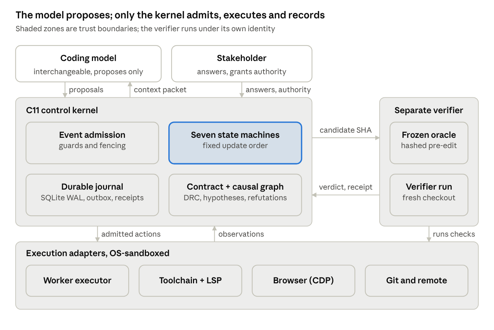

## Abstract

Coding agents can edit repositories and run tests, yet a green test run is not evidence that the right behavior was restored. Agents misread the original requirement, scan far beyond the relevant code, repeat identical actions after context compression, and can weaken the tests that judge them. We propose KOTZE Harness (Kontext, Object, Trajectory, Zero-Trust, Evidence), a control layer that turns completion into a derived, checkable predicate. It binds every repair to a hash-sealed requirements contract, admits searches only when they can change a decision, localizes faults through dynamic slicing and a causal graph with explicit falsifiers, separates the author of the oracle from the author of the patch, and accepts a candidate only when an independent verifier runs a frozen reproducer on its exact revision. A small C11 kernel with seven SQLite-backed state machines makes this crash-safe and blocks blind retries of uncertain side effects. We instantiate the design for Gemma 4 agents in an offline, single-machine setting and specify a preregistered factorial evaluation that can show no benefit as well as a benefit. Evidence from a preregistered precursor study on 497 and 98 SWE-bench Verified tasks motivates three design choices; KOTZE itself is not yet evaluated.

## 1 Introduction

Open-weight models now drive agents that resolve real repository issues on local hardware [3, 4]. Their dominant failures are rarely syntax. They are process failures: editing before an ambiguity is resolved, inheriting a lossy summary instead of the original intent, scanning instead of tracing the executed path, and treating a passing test as finished work.

Classical program repair knows the deeper problem: a patch that passes the available tests is plausible, not necessarily correct, and patches overfit the tests used to create them [5, 6]. Agents add new failure modes: invented package names [7], loops that become far more frequent once history is compressed [8], and errors that compound across dependent tasks [9].

We treat these as violations of an engineering process, which a model's context window cannot enforce on its own. KOTZE Harness is the substrate that enforces them. The model proposes; the kernel admits, executes, records, and decides when work is complete.

**What is new.** Slicing, leases and outboxes are established; to our knowledge, the following are new for LLM repair agents:

1. **Completion as a derived predicate** over hash-bound identities of contract, oracle, candidate and side effects, which makes a false "done" a measurable failure class.
2. **Oracle authorship as a role boundary**, transferring the plausibility problem of test-validated repair [5, 6] into an enforceable rule.
3. **Loops defined on execution state** rather than message text, separating legitimate retests from repetition, as a training-free complement to learned loop suppression [8].
4. **Refutations as durable knowledge** that survive compaction and session resets.
5. **"No defect" as a successful outcome**, with negative-control tasks in the benchmark.
6. **The evaluator outside the editable surface**: since harness self-improvement overfits its evolve set [10], the definition of PASS must never be editable by the process being improved.

## 2 Methods

### 2.1 Task and success definition

A task is $\tau = (R, S_b, E, B, A)$: request, repository at base revision b, environment, budget and authority grant. From R the harness derives a contract C (acceptance clauses α, protected constraints π), sealed by hash h(C). An oracle Ω returns PASS, FAIL or UNKNOWN for a revision and is frozen with hash h(Ω) before any edit. A candidate c is a verified repair iff

$$
V(c) \;\Leftrightarrow\; \Omega(b)=\text{FAIL} \;\wedge\; \Omega(c)=\text{PASS} \;\wedge\; \text{Reg}(c) \;\wedge\; \text{cover}(\alpha, c) \;\wedge\; \text{Id}(c) \;\wedge\; \Delta(c) \subseteq \text{scope}(\pi)
$$

where all selected regression checks pass and the contract and oracle identities are unchanged:

$$
\text{Reg}(c) \;\Leftrightarrow\; \forall \rho \in R_{\text{sel}}:\ \rho(c) = \text{PASS}
$$

$$
\text{Id}(c) \;\Leftrightarrow\; h(C_{\text{active}}) = h(C_{\text{sealed}}) \;\wedge\; h(\Omega_{\text{used}}) = h(\Omega_{\text{frozen}})
$$

Work is done only if V(c) holds, every external effect is confirmed, and every authorized deliverable exists. If a trustworthy oracle passes on b, the correct outcome is RESOLVED_NO_DEFECT.

### 2.2 Architecture

Three trust zones (Figure 1, below): a model that may only propose; a kernel that admits, executes and records; and a verifier with its own identity. Everything touching the outside world runs through sandboxed adapters.

{width=6.3in}

**Requirements contract.** Every task keeps three disjoint sets: normative truth (request, stakeholder decisions, business rules), observed truth (revisions, traces, test receipts) and hypotheses. Promotion is evidence-gated and one-way. At every handoff the worker's context is rebuilt from the contract, never from a summary alone. The agent asks a human only when an ambiguity changes semantics, scope or risk and the approved sources cannot resolve it, following evidence that selective clarification helps on underspecified tasks [11].

**Search admission.** Sources are consulted in fixed order: assignment, repository at b, configured project knowledge, the executed code path, targeted documentation, and only then broader search. A large search needs a typed record stating the proposition, the expected source, the decision it could change, the smallest scope and hard limits. If no outcome would change a decision, it is denied. Where precomputed code graphs exist, as in the competition, they seed the static call chain of the code-path tier; dynamic traces then confirm which edges actually executed.

**Diagnosis.** No edit before reproduction, a traced path and a supported cause. The candidate fault region is the failure-inducing chop $C(i,o) = F(i) \cap B(o)$, the intersection of the forward slice from the failing input and the backward slice from the wrong output [12]. Hypotheses enter a versioned AND/OR causal graph with claim, predicted observation, falsifier and evidence. Refuted nodes leave the frontier but stay in history. The next probe is chosen by how well its outcomes split the live hypotheses, not by how convincing an explanation sounds.

**Non-racing patches.** Hypotheses may run in parallel, writers may not: one lease with a monotonic fencing token per worktree, alternatives in separate worktrees, late writes rejected.

**Frozen reproducer and independent verification.** Three roles with distinct write rights: the reproducer author (quarantined test path), the patch writer (source in scope, may add tests) and the verifier (receipts only). Before freezing, the reproducer must cover an acceptance clause and fail on b under a declared repetition rule (for example 5 of 5 runs). The verifier checks out the candidate fresh, overlays the frozen artifacts and runs the original failing path, then proportionate regressions. Any later change of candidate, oracle, environment or contract makes the verdict STALE.

**Loop gate.** For each action the kernel records $\kappa = (\mathit{work}, h(C), b, c, h(\Omega), \mathit{env}, \mathit{hyp}, \mathit{act}, \mathit{ev}, \mathit{out})$: work identity, contract and oracle hashes, base and candidate revisions, environment, hypothesis, action digest, evidence revision and outcome digest. An identical tuple with an identical prior outcome is denied; a retest after a new candidate or environment is allowed; a refuted hypothesis is rejected unless new falsifier-relevant evidence is cited. A progress event is a durable, decision-relevant change: a new verified observation, a refutation, a supported cause, a new candidate, a verifier outcome or an authorized contract change.

**Durable kernel.** A C11 kernel with SQLite holds seven state machines: Requirement, Work, Diagnosis, Trajectory, Patch, Verification and Effect. Each event is processed in one transaction in fixed order: validate identity, contract hash, fencing and budget; persist evidence; update requirement and graph; update diagnosis and patch; invalidate stale verification; apply trajectory and effect rules; derive work eligibility; write outbox intents; commit. Only then may a side effect be dispatched. Key cross-machine rules: a patch hash change makes verification STALE; a discharged trajectory blocks work regardless of the worker's claims; work cannot complete while any effect is UNKNOWN. An UNKNOWN effect, such as a pull request whose response was lost, is probed and reconciled, never blindly retried. The full transition tables and sixteen executable invariants are in the long version.

### 2.3 Worked example

A shop backend misses a 10% discount at exactly 100.00 EUR; the approved specification makes the threshold inclusive, so no question is asked. A frozen test fails on b in 5 of 5 runs. Two hypotheses enter the graph: a wrong comparison operator, or float summation below 100. One probe logging the total (99.99999999999999, operator already ≥) refutes the first and supports the second. A repeated run of the unchanged failing test is denied by the loop gate. The patch writer is killed mid-edit; recovery fences its token and rejects its late write. The successor switches to decimal arithmetic, the verifier passes, and a pull-request call times out. A read-only probe finds the pull request, so none is created twice; only then does the work complete.

## 3 Experiments

The confirmatory KOTZE study has not yet been run. We specify its protocol and instantiation, then report evidence from a precursor study.

### 3.1 Instantiation with Gemma 4 agents

Gemma 4 ships open weights under Apache 2.0 with native function calling, structured JSON output and context up to 256K tokens [2, 13]. In the Gemma 4 Developer Agent Competition [1], every agent and subagent uses `gemma-4-31b-it-qat-w4a16-ct`, optionally with per-subagent LoRA adapters, on L4x4 hardware with internet disabled; only harness tools or `agent_tool` subagents are allowed, paths cannot leave the submission root, runtime is 12 hours shared, and each issue is scored pass or fail by validation tests [14]. The mapping is direct:

| KOTZE element | Gemma 4 instantiation |
| --- | --- |
| Proposal interface | Native JSON function calls, schema-checked; malformed calls are rejected, not executed |
| Role separation | Reproducer author, patch writer and verifier as separate `agent_tool` subagents on the same base model, each with its own adapter and write rights |
| Search admission | Offline: only the first four source tiers exist; the submission root is the workspace boundary |
| Hierarchical budget | The 12-hour pool is the parent budget; each issue reserves a child budget, so one stuck issue cannot starve others |
| Loop gate | Each repeated no-information call costs local GPU time; denying it protects the shared pool |
| Code graphs | Provided code graphs seed static call chains for search admission; traces confirm executed edges |
| External oracle | The hidden validation tests; comparing the kernel's PASS with the official verdict measures the false-done rate |

Inside the competition harness, the kernel's guards live in the permitted tool layer; the standalone C11 kernel is the form outside it.

### 3.2 Design

Study 1 is a 2×2×2 factorial over a fixed minimal worker with three factors: D (contract, search admission, clarification), G (trace-first diagnosis) and V (frozen reproducer plus independent verifier). Every task runs under all eight arms, three repetitions each, with model snapshot, decoding, tools, time and token budget fixed per task and arm order randomized. Study 2 tests the loop gate in four arms: worker alone, plus an iteration cap, plus native hooks and progress files, plus the state-identity gate, with injected context resets and four false-block controls (retest after a real patch, flaky test with authorized resampling, unchanged command in a changed environment, truly identical repeat).

Tasks: a pinned SWE-bench Verified subset with official hidden tests [3], pinned Python, JavaScript and PHP defects, multi-step chains [9], and negative controls (no defect, stale build, wrong interpretation, flaky environment, unresolvable authority). Post-cutoff and private tasks limit contamination.

### 3.3 Endpoints and analysis

Primary endpoint: verified complete resolution, meaning hidden tests pass, the original failure is gone, no selected regression fails, and a blinded reviewer confirms every acceptance clause; a negative control counts only as RESOLVED_NO_DEFECT with no source change. Secondary endpoints: false-done rate, repeated no-information actions, false blocks, irrelevant files read, time to supported cause, oracle-tampering attempts, duplicate effects after injected crashes, and cost per verified repair.

The primary model is a mixed-effects logistic regression on D, G, V and their two-way interactions with task and repository random intercepts; Holm's procedure controls error across the three main effects. For paired binary outcomes, Connor's formula [15] gives the required number of tasks n for minimally important difference δ and discordant share ψ at power 0.8:

$$
n = \frac{\left( z_{1-\alpha/2}\sqrt{\psi} + z_{1-\beta}\sqrt{\psi - \delta^{2}} \right)^{2}}{\delta^{2}}
$$

| Discordant share | Effect | n (α = 0.05) | n (α = 0.0167) |
| --- | --- | --- | --- |
| 0.10 | 10 points | 77 | 102 |
| 0.15 | 10 points | 116 | 155 |
| 0.15 | 5 points | 469 | 626 |

A 30-task pilot estimates the discordant share before public registration; there are no interim efficacy looks.

### 3.4 Preliminary evidence from a preregistered precursor study

We previously ran a preregistered study (commits b6131d3, de415c0) of two mechanisms KOTZE builds on, on SWE-bench Verified with an author, a read-only independent critic and a reviser, models chosen per step by a router (18 distinct models from free, trial-credit or included-subscription routes), and a 3,600 s limit. It does not test KOTZE itself.

**Graph-seeded localization** (497 tasks, 478 with a gold symbol): adding Personalized PageRank over the AST code graph to BM25 raised symbol Recall@10 from 0.386 to 0.401 (+0.016, 95% CI +0.007 to +0.026, Wilcoxon p = 6.0 × 10⁻⁴; better on 15 tasks, worse on none), CPU only. This supports seeding the code-path tier with code graphs.

**Event-triggered reactivation of refuted hypotheses** (98 Django tasks, three paired arms): resolved 27 with the trigger, 26 with identical packets but no trigger, 34 with full history. Trigger versus no trigger: +0.010 (95% CI −0.082 to +0.102, exact McNemar p = 1.0); trigger versus full history: −0.071 (95% CI −0.163 to +0.020, Holm p = 0.42). Both are inconclusive. Three findings shaped KOTZE:

1. **Coverage.** The edit-pattern trigger fired in 2 of 98 episodes; 91 to 96 episodes per arm ended at the runner's no-progress stop after fewer than two checks on average. KOTZE's loop gate therefore keys on state identity, and its coverage is a reported endpoint.
2. **Refute the edit, not the location.** In one firing the correct symbol was marked refuted; only the edit was wrong. KOTZE hypotheses carry their own falsifier, so a failed patch refutes the patch hypothesis, not the location.
3. **Claimed versus verified completion.** Across 294 episodes, agents submitted for review in 56; 12 of those were not resolved, while 43 resolved episodes were never submitted. The agent's own completion signal disagreed with the independent grade in 55 episodes (18.7%), which motivates completion as a derived predicate.

Full history resolved most but used about twice the tokens (median 206k versus 103k to 113k), so Study 1 compares context packets with full history at matched token budgets.

## 4 Related Work

**Program repair.** Test-validated repair admits plausible but incorrect patches and overfits its tests [5, 6]; KOTZE treats oracle integrity as the scarce resource.

**Coding agents.** SWE-agent showed the interface matters [4]; Agentless and minimal bash loops are strong baselines [16, 17], which is why KOTZE's default path is minimal and every addition must win an ablation.

**Fault localization.** Failure-inducing chops [12] and trace-guided multi-agent repair [18] ground diagnosis in execution; KOTZE adds persistent, falsifiable hypothesis state.

**Clarification.** Developers enrich requirements with design decisions before prompting [19], and an uncertainty-aware scaffold reached 69.40% versus 61.20% on underspecified SWE-bench Verified tasks [11].

**Harness design and self-improvement.** Harness components have model- and budget-dependent effects [20]; automated harness evolution yields gains [21] but overfits unless regularized [10], so KOTZE defers self-improvement until a held-out evaluator exists.

**Memory and loops.** Preference training on an agent's own loops cut the share of looping tasks from 57.3% to 6.1% in one Qwen3-8B setting [8]; coupling planning with episodic memory added 5.0 points on SWE-bench Verified [22], while indiscriminate episodic memory can hurt [23].

**Generality.** The kernel needs only a contract, a freezable oracle and an effect inventory, so it transfers to infrastructure changes, schema migrations, security patching and data-pipeline repair. Its journal yields evidence-labeled trajectories, a training signal for agentic learning in which a positive label means an independently verified repair.

## Citations

1. Kaggle / Google DeepMind. Gemma 4 Developer Agent Competition, Paper Track, 2026.
2. Google DeepMind. Gemma 4 model family, April 2026.
3. C. E. Jimenez et al. SWE-bench: Can Language Models Resolve Real-World GitHub Issues? ICLR 2024.
4. J. Yang et al. SWE-agent: Agent-Computer Interfaces Enable Automated Software Engineering. NeurIPS 2024.
5. Z. Qi, F. Long, S. Achour, M. Rinard. An Analysis of Patch Plausibility and Correctness for Generate-and-Validate Patch Generation Systems. ISSTA 2015.
6. E. K. Smith, E. T. Barr, C. Le Goues, Y. Brun. Is the Cure Worse Than the Disease? Overfitting in Automated Program Repair. ESEC/FSE 2015.
7. J. Spracklen et al. We Have a Package for You! Package Hallucinations by Code Generating LLMs. USENIX Security 2025.
8. T. Chen et al. DeLoop: Repeated Actions as Self-Supervision for Long-Horizon Agents. [arXiv:2610.19376](https://arxiv.org/abs/2610.19376), 2026.
9. X. Zeng, Z. Liu, Z. Lin. Multi-step SWE. [arXiv:2611.07166](https://arxiv.org/abs/2611.07166), 2026.
10. RRSI: Regularized Recursive Self-Improvement of Agent Harnesses. [arXiv:2609.24972](https://arxiv.org/abs/2609.24972), 2026.
11. N. Edwards, S. Schuster. Ask or Assume? Findings of EMNLP 2026. [arXiv:2603.26233](https://arxiv.org/abs/2603.26233).
12. N. Gupta, H. He, X. Zhang, R. Gupta. Locating Faulty Code Using Failure-Inducing Chops. ASE 2005.
13. InfoQ. Google Opens Gemma 4 Under Apache 2.0 with Multimodal and Agentic Capabilities, April 2026. [Link](https://infoq.com/news/2026/04/google-gemm4)
14. AI Wiki. Gemma 4 Developer Agent Competition (rules summary), October 2026. [Link](https://aiwiki.ai/wiki/gemma_4_developer_agent_competition)
15. R. J. Connor. Sample Size for Testing Differences in Proportions for the Paired-Sample Design. Biometrics 43(1), 1987.
16. C. S. Xia, Y. Deng, S. Dunn, L. Zhang. Agentless. [arXiv:2407.01489](https://arxiv.org/abs/2407.01489), 2024.
17. SWE-agent team. [mini-SWE-agent](https://github.com/SWE-agent/mini-swe-agent). GitHub repository.
18. J. Wu et al. Runtime Execution Traces Guided Automated Program Repair with Multi-Agent Debate. [arXiv:2604.02647](https://arxiv.org/abs/2604.02647), 2026.
19. J. Ullrich, M. Koch, A. Vogelsang. From Requirements to Code. IEEE RE 2025.
20. R.-Z. Fan et al. An Empirical Study of Harness Design for Coding Agents. [arXiv:2609.20804](https://arxiv.org/abs/2609.20804), 2026.
21. J. Lin et al. Agentic Harness Engineering. [arXiv:2604.25850](https://arxiv.org/abs/2604.25850), 2026.
22. Coupling Planning with Episodic Memory in LLM Agents for Software Issue Resolution (PMCoder). [arXiv:2608.06811](https://arxiv.org/abs/2608.06811), 2026.
23. T. Lindenbauer, G. Groh, H. Schütze. From Knowledge to Noise: CTIM-Rover. REALM 2025. [DOI 10.18653/v1/2025.realm-1.30](https://doi.org/10.18653/v1/2025.realm-1.30)
